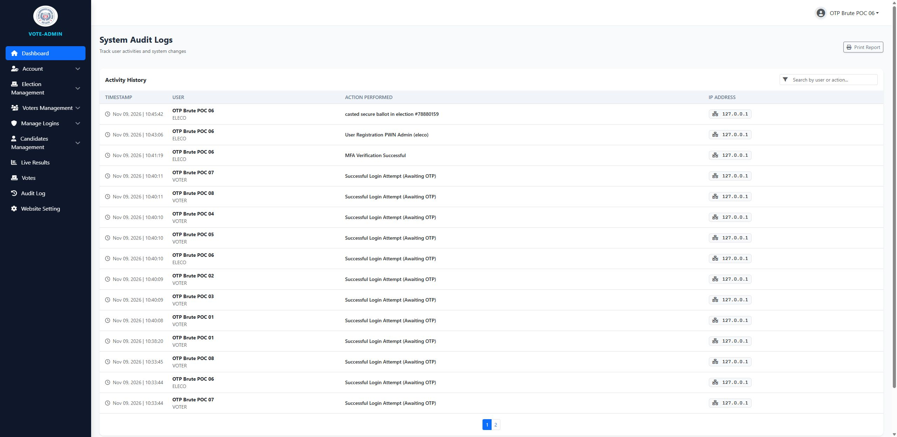

# SourceCodester Secured E-Voting System 1.0 /otp_verify.php code= Missing Rate Limiting allows OTP Brute Force and Account Takeover

## NAME OF AFFECTED PRODUCT(S)

- Secured E-Voting System (St Paul Academy Alumni 2001 set e-voting portal)

## Vendor Homepage

- https://www.sourcecodester.com/php/18790/secured-e-voting-system.html

## AFFECTED AND/OR FIXED VERSION(S)

### submitter

- (submitter name pending user confirmation — will be filled from vuldb.txt account at submission time)

## Vulnerable File

- /otp_verify.php

## VERSION(S)

- 1.0 (current public download, 2026-11)

## Software Link

- https://www.sourcecodester.com/download-code?nid=18790&title=Secured+E-Voting+System+using+PHP+and+MySQL+Source+Code

# PROBLEM TYPE

## Vulnerability Type

- Improper Restriction of Excessive Authentication Attempts / Missing Rate Limiting (CWE-307) → MFA Bypass / Account Takeover

## Root Cause

1. The one-time code is a 5-digit value from a 90,000-size space, generated with a non-cryptographic RNG:

```php
// login.php:73
$otp = rand(10000, 99999);   // 90,000 possibilities, not random_int()
```

2. It is stored **in plaintext** in the `voter_sessions` table (`code` column) with a 1440-minute (24 h) validity window — so even offline DB read yields working codes, and the online window is a full day.
3. `/otp_verify.php` performs **no attempt counter, no lockout, no delay, no CAPTCHA** — failed verifications just re-render the form. The `failed_login` tracking used elsewhere in the app only applies to password logins, not OTP checks:

```php
// otp_verify.php:28-77 — the whole verification block; no counter is incremented anywhere
if (isset($_POST['verify_btn'])) {
    ...
    if ($entered_code == $row['code'] && strtotime($row['expires_at']) > time()) {
        // success: mark verified, log in
    }
    // failure: fall through, page re-renders — unlimited retries
}
```

## Impact

- Complete MFA bypass / account takeover. The system's "security" hinges on this email OTP: an attacker who knows a victim's email + password (or registers/controls an account) can exhaustively guess the code before the legitimate user. At ~140 requests/second total (8 parallel PHP server instances × 8 sessions), the entire 90,000 code space is covered in **~67 seconds** — measured, not estimated. The OTP is the only second factor for voting accounts, so this defeats the product's core security claim ("Secured E-Voting").

# DESCRIPTION

- During the security review of "Secured E-Voting System", the OTP verification endpoint `/otp_verify.php` was found to impose no limit on verification attempts. Combined with a 5-digit numeric code (`rand(10000,99999)`), a 24-hour validity window and parallelizable requests, the full code space is brute-forceable in about one minute, after which the attacker holds a fully authenticated session of the target account.

# Login required? — Only the pre-OTP credentials (email + password) of the target account, which is the standard MFA scenario; no admin privilege required

# Vulnerability details and POC

## Vulnerability location:

- `code` parameter (POST), `/otp_verify.php`

## Setup (proof-of-concept on the local deployment at http://127.0.0.1:8138):

- Registered 8 test accounts `otpbrute01..08@local.test` and triggered 8 OTP emails (codes stored server-side, used **only** to verify the crack afterwards).
- Started 8 independent PHP built-in server instances (ports 8139-8146) because the built-in server handles one request at a time; drove 8 independent PHP sessions (session files lock per-session, so parallelism = sessions × instances).
- 8 Python threads each swept the range 10000-99999 posting `code=<n>&csrf_token=<token>&verify_btn=1`, checking for the `302` redirect that signals a verified session.

## Result:

```
cracked code: 12491  (account otpbrute06@local.test)
wall time:    67.3 s for the full 90,000-space sweep (~1,337 req/s aggregate)
verification: cracked value matches the true code stored in voter_sessions (12491)
audit trail:  audit_logs gained "MFA Verification Successful" for the account
```

The winning `PHPSESSID` then behaved as a fully logged-in user (voter dashboard reachable, voting permitted).

Full request/response log with timings: `poc/F04-otp-bruteforce.txt`

## Screenshot: audit log showing "MFA Verification Successful" recorded for the brute-forced account



# Suggested repair

1. **Attempt counter + lockout** per session/user: after 5 failures invalidate the OTP and force re-issue.
2. **Use `random_int()`** (cryptographically secure) and shorten the validity to ≤ 5 minutes.
3. **Expire the code on first failure threshold** and rate-limit `/otp_verify.php` per IP + per account (e.g. token bucket).
4. **Hash the stored code** instead of plaintext, so a DB leak does not yield valid OTPs.

# Dedup note

- NVD: 0 CVEs for this product (checked 2026-11-09). VulDB: no entries for this product or `otp_verify`.
