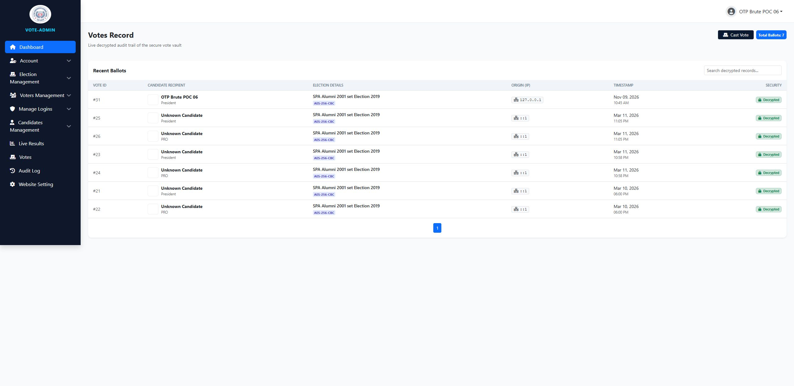

# SourceCodester Secured E-Voting System 1.0 /election/ballot.php votes[]= Hard-coded AES Key allows Offline Ballot Decryption and Vote Manipulation

## NAME OF AFFECTED PRODUCT(S)

- Secured E-Voting System (St Paul Academy Alumni 2001 set e-voting portal)

## Vendor Homepage

- https://www.sourcecodester.com/php/18790/secured-e-voting-system.html

## AFFECTED AND/OR FIXED VERSION(S)

### submitter

- (submitter name pending user confirmation — will be filled from vuldb.txt account at submission time)

## Vulnerable File

- /election/ballot.php (encryption), /inc/app_data.php (key definition)

## VERSION(S)

- 1.0 (current public download, 2026-11)

## Software Link

- https://www.sourcecodester.com/download-code?nid=18790&title=Secured+E-Voting+System+using+PHP+and+MySQL+Source+Code

# PROBLEM TYPE

## Vulnerability Type

- Use of Hard-coded Cryptographic Key (CWE-321) / Inadequate Encryption Strength (CWE-326) — ballot confidentiality is cosmetic

## Root Cause

- The application's ballot "encryption" uses a key and IV derived from **hard-coded 4-5 character string constants** shipped in the source:

```php
// inc/app_data.php:37-38
define('ENCRYPTION_KEY', 'ccc@@');    // ← the entire secret, 5 characters, in the public archive
define('ENCRYPTION_IV',  'ccc');
```

- Votes are stored AES-256-CBC encrypted, but the effective key material is fully attacker-derivable:

```php
// election/ballot.php:43-47 (how votes are written)
$encrypted = openssl_encrypt($candidate_id, 'AES-256-CBC',
    hash('sha256', ENCRYPTION_KEY), 0, substr(hash('sha256', ENCRYPTION_IV), 0, 16));
// effective key = sha256('ccc@@'), effective IV = first 16 bytes of sha256('ccc')
```

- The same constants are used for decryption in the admin views (`vote_record.php`, `live_results.php`) and in the public `election/fetch_live_data.php` — so every ciphertext in the `votes` table is decryptable by anyone holding the public source, on any machine, without touching the server.

## Impact

- **Ballot secrecy is entirely broken.** Any party (server operator, backup thief, SQL-injection attacker, or simply anyone who downloaded the product) can decrypt every stored vote and see exactly which candidate each voter chose — destroying ballot anonymity, the minimum guarantee of any voting system.
- The writable side is equally affected: an attacker with a session (see report 03) can **forge** validly encrypted vote values, e.g. substitute the candidate id of their choice, and the tally will accept it as a genuine ballot.

# DESCRIPTION

- During the security review of "Secured E-Voting System", the AES-256-CBC scheme protecting individual votes was found to use a key and IV derived from hard-coded constants (`ccc@@` / `ccc`) present in the public source archive. The effective 32-byte key is a plain SHA-256 of the constant, so all ballot ciphertexts in the database can be decrypted off-box. A stored vote was decrypted as a demonstration, recovering the plaintext candidate id.

# Login required? — No (for decryption; the ciphertext alone plus the public source suffices)

# Vulnerability details and POC

## Vulnerability location:

- `votes[<position_id>]` (POST) writes `openssl_encrypt(..., hash('sha256', ENCRYPTION_KEY), 0, substr(hash('sha256', ENCRYPTION_IV), 0, 16))` into the `votes` table.

## Steps (against the local deployment at http://127.0.0.1:8138):

1. Cast a real ballot through the UI as a voter (candidate id **21**, position id **5**) — see report 07/08 for the request.
2. Read the ciphertext from the `votes` table (any DB read path; here: local DB forensics).
3. Decrypt **off-box** with the constants from the public source — one line of PHP CLI:

```
$ php -r "echo openssl_decrypt('<ciphertext>','AES-256-CBC',hash('sha256','ccc@@'),0,substr(hash('sha256','ccc'),0,16));"

21
```

- Output `21` matches exactly the candidate chosen in step 1 — full ballot plaintext recovery from a public constant.

Full evidence log: `poc/F06-ballot-key-decrypt.txt`

## Screenshot: admin vote_record page rendering the decrypted ballot (candidate 21 shown as the stored choice)



# Suggested repair

1. **Per-installation secret**: generate a random 32-byte key at install time, store outside the web root (env var / secret file), never in source.
2. **Per-vote derivation**: derive subkeys from the installation secret + vote context (HKDF), so one leak does not expose history.
3. **Authenticated encryption**: use AES-GCM (or encrypt-then-MAC) so forged ciphertexts are rejected.
4. **Threat-model honesty**: client-side end-to-end verifiable schemes (e.g. Benaloh challenge style) if ballot privacy against the server operator is a requirement; server-side AES with a local key cannot provide that.

# Dedup note

- NVD: 0 CVEs for this product (checked 2026-11-09). VulDB: no entries for this product or these files.
