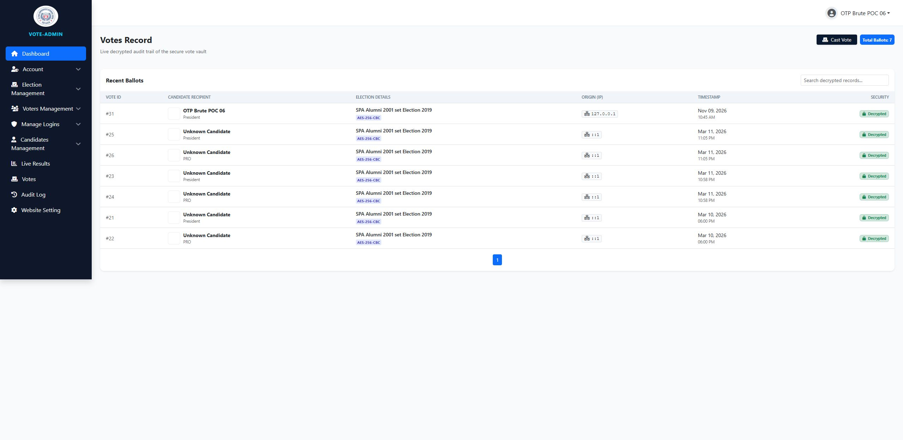

# SourceCodester Secured E-Voting System 1.0 /election/ballot.php votes[]= Missing Candidate Validation allows Voting for Unapproved/Pending Candidates

## NAME OF AFFECTED PRODUCT(S)

- Secured E-Voting System (St Paul Academy Alumni 2001 set e-voting portal)

## Vendor Homepage

- https://www.sourcecodester.com/php/18790/secured-e-voting-system.html

## AFFECTED AND/OR FIXED VERSION(S)

### submitter

- (submitter name pending user confirmation — will be filled from vuldb.txt account at submission time)

## Vulnerable File

- /election/ballot.php

## VERSION(S)

- 1.0 (current public download, 2026-11)

## Software Link

- https://www.sourcecodester.com/download-code?nid=18790&title=Secured+E-Voting+System+using+PHP+and+MySQL+Source+Code

# PROBLEM TYPE

## Vulnerability Type

- Improper Validation / Missing Server-Side Integrity Check on Vote Input (CWE-20 / CWE-807) — trusting a client-controlled candidate id

## Root Cause

- The vote handler encrypts and stores **whatever candidate id arrives in POST**, without checking that the candidate (a) belongs to the given position/election, (b) is `approved`/`active`, or (c) even exists in this election at all:

```php
// election/ballot.php:43-47
foreach ($_POST['votes'] as $position_id => $candidate_id) {
    // $candidate_id goes straight into the encrypted INSERT —
    // no SELECT ... FROM candidates WHERE id=$candidate_id
    //   AND status='approved' AND position_id=$position_id
    $encrypted = openssl_encrypt($candidate_id, ...);
    // INSERT into votes ...
}
```

- Candidate records are created with `status='pending'` at signup (`candidate_signup.php:59`) and only later approved by an admin — but the voting path never re-checks that status, so the "pending" gate on candidacy is purely cosmetic at the ballot box.

## Impact

- Votes can be cast for **candidates that were never approved** (pending/rejected), for candidates outside the voted position, or for arbitrary nonexistent ids — all stored as genuine encrypted ballots and **counted by the tally**, because the live-result counting path (`fetch_live_data.php` / `live_results.php`) aggregates by `candidate_id` without re-validating either. In an election system this is direct ballot integrity failure: an attacker with any voter session (or via the CSRF issue in report 07) can inflate a pending candidate's count before admins even approve them, or poison tallies with junk rows.

# DESCRIPTION

- During the security review of "Secured E-Voting System", `/election/ballot.php` was found to store votes for arbitrary client-supplied candidate ids with no validation against the candidates table. A vote was cast for a candidate whose status was still `pending` (not yet approved by any admin); the vote was accepted, stored, and displayed in the results/tally as a count for that pending candidate.

# Login required? — Yes, a voter session is required (obtainable without admin consent, see reports 03/04); no admin action is required

# Vulnerability details and POC

## Vulnerability location:

- `votes[<position_id>]` parameter (POST), `/election/ballot.php?id=<election_id>`

## Steps (verified locally at http://127.0.0.1:8138):

1. Candidate with `id=21` exists with `status='pending'` (registered via `/candidate_signup`, never approved — confirmed in DB).
2. Voter (fresh session, `has_voted=0`) submits:

```
POST /election/ballot?id=5 HTTP/1.1
Host: 127.0.0.1:8138
Cookie: PHPSESSID=<voter session>
Content-Type: application/x-www-form-urlencoded

votes[5]=21&cast_vote=1
```

3. Server responds:

```
HTTP/1.1 302 Found
Location: /election/vote_success
```

4. DB forensics: a `votes` row exists for candidate 21; decrypting it (see report 06) yields `21`; the live tally for position 5 **includes** that row — the pending candidate received and keeps the vote.

Full evidence log: `poc/F08-ballot-no-validation.txt`

## Screenshot: admin vote_record showing the vote for the pending candidate counted in results



# Suggested repair

1. **Server-side re-validation** before storing each vote: `SELECT id FROM candidates WHERE id=? AND position_id=? AND election_id=? AND status='approved'` — reject otherwise.
2. **Whitelist from the rendered ballot**: store the set of candidate ids the server actually rendered, and accept only ids from that set.
3. **Validate in the tally too**: counting queries must join `candidates` on `status='approved'` so legacy junk rows cannot surface.
4. **Referential integrity**: foreign key `votes.candidate_id → candidates.id` plus a check constraint on status at insert time.

# Dedup note

- NVD: 0 CVEs for this product (checked 2026-11-09). VulDB: no entries for this product or `/election/ballot`. (Same-author "Online Voting System 1.0" VDB entry for `/saveVote.php` is a different product.)
