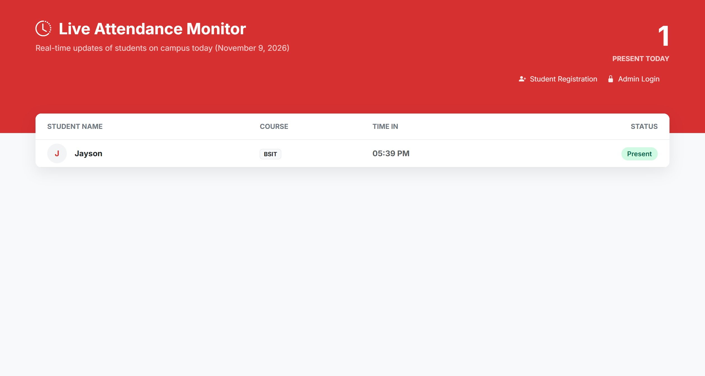

# SourceCodester Smart Attendance System with QR Code Scanner 1.0 /live_feed.php Information Disclosure

## Author

- (submitter name pending user confirmation — will be filled from vuldb.txt account at submission time)

## Vendor and Software Links

- https://www.sourcecodester.com/php/18702/smart-attendance-system-qr-code-scanner-phpmysql.html
- https://www.sourcecodester.com/download-code?nid=18702

## Overview

- Smart Attendance System with QR Code Scanner, version 1.0 (current public download, 2026-11), renders `/live_feed.php` — a public "real-time attendance" page — without any session requirement. The page queries the attendance logs joined with the students table and publishes, to any unauthenticated visitor, every student marked present today together with their full name, student code (in the page source), course, section, exact scan time, and IN/OUT status. Attendance data is personal data; this page turns the product into a public tracker of individuals' campus presence.

## Details

- Vulnerable file: `/live_feed.php`
- Affected version: 1.0 (current public download, 2026-11)
- The file includes only the database connection — no `includes/auth.php`, unlike the admin pages:

```php
// live_feed.php:3
require 'includes/db.php';
```

- It selects today's full attendance roster with student identity:

```php
// live_feed.php:10-13
$sql = "SELECT s.full_name, s.course, a.scan_time, a.status
        ...
        JOIN students s ON a.student_code = s.student_code
        WHERE DATE(a.scan_time) = :today
```

- The rendered row (page source) additionally exposes the raw `student_code`:

```html
<!-- live_feed.php row markup -->
<span class="fw-bold text-dark"><?= htmlspecialchars($log['full_name']) ?></span>
...
<td><span class="badge bg-light text-dark border"><?= htmlspecialchars($log['course']) ?></span></td>
```

## Description

- Anyone who can reach the server — no login, no token — sees in real time which named students are on campus, in which course/section, and exactly when they scanned in or out. The unauthenticated `student_code` values in the page source additionally feed the attendance-forgery API (`/api/attendance_handler.php student_code=` Missing Authorization, reported separately): a visitor harvests valid QR-code values from this page and replays them to forge attendance. Student presence data supports stalking and other real-world harms, and in deployments where attendance affects visas, scholarships, or discipline, the public exposure invites manipulation.

## PoC

- Request (no cookie of any kind):

```
GET /live_feed.php HTTP/1.1
Host: 127.0.0.1:8142
```

- Response — a complete roster row for a student recorded earlier the same day, retrievable with plain `curl`:

```
... >J Jayson< ... >BSIT< ... >05:39 PM< ... >Present< ...
```

- Browser check of the same unauthenticated page: the table body contains exactly `"J Jayson BSIT 05:39 PM Present"`.

## Payload

```
GET /live_feed.php
```

## Screenshot: unauthenticated visitor sees named students' attendance

The page below was opened in a browser with no session on the target origin; it renders the day's attendance roster with real names, course, scan time, and status.



Full evidence log: `poc/F03-livefeed-pii-disclosure.txt`.

## Suggested repair

1. Place `/live_feed.php` behind the same `includes/auth.php` gate as the admin pages, or restrict the kiosk display to first-name-plus-initial anonymization.
2. Strip `student_code` from any publicly rendered markup — it is the credential for the scan API.
3. Do not render precise scan times in public views; aggregate counts are sufficient for a lobby display.
4. Treat attendance logs as personal data: document retention limits and access logging for the feed endpoint.

## Dedup note

- NVD: the product's single CVE (CVE-2026-95957) is an XSS in `student_signup.php`; no entry mentions `live_feed.php` or information disclosure (checked 2026-11-09).
- VulDB: only VDB-408556 exists for this product; no `live_feed` entry. New entry.
